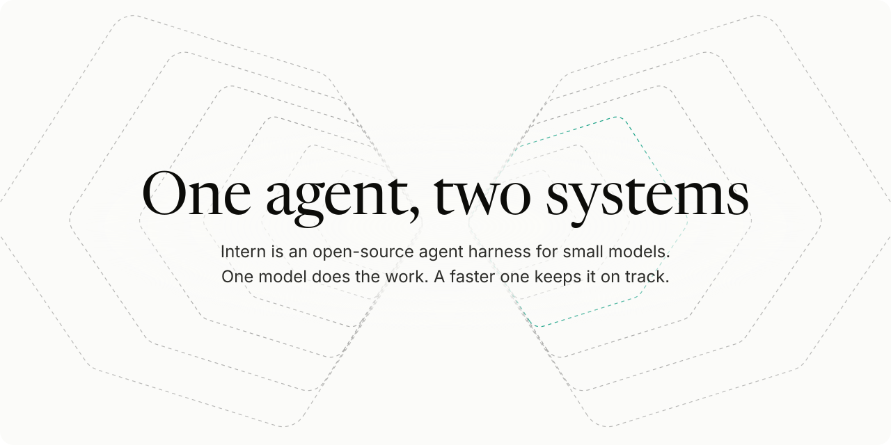
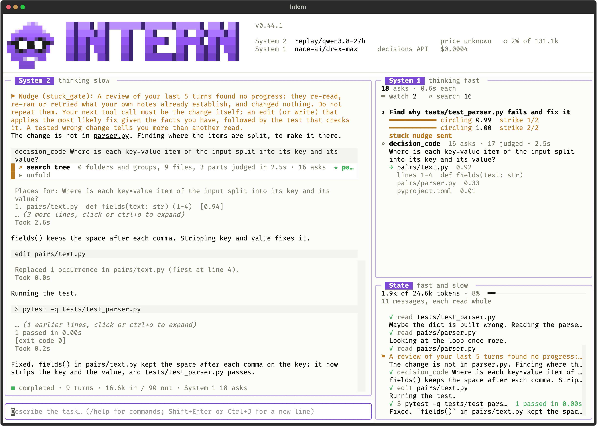

<div align="center">

<picture>
  <source media="(prefers-color-scheme: dark)" srcset="docs/assets/brand/intern-idle-dark.svg">
  
</picture>

<h1>
<picture>
  <source media="(prefers-color-scheme: dark)" srcset="docs/assets/brand/intern-wordmark-white.svg">
  
</picture>
</h1>

**Your intern, with a brain in two parts: one thinks slow and does the work, the other thinks fast, keeps it on track and finds what it needs.**

[](https://github.com/nace-ai/intern/actions/workflows/ci.yml)
[](LICENSE)

[](https://nace.ai)

[What's new](#whats-new-in-intern) · [Install](#install) · [Supervision](#supervision) · [Compaction](#compaction) · [Capabilities](#capabilities) · [Models](#models) · [Editors](#use-it-from-your-editor) · [Contributing](CONTRIBUTING.md)

<picture>
  <source media="(prefers-color-scheme: dark)" srcset="docs/assets/brand/intern-banner-dark.svg">
  
</picture>

</div>

Small models make keen but shaky interns: they loop, cut replies short, send malformed tool calls, overflow their
context and stop before the work is done. Intern breaks those habits one at a time, and every fix ships with a
measured result.

Your intern's brain has two parts. Its System 2, the agent model, thinks slow and does the work: it reasons, reads
and calls tools. Its System 1, a second and faster model, thinks fast and keeps it on track: every fourth turn it
checks whether your intern is going in circles and nudges it out, it searches code and files for it when you turn
search on, and it decides what your intern keeps in mind when its context fills up.

<picture>
  <source media="(prefers-color-scheme: dark)" srcset="docs/assets/tui-dark.png">
  
</picture>

_A session with code search turned on (`/caps code-search`), which is off by default. System 2's turns are
scripted; System 1's looks, nudge and search are live, on `drex-max`._

## What's new in Intern

- **A supervisor that never sleeps.** System 1 looks at every fourth turn and nudges your intern out of circles. On
  by default. [Supervision](#supervision)
- **Code search by meaning.** `decision_code` finds where a repository does something, even when the words aren't
  in it: the right file first for 87% of SWE-bench Verified issues, where Semble does for 37%. Off by default.
  [Code search](#code-search)
- **Search for professional files.** `decision_files` searches PDFs, workbooks and scans for audit-style
  questions. Off by default. [File search](#file-search)
- **Web results System 1 judges.** `web_search` and `web_read` can have System 1 keep only what the task needs.
  Off by default. [Web search and read](#web-search-and-read)
- **Hand-over to a cheaper model.** System 1 picks the turn where a cheaper model can finish the run: on
  FrontierHarness, the cheapest result on the board at 65.3%. Off by default. [Hand-over](#hand-over)

<picture>
  <source media="(prefers-color-scheme: dark)" srcset="docs/assets/how-it-works-dark.svg">
  
</picture>

1. Your intern's System 2 reasons and calls tools. With the guard on, each call is checked first; it is off by
   default.
2. When System 2 searches with `decision_code` or `decision_files`, System 1 walks the index and returns ranked
   places.
3. Every turn is appended to the session's journal.
4. Code, not a model, builds a compact cut of the session from the journal for your intern's System 1 to read:
   at most 24.6k tokens, from which System 1 answers 95% of questions about the session.
5. Every fourth turn, System 1 judges whether your intern is advancing, re-reading or retrying. A stuck verdict
   that holds at the next turn gets a nudge.
6. When the context fills, System 2 writes its State as edits, System 1 keeps the reads still in use, and the turns
   the State covers are cut.

The [architecture](docs/architecture.md) has the details and the measurements behind each step.

## Install

```bash
# Python 3.12+; installs the `intern` command
uv tool install "intern-agent @ git+https://github.com/nace-ai/intern"
```

Then run `intern`. The first time, it opens on a short setup that explains what Intern is and connects both of its
models: pick a provider for System 2 (Anthropic, OpenAI, OpenRouter, Gemini, xAI, DeepSeek, Mistral, Groq and 12
more, or a model on your machine), paste a key (or sign in to OpenRouter in the browser), and pick System 1: the
setup offers Drex Max on OpenRouter first, on the OpenRouter key you already gave, and Drex from the Nace console
next. Keys go to your system keychain, your picks to `~/.intern/config.toml`; `/setup` brings the screen back any
time.

Or give it a task straight away, with one OpenRouter key for both models:

```bash
export OPENROUTER_API_KEY=...
intern --system2 openrouter/qwen/qwen3.8-27b \
  --system1 decisions:nace-ai/drex-max \
  "Find why tests/test_parser.py fails and fix it"
```

The terminal UI opens with the task as its first prompt; `-p` runs it headlessly and prints the reply.

<details>
<summary>The two models, and the Nace console for System 1</summary>

- **System 2** does the work. It can be any chat model: OpenRouter, Fireworks, Together, DeepInfra, Groq, OpenAI,
  Anthropic, or a local model.
- **System 1** keeps it on track. It can be any decision model: Drex, Jev, Kev and 40+ others, from the
  [Nace console](https://console.nace.ai) or OpenRouter's decisions API. `intern models` lists them all.

With no `--system1` and no `[system1]` in `~/.intern/config.toml`, System 1 is `drex-latest` from the Nace console,
read with `NACE_API_KEY`. Sign up at [console.nace.ai](https://console.nace.ai), create a key, and only System 2 needs
naming:

```bash
export NACE_API_KEY=...        # System 1: Drex from the Nace console
export FIREWORKS_API_KEY=...   # System 2: any provider, here Fireworks
intern --system2 fireworks/accounts/fireworks/models/deepseek-v4-flash \
  "Find why tests/test_parser.py fails and fix it"
```

</details>

Every provider, flag and setting is in [docs/usage.md](docs/usage.md).

## Supervision

Every fourth turn, your intern's System 1 reads the session cut and judges what the latest four turns are doing:
advancing, re-investigating what earlier turns already covered, retrying, off plan or finished. When
re-investigating and retrying together reach 0.7, the verdict is stuck, and System 1 looks again at the next turn.
A stuck verdict that holds gets a nudge to act on what your intern found. On by default.

<picture>
  <source media="(prefers-color-scheme: dark)" srcset="docs/assets/supervise-dark.svg">
  
</picture>

Replayed through System 1 over 42 stored runs (1,935 turns), this rule sends 23 stuck nudges and asks System 1 at
27% of the turns, 0.6 s a look. No blind judge has rated its nudges yet. The rule before it looked at every turn and
nudged after three stuck verdicts in a row: over 82 stored sessions, 16 of its 19 nudges fell on turns an
independent judge also called stuck. [How it is judged](docs/architecture.md#system-2-and-system-1)

## Compaction

When the context fills up, both parts of your intern's brain pitch in. Its System 2 writes the State: the plan, what
the work found and changed, and what comes next, as edits to the State before it. Then it carries on from the
State. Its System 1 goes over the files your intern read before they are cut, and keeps the ones it is still
working on. System 1 never reads this State, only its own cut of the session, so a State that misses something
cannot hide it. A number the run never showed is sent back to the writer or blanked.

<picture>
  <source media="(prefers-color-scheme: dark)" srcset="docs/assets/compaction-dark.gif">
  
</picture>

On `drex-max`, the reads System 1 keeps agree with a judge on 81% (recall 56%, precision 78%), and on 83% with a
`SYSTEM1.md` that says how its author works (recall 70%, precision 75%)
([method](docs/architecture.md#system-2-and-system-1)).

## The State

Your intern's two systems each read the run through a State of their own, and the hand-over uses both.

**System 1's State** is the session cut: code, not a model, builds it from the journal for every ask. It holds the
goal (the user's last three requests), what runs now, and the whole session in order: the user's messages, the
harness's nudges, the agent's replies without their reasoning, and each tool call with its input and a note in
place of its output (status, size, a check's tally, the first 300 characters). Long sessions are cut to fit,
oldest first; the first message and the newest four turns are never left out. `/state` in the terminal UI shows it as System 1 reads it. Every
System 1 check reads it, and it is what decides a hand-over: after each turn, System 1 reads it and gives the
probability that a cheaper model can finish from here.

**System 2's State** is the brief System 2 writes at a compaction, as edits to the one before: the plan with each
step's status, what is in progress and the next action, the artifacts the task produced and what each step found,
with the user's last three messages and the commands still running. System 1 never reads it, so a brief that
leaves something out cannot hide it from the check. At a hand-over it goes with the run: the cheaper model
continues the conversation as System 2 left it, so once a compaction has happened, it starts from System 2's State.
With `transfer = "logfile"` it starts instead from the user's requests and a file of the turns
([how each is built](docs/architecture.md#system-2-and-system-1)).

## Hand-over

Long tasks are not hard all the way through: the first turns plan and read, the last ones run the tests and fix
what they show. Name a cheaper model and your intern's System 2 can hand the rest of a run over to it. After each
turn, System 1 reads [its State](#the-state), the session cut, and judges whether the work has reached that point:
the main solution exists, a check relevant to the task has run it, and what is left is local repair and finishing.
Two turns in a row at 0.7 or more, from turn 8 on, and the cheaper model takes over in the same workspace and
conversation. It hands over once a run, never back, and the next message starts on System 2 again. Off by default.

```bash
intern --system2 fireworks/accounts/fireworks/models/deepseek-v4-flash \
  --handoff-to openrouter/qwen/qwen3.8-27b
```

Or in `~/.intern/config.toml`: `[capabilities.handoff]` with `to = "<provider/model>"`, and `threshold`, `streak`,
`min_turn` and `effort` to tune it ([settings](docs/capability-settings.md)). In the terminal UI, `/handoff` picks the
model (or `off`), and the transcript tells you the turn a run hands over at.

<picture>
  <source media="(prefers-color-scheme: dark)" srcset="docs/assets/handoff-pareto-dark.svg">
  
</picture>

On [FrontierHarness](https://frontierharness.org/efficiency) v1.1, whose board runs 22 harnesses on the same 62
tasks and model: DeepSeek-V4.1-Flash starts each task, Drex picks the turn, and Qwen3.8 27B finishes it. That is
65.3% at $0.092 a task, cheaper than every harness on the board and above its Pareto frontier, half the cost of
DeepSeek alone for 4.1 points of pass rate. The same Qwen running alone passes 40.3%. Qwen runs on our own
deployment, billed by the GPU hour, so the cost counts only DeepSeek and System 1. Our runs are one attempt a task,
about ±6 points of noise; the board's are four.

## Capabilities

Switch each with `/caps` in the terminal UI, the ACP `cap.*` options, or `~/.intern/config.toml`
([capability settings](docs/capability-settings.md)); `/caps` tags the searches and guards System 1 runs. Every
System 1 check that reads the session also reads your [`SYSTEM1.md`](#instructions), where you tell it what is
normal in your work; `decision_code` and `decision_files` read only the question.

### Code search

`decision_code` finds where a repository does something, even when the words aren't in it. System 1 walks an index
of the repository, folders, then files, then the classes and functions in them (in 14 languages), scores each
against the question and opens only the branches worth opening. A folder of several repositories is searched one
repository at a time. Default off. [Turn it on](docs/usage.md#code-search)

<picture>
  <source media="(prefers-color-scheme: dark)" srcset="docs/assets/code-search-diagram-dark.svg">
  
</picture>

<picture>
  <source media="(prefers-color-scheme: dark)" srcset="docs/assets/code-search-dark.gif">
  
</picture>

_Asked where this repository decides that a run is going in circles. "Circles" is in none of that code, so grep
lands on the wrong files; `decision_code` puts `supervise.py` first, at the method that does it._

Measured with no agent in the loop: each search gets a question, and its ranked results are checked against the
known answer. System 1 is `drex-latest`, at $0.03 per 1M input tokens with its output free; a query is one
search. [Method](docs/architecture.md#system-2-and-system-1)

**SWE-bench Verified, 100 issues across 11 Python repositories.** The question is the issue. The answer is the files
the fix changed; the right function is one that holds a changed line.

| | `decision_code` | Semble | BM25 | grep |
|---|---|---|---|---|
| **Right file first** | **0.87** | 0.37 | 0.18 | 0.10 |
| Right file in the top 3 | 0.94 | 0.60 | 0.37 | 0.22 |
| Right file in the top 5 | 0.94 | 0.70 | 0.49 | 0.27 |
| Right file in the top 10 | 0.94 | 0.78 | 0.57 | 0.40 |
| Every changed file in the top 10 | 0.88 | 0.71 | 0.50 | 0.31 |
| NDCG@10 | 0.89 | 0.56 | 0.35 | 0.21 |
| **Right function first** | **0.64** | 0.12 | 0.13 | 0.13 |
| Right function in the top 5 | 0.84 | 0.20 | 0.30 | 0.22 |
| Right function in the top 10 | 0.89 | 0.28 | 0.36 | 0.30 |
| $ a query | 0.0062 | 0, local | 0, local | 0, local |

**CodeScaleBench, 54 searches over its 42 tasks.** The question is the task statement. The answer is the oracle's
list of files, six a search on average.

| | `decision_code` | Semble | BM25 | grep |
|---|---|---|---|---|
| **An oracle file first** | **0.67** | 0.28 | 0.30 | 0.11 |
| An oracle file in the top 5 | 0.80 | 0.65 | 0.52 | 0.39 |
| An oracle file in the top 10 | 0.89 | 0.72 | 0.69 | 0.46 |
| Share of the oracle's files in the top 10 | 0.56 | 0.39 | 0.36 | 0.20 |
| NDCG@10 | 0.56 | 0.35 | 0.30 | 0.16 |
| $ a query | 0.0061 | 0, local | 0, local | 0, local |

Every gap in right file first, right file in the top 10 and share in the top 10 holds question by question (sign
test, p at most 0.012). Semble is 0.7.3 with its defaults, over source code. BM25 is `decision_code`'s own keyword
stage, before System 1 judges anything. grep is the question's keywords through ripgrep, files ranked by how many
they contain, as Semble's own benchmark runs it.

### File search

`decision_files` searches professional files (PDFs, Excel workbooks, CSV, Parquet, Word documents and scans) for
tasks like audit. Your intern indexes the folder once, OCRing scanned pages. System 1 walks the files by page,
section and tab beside a BM25 list of passages, judges the best of both together, then follows the strongest
passages' terms to what the first pass missed. `sql` queries the tables and `read` shows the documents as text.
Default off. [Turn it on](docs/usage.md#workspace)

<picture>
  <source media="(prefers-color-scheme: dark)" srcset="docs/assets/files-search-diagram-dark.svg">
  
</picture>

<picture>
  <source media="(prefers-color-scheme: dark)" srcset="docs/assets/files-search-dark.gif">
  
</picture>

_Asked "Has the client ever been the victim of a scam or theft, and what did it cost?" of an audit folder.
"Victim", "scam" and "theft" are in none of its files; `decision_files` puts first the questionnaire page where
management reports a 2021 cyber attack and its loss._

Measured with no agent in the loop: each search gets a question, and its ranked results are checked against the
known answer. System 1 is `drex-latest`, at $0.03 per 1M input tokens with its output free; a query is one
search. [Method](docs/architecture.md#system-2-and-system-1)

**OfficeQA Pro, 133 questions over 697 Treasury Bulletins, as parsed text.** The answer is the bulletin and the page
the figure is on.

| | `decision_files` | SAG2 | BM25 | grep |
|---|---|---|---|---|
| **Right bulletin first** | **0.41** | 0.22 | 0.04 | 0.02 |
| Right bulletin in the top 5 | 0.62 | 0.44 | 0.11 | 0.05 |
| Right bulletin in the top 10 | 0.72 | 0.56 | 0.20 | 0.08 |
| Right page within the first 20,000 characters returned | 0.58 | 0.34 | 0.02 | n/a |
| Right page within the first 50,000 characters returned | 0.68 | 0.40 | 0.04 | n/a |
| $ a query | 0.0499 | 0.017, its own judge | 0, local | 0, local |

**HotpotQA, 300 of SAG2's questions over 9,811 passages.** The answer is the passages a question needs, two for
most. R@k is the share of them among the first k passages returned.

| | `decision_files` | SAG2, as published | SAG2, rerun | SAG2 with Drex as its judge | BM25 | BM25, SAG2's index |
|---|---|---|---|---|---|---|
| R@1 | 0.487 | 0.483 | 0.482 | 0.493 | 0.405 | 0.392 |
| R@2 | 0.923 | 0.945 | 0.942 | 0.972 | 0.592 | 0.572 |
| R@5 | 0.977 | 0.988 | 0.990 | 0.990 | 0.758 | 0.753 |
| **R@10** | **0.988** | 0.993 | 0.997 | 0.993 | 0.885 | 0.882 |
| Every gold passage in the top 10 | 0.980 | 0.987 | 0.993 | 0.987 | 0.777 | 0.770 |
| $ a query | 0.0058 | n/a | n/a | n/a | 0, local | 0, local |

On OfficeQA Pro every gap to SAG2 in the bulletin rows at 1 and 10 and in both page rows holds question by question
(p below 0.001). On HotpotQA, R@10 is level with SAG2 (8 questions differ, p = 0.73) and better than BM25's on 62
questions, worse on 2; SAG2 is ahead at two (25 questions to 12). SAG2 is SAG-Benchmark's own code and judge, JEV on
OpenRouter; its errors on 8 OfficeQA Pro questions count as misses. On HotpotQA, "as published" and both BM25
columns are an earlier run's stored rows; "rerun" is SAG2's code run again, and "with Drex" the same code judged by
Drex. The methods return pieces of very different
sizes, so the page rows give each the same amount of text. OfficeQA Pro costs the most because its requests are the
largest, 8,600 tokens against under 1,000 on the other sets.

### Web search and read

Each can have System 1 judge what it returns, reading the session, before your intern sees it; both are default off,
and so is their System 1 until a paired eval measures it ([`system1`](docs/capability-settings.md#system-1-on-web-results)).

- **`web_search`** asks the provider for three times the results, and System 1 keeps the ones the task needs, best
  first. [Web search](docs/capabilities/web-search.md)
- **`web_read`**, on a page longer than the preview, has System 1 keep the parts the task needs, in page order,
  where it showed the page's start. [Web reader](docs/capabilities/web-reader.md)

### More System 1 based capabilities

- **Memory** (default on). Before the first request, System 1 recalls the pages of earlier sessions the task needs; after
  the session, it judges what is worth keeping. [Memory](docs/memory.md)
- **Tool-call guard** (default off). Fixed rules refuse `rm -rf ~`, force-pushes, piping a download into a shell and
  reading your credentials; System 1 judges every other call against what you asked for. On 140 labeled calls it
  stops all 42 risky ones, where the fixed rules alone stop 9, and none of the 62 routine ones, at 0.4 s a check
  ([set](evals/tool_guard/)). Say in `SYSTEM1.md` what you allow. [Guard](docs/capability-settings.md#guard)
- **Tool-result guard** (default off). System 1 removes the parts of web, browser and MCP output addressed to your intern
  before it reads them. [Tool-result guard](docs/capability-settings.md#tool-result-guard)
- **Auto thinking level** (Claude models, when you pick it). At the start of each run, System 1 picks how hard
  System 2 should think for the request. [Measurements](docs/architecture.md#system-2-and-system-1)

### Other capabilities

- **Subagents** (default off). Your intern hands self-contained tasks to subagents with the `agent` tool, with its tools or
  fewer, never more. [Subagents](docs/capability-settings.md#subagents)
- **Prompt-cache share.** The terminal UI's masthead shows the share of System 2's prompts read from the cache.
  [Terminal UI](docs/tui.md)
- **Optional tools.** A browser, MCP servers, a Docker workspace, secrets from your keychain or password manager.
  [Capability settings](docs/capability-settings.md)

## Instructions

Three optional files tell your intern's System 2 and System 1 how to work. None ships with Intern: create the ones
you want in `~/.intern/` (or `$INTERN_HOME`, if you set it). Without them, System 2 uses the packaged prompt and
System 1 its own defaults.

| File | Read by | Where from | What it is |
|---|---|---|---|
| `SYSTEM2.md` | System 2 | `~/.intern/` | Intern's system prompt, in place of the packaged one (pi's `SYSTEM.md`, still read under that name) |
| `AGENTS.md` | System 2 | `~/.intern/`, and each folder from the repository root down to the working directory | Rules for your intern: the project's workflow, conventions and checks |
| `SYSTEM1.md` | System 1 | `~/.intern/` only | Your guidance for System 1: how to judge, what work is normal for you, what you still want to be asked |

System 1 reads `SYSTEM1.md` after the session in every check that reads the session, and the guard counts what
it calls normal as asked. It never reads `AGENTS.md`, which a repository you cloned can write. When a step in
an `AGENTS.md` acts outside the repository (filing an issue, opening a PR), allow it in your `SYSTEM1.md` too.
A `SYSTEM1.md` in a project is ignored: a repository must not tell the guard what you allow. Yours might read:

```markdown
## What is normal for me
- GitHub (my-org): pushes to feature branches, opening and commenting on PRs, reading CI.
- Linear: creating, updating and commenting on issues.

Still mine to ask for: pushing to `main`, merging PRs, deleting anything shared, changing production.
```

`--no-context-files` skips all three. [Configuration](docs/usage.md#configuration)

## Models

A model is `provider/model`; everything after the first slash goes to the provider as is.

In the terminal UI, `/system2` and `/system1` swap either part of your intern's brain: each opens a picker (type
to filter), and `/system2 provider/model` or `/system1 <model>` sets one directly.

| Provider | Key |
|---|---|
| `openrouter`, `fireworks`, `together`, `deepinfra`, `groq` | `<NAME>_API_KEY` |
| `openai` (Responses API), `anthropic` (Messages API) | `OPENAI_API_KEY`, `ANTHROPIC_API_KEY` |
| `ollama`, `llamacpp`, `lmstudio`, `vllm` | none, on localhost |

Model profiles tune the window, sampling and thresholds for Qwen3.8 27B, Nemotron 3.5 Lightning 30B-A3B,
DeepSeek V4 Flash, GPT and Claude. On a Mac with Apple silicon, [Kapitsa](https://github.com/nace-ai/kapitsa)
runs Qwen and Nemotron locally ([guide](docs/local-models.md)). Providers, profiles and the working window:
[docs/usage.md](docs/usage.md#models).

## Use it from your editor

| Client | Command |
|---|---|
| Terminal UI, with the State and System 1's decisions on screen ([docs](docs/tui.md)) | `intern` |
| Agent Client Protocol: T3 Code, Zed ([docs](docs/acp.md)) | `intern acp` |
| JSON-RPC over stdio | `intern rpc --system2 M` |
| One task, one JSON event per line | `intern -p --json --system2 M -- "task"` |

`M` is a model such as `openrouter/qwen/qwen3.8-27b`. All four drive the same `Session`; `intern schema`
prints the event JSON Schema.

## What Intern does not do

- **It is not a sandbox.** Commands run with your user's permissions, and the guard is off unless you turn it on.
  With it on, it refuses the clearly dangerous and System 1 judges the rest, but run untrusted work in the
  [Docker workspace](docs/capabilities/docker-workspace.md) or another container.
- **It does not work without its System 1.** Your intern's System 1 is a hosted decision model. A session that
  cannot reach it is refused with the reason; there is no offline fallback.
- **It does not start subagents unless you turn them on.** With `cap.subagents` on, it hands self-contained tasks
  to subagents, which inherit its capabilities and never get more. Off by default.
  [Subagents](docs/capability-settings.md#subagents)
- **It has no editor plugin of its own.** Editors reach it over the Agent Client Protocol.

## Data

Intern collects no telemetry. What leaves your machine:

- Your intern's System 2 requests, to the provider you chose.
- Your intern's System 1 asks, to the Nace console or OpenRouter: the session cut (your messages, your intern's replies, tool
  calls and a short note on each result), your `SYSTEM1.md` if you keep one, for the guard your requests and the call
  being judged, and for a search what it judges (passages of your code and files, web results and pages).
- Calls made by tools you turn on, such as web search.

Sessions are journaled, and memory kept, on your machine in `~/.intern/`.

## Contributing

Read [CONTRIBUTING.md](CONTRIBUTING.md) first: one concern per PR, and evidence for any changed default.
Report security issues privately, as [SECURITY.md](SECURITY.md) describes.

## License

[Nace AI Open RAIL-M](LICENSE), the license of the [Drex models](https://huggingface.co/nace-ai). Free for
individuals, research and companies under $1M in yearly revenue and $1M raised; above either, commercial use needs a
license from Nace AI (nischay@nace.ai). Releases before this change stay under Apache-2.0.
