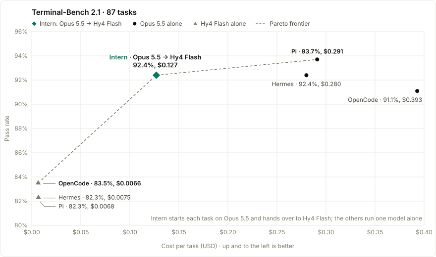
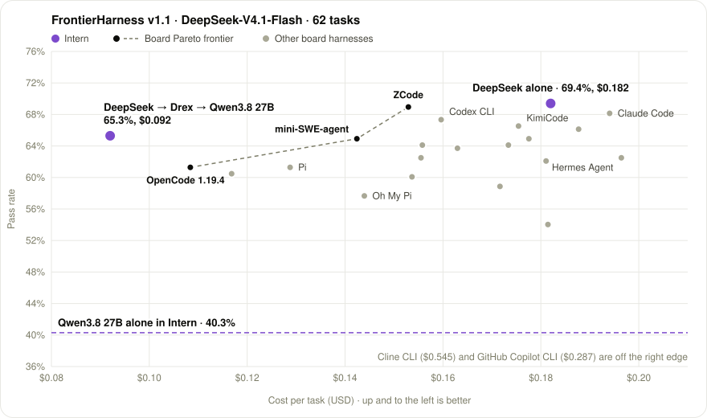
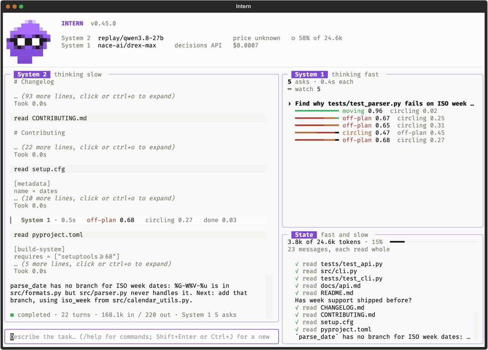
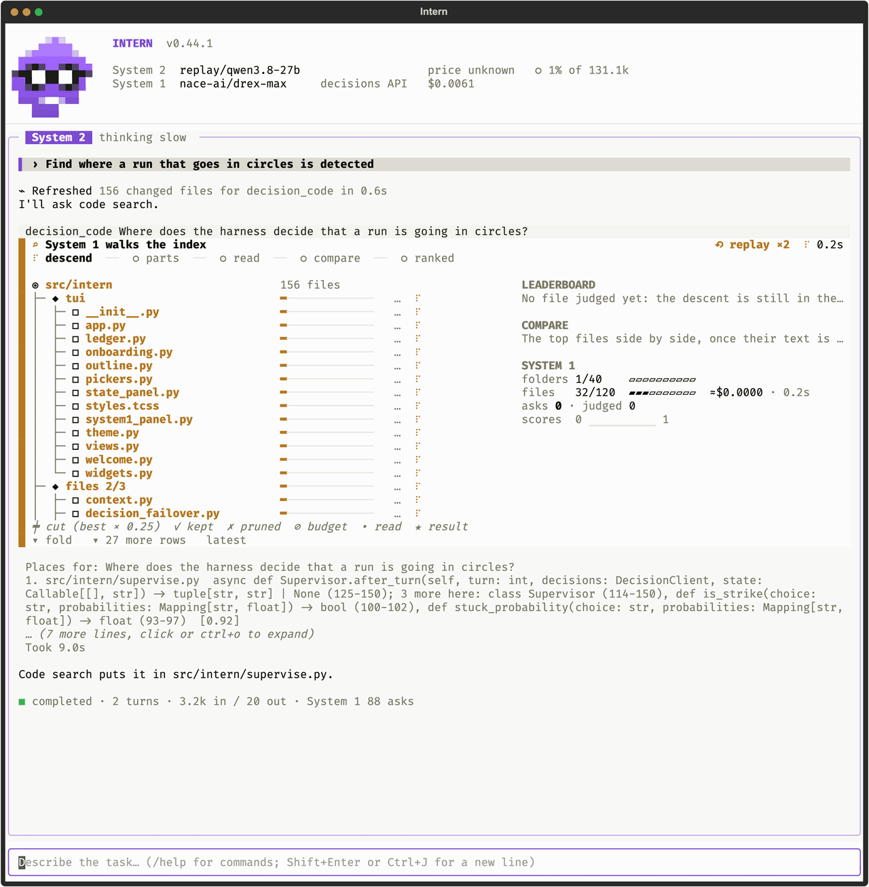
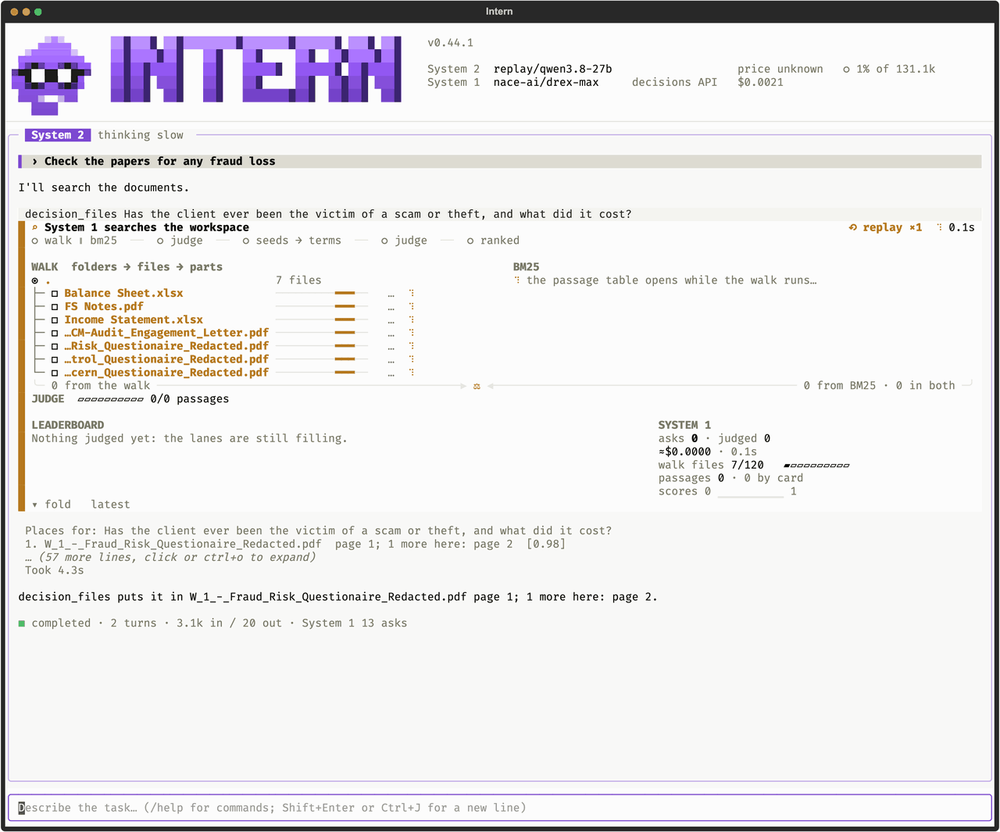

<div align="center">

<picture>
  <source media="(prefers-color-scheme: dark)" srcset="docs/assets/brand/intern-idle-dark.svg">
  
</picture>

<h1>
<picture>
  <source media="(prefers-color-scheme: dark)" srcset="docs/assets/brand/intern-wordmark-white.svg">
  
</picture>
</h1>

**Three models, each on the work it's good at. A frontier model cracks the hard part, an efficient model finishes the job, and a decision model picks the moment to hand over.**

[](https://github.com/nace-ai/intern/actions/workflows/ci.yml)
[](LICENSE)

[](https://nace.ai)

[How it works](#how-it-works) · [Results](#results) · [Install](#install) · [Decision model](#what-the-decision-model-does) · [Capabilities](#capabilities) · [Models](#models) · [Editors](#use-it-from-your-editor) · [Contributing](CONTRIBUTING.md)

<picture>
  <source media="(prefers-color-scheme: dark)" srcset="docs/assets/tb21-pareto-dark.svg">
  
</picture>

</div>

One model on its own is either too weak for hard tasks or too expensive for the easy parts. Intern is an
open-source coding harness that runs every task on three:

- **Frontier model.** The smart, pricey one: Claude Opus 5.5, Fable, Sol, Hy4. It reads the code, works out what
  has to be done and does the hard part.
- **Efficient model.** The fast, cheap one: Hy4 Flash, DeepSeek Flash, Sonnet, or a model on your own machine. It
  carries on with the rest of the job.
- **Decision model.** A small model between the turns: Drex Max, Jev. It picks the moment to hand over, searches and
  reranks code and files, decides what to keep when the context fills up, and nudges the work out of circles.

On Terminal-Bench 2.1 (87 tasks), Claude Opus 5.5 handing over to Hy4 Flash passes **92.4% at $0.127 a task**. Opus
5.5 on its own passes 91.1–93.7% at $0.280–0.393 in Pi, Hermes and OpenCode, and Hy4 Flash on its own 82.3–83.5%.
[Results](#results)

<picture>
  <source media="(prefers-color-scheme: dark)" srcset="docs/assets/tui-dark.png">
  
</picture>

## How it works

<picture>
  <source media="(prefers-color-scheme: dark)" srcset="docs/assets/how-it-works-dark.svg">
  
</picture>

1. **The frontier model starts every task.** It reads the code, runs what fails and lays down the main fix.
2. **The decision model watches each turn.** It reads a compact cut of the session, built by code rather than a
   model, and answers one question: is the main solution in place, has a check run it, and is what's left only
   local repair and finishing? Two turns in a row at 0.7 or more, from turn 8 on, and it hands over.
3. **The efficient model finishes.** It takes over in the same workspace and conversation, runs the tests, fixes
   what they show and wraps up. A run hands over once and never back; your next message starts on the frontier
   model again.
4. **The decision model keeps the work on track the whole way.** Every fourth turn it checks for circles and nudges.
   It searches when your models ask, and it picks which reads to keep when the context fills up.

The work splits unevenly by design. On the Terminal-Bench 2.1 run, Hy4 Flash made about two-thirds of the model
calls and half the output, for 1% of the cost:

| | Claude Opus 5.5, frontier | Hy4 Flash, efficient |
|---|---|---|
| Model calls | 35% | 65% |
| Output tokens, thinking included | 52% | 48% |
| Cost | 99% | 1% |

The [architecture](docs/architecture.md) has the details and the measurements behind each step.

## Results

**Terminal-Bench 2.1, 87 tasks: Claude Opus 5.5 → Hy4 Flash.** The chart at the top.

| Harness and models | Pass rate | $ a task |
|---|---|---|
| **Intern, Opus 5.5 → Hy4 Flash** | **92.4%** | **0.127** |
| Pi, Opus 5.5 | 93.7% | 0.291 |
| Hermes, Opus 5.5 | 92.4% | 0.280 |
| OpenCode, Opus 5.5 | 91.1% | 0.393 |
| OpenCode, Hy4 Flash | 83.5% | 0.0066 |
| Pi, Hy4 Flash | 82.3% | 0.0068 |
| Hermes, Hy4 Flash | 82.3% | 0.0075 |

Within 1.3 points of the best Opus 5.5 run, at 2.2–3.1 times less a task.

**Open weights: FrontierHarness v1.1, DeepSeek → Qwen.** [FrontierHarness](https://frontierharness.org/efficiency)
runs 22 harnesses on the same 62 tasks and model. DeepSeek-V4.1-Flash starts each task, Drex picks the turn, and
Qwen3.8 27B finishes it.

<picture>
  <source media="(prefers-color-scheme: dark)" srcset="docs/assets/handoff-pareto-dark.svg">
  
</picture>

- DeepSeek alone in Intern: 69.4% at $0.182, the highest pass rate on the board.
- DeepSeek → Qwen: 65.3% at $0.092. That's cheaper than every harness on the board and above its Pareto frontier,
  and half the cost of DeepSeek alone for 4.1 points of pass rate.
- The same Qwen running alone passes 40.3%.

Qwen runs on our own deployment, billed by the GPU hour, so the cost counts only DeepSeek and the decision model.
Our runs are one attempt a task, about ±6 points of noise; the board's are four.

**One vendor: GPT-6.1 Sol → GPT-6 Luna, 62 terminal tasks, one attempt each.**

| | Passed | $ a task |
|---|---|---|
| Codex CLI, GPT-6.1 Sol | 44/62 | 0.274 |
| Intern, GPT-6.1 Sol alone | 44/62 | 0.233 |
| **Intern, GPT-6.1 Sol → GPT-6 Luna** | **44/62** | **0.143** |

The same tasks pass at 39% less than Sol alone and 48% less than Codex CLI.

## Install

```bash
# Python 3.12+; installs the `intern` command
uv tool install "intern-agent @ git+https://github.com/nace-ai/intern"
intern
```

The first time, `intern` opens on a setup that takes about a minute:

1. **Connect a provider.** OpenRouter is the one we recommend: one key runs every model, and you can sign in with
   your browser instead of pasting a key. Anthropic, OpenAI, Gemini and 20 more work too, as does a model on your
   machine (Ollama, LM Studio, llama.cpp, vLLM, Kapitsa).
2. **Pick your models.** Each pick is a frontier model and an efficient model together. On OpenRouter: Claude Opus
   5.5 → Hy4 Flash (best results), Hy4 → Hy4 Flash (lowest cost), GPT-6.2 Astra → GPT-6 Luna, or your own pair.
3. **Pick the decision model.** Drex Max is first, and it runs on the OpenRouter key you already gave.

Keys go to your system keychain and your picks to `~/.intern/config.toml`. `/setup` brings the screen back any
time.

Or give it a task straight away, with one OpenRouter key for all three models:

```bash
export OPENROUTER_API_KEY=...
intern --system2 openrouter/anthropic/claude-opus-5.5 \
  --handoff-to openrouter/tencent/hy4-flash \
  --system1 decisions:nace-ai/drex-max \
  "Find why tests/test_parser.py fails and fix it"
```

`--system2` is the frontier model, `--handoff-to` the efficient model and `--system1` the decision model. The
terminal UI opens with the task as its first prompt; `-p` runs it headlessly and prints the reply.

<details>
<summary>Decision models, and the Nace console</summary>

The decision model can be Drex, Jev, Kev or any of 40+ others, from the [Nace console](https://console.nace.ai)
or OpenRouter's decisions API. `intern models` lists them all.

With no `--system1` and no `[system1]` in `~/.intern/config.toml`, the decision model is `drex-latest` from the
Nace console, read with `NACE_API_KEY`. Sign up at [console.nace.ai](https://console.nace.ai) and create a key.
Then only the frontier model needs naming:

```bash
export NACE_API_KEY=...        # the decision model: Drex from the Nace console
export FIREWORKS_API_KEY=...   # the frontier model: any provider, here Fireworks
intern --system2 fireworks/accounts/fireworks/models/deepseek-v4-flash \
  "Find why tests/test_parser.py fails and fix it"
```

</details>

Every provider, flag and setting is in [docs/usage.md](docs/usage.md).

## What the decision model does

### Hand-over

Long tasks are not hard all the way through. The first turns read, plan and build; the last ones run the tests and
fix what they show. After each turn, the decision model reads [the session cut](#what-the-decision-model-reads)
and judges whether the work has reached that point. The main solution has to exist, a check relevant to the task
has to have run it, and what's left must be local repair and finishing. Two turns in a row at 0.7 or more, from
turn 8 on, and the efficient model takes over in the same workspace and conversation. It hands over once a run,
never back. The next message starts on the frontier model again, which reads what the efficient model did as part
of the conversation.

The terminal UI opens in auto mode and hands over to the efficient model you picked in setup (Claude Haiku 5.5 if
you named none). `/efficient` picks another model or turns hand-over off, and `auto = false` in
`~/.intern/config.toml` starts with it off. Headless runs hand over only when you name the model:

```bash
intern --system2 fireworks/accounts/fireworks/models/deepseek-v4-flash \
  --handoff-to openrouter/qwen/qwen3.8-27b
```

Or in `~/.intern/config.toml`: `[capabilities.handoff]` with `to = "<provider/model>"`. `threshold`, `streak`,
`min_turn` and `effort` tune it ([settings](docs/capability-settings.md)). The transcript marks the turn a run
hands over at, and every turn says whether the frontier or the efficient model ran it.

### Supervision

Every fourth turn, the decision model reads the session cut and judges what the latest four turns are doing:
advancing, re-investigating what earlier turns already covered, retrying, off plan or finished. When
re-investigating and retrying together reach 0.7, the verdict is stuck, and it looks again at the next turn. A stuck
verdict that holds gets a nudge to act on what the work found. On by default.

<picture>
  <source media="(prefers-color-scheme: dark)" srcset="docs/assets/supervise-dark.svg">
  
</picture>

Replayed through the decision model over 42 stored runs (1,935 turns), this rule sends 23 stuck nudges and asks the
decision model at 27% of the turns, 0.6 s a look. No blind judge has rated its nudges yet. The rule before it looked
at every turn and nudged after three stuck verdicts in a row: over 82 stored sessions, 16 of its 19 nudges fell on
turns an independent judge also called stuck. [How it is judged](docs/architecture.md#system-2-and-system-1)

### Compaction

When the context fills up, two models share the work. The frontier model writes the State: the plan, what the work
found and changed, and what comes next, as edits to the State before it. Then it carries on from the State. The
decision model goes over the files read so far before they are cut, and keeps the ones still being worked on. It
never reads this State, only its own cut of the session, so a State that misses something cannot hide it. A number
the run never showed is sent back to the writer or blanked.

<picture>
  <source media="(prefers-color-scheme: dark)" srcset="docs/assets/compaction-dark.gif">
  
</picture>

On `drex-max`, the reads the decision model keeps agree with a judge on 81% (recall 56%, precision 78%), and on 83%
with a `SYSTEM1.md` that says how its author works (recall 70%, precision 75%)
([method](docs/architecture.md#system-2-and-system-1)).

### What the decision model reads

The decision model reads the session cut. Code, not a model, builds it from the journal for every ask. It holds:
- the goal (the user's last three requests);
- what runs now;
- the whole session in order: the user's messages, the harness's nudges, the models' replies without their
  reasoning, and each tool call with its input and a note in place of its output (status, size, a check's tally,
  the first 300 characters).

Long sessions are cut to fit, oldest first; the first message and the newest four turns are never left out. The cut
is at most 24.6k tokens, and the decision model answers 95% of questions about the session from it. `/state` in the
terminal UI shows it as the decision model reads it ([how it is built](docs/architecture.md#system-2-and-system-1)).

It judges from what the tool results show, such as a test run's tally and the start of each output, not from what
the agent says it did. For a hand-over it answers ready, not ready or unclear with a probability for each, and
P(ready) is the only signal the switch uses.

## Capabilities

Switch each with `/caps` in the terminal UI, the ACP `cap.*` options, or `~/.intern/config.toml`
([capability settings](docs/capability-settings.md)); `/caps` tags the searches and guards the decision model runs.
Every decision-model check that reads the session also reads your [`SYSTEM1.md`](#instructions), where you tell it
what is normal in your work; `decision_code` and `decision_files` read only the question.

### Code search

`decision_code` finds where a repository does something, even when the words aren't in it. The decision model walks
an index of the repository: folders, then files, then the classes and functions in them (in 14 languages). It scores
each against the question and opens only the branches worth opening. A folder of several repositories is searched
one repository at a time. Default off. [Turn it on](docs/usage.md#code-search)

<picture>
  <source media="(prefers-color-scheme: dark)" srcset="docs/assets/code-search-diagram-dark.svg">
  
</picture>

<picture>
  <source media="(prefers-color-scheme: dark)" srcset="docs/assets/code-search-dark.gif">
  
</picture>

_Asked where this repository decides that a run is going in circles. "Circles" is in none of that code, so grep
lands on the wrong files; `decision_code` puts `supervise.py` first, at the method that does it._

Measured with no agent in the loop: each search gets a question, and its ranked results are checked against the
known answer. The decision model is `drex-latest`, at $0.03 per 1M input tokens with its output free; a query is one
search. [Method](docs/architecture.md#system-2-and-system-1)

**SWE-bench Verified, 100 issues across 11 Python repositories.** The question is the issue. The answer is the files
the fix changed; the right function is one that holds a changed line.

| | `decision_code` | Semble | BM25 | grep |
|---|---|---|---|---|
| **Right file first** | **0.87** | 0.37 | 0.18 | 0.10 |
| Right file in the top 3 | 0.94 | 0.60 | 0.37 | 0.22 |
| Right file in the top 5 | 0.94 | 0.70 | 0.49 | 0.27 |
| Right file in the top 10 | 0.94 | 0.78 | 0.57 | 0.40 |
| Every changed file in the top 10 | 0.88 | 0.71 | 0.50 | 0.31 |
| NDCG@10 | 0.89 | 0.56 | 0.35 | 0.21 |
| **Right function first** | **0.64** | 0.12 | 0.13 | 0.13 |
| Right function in the top 5 | 0.84 | 0.20 | 0.30 | 0.22 |
| Right function in the top 10 | 0.89 | 0.28 | 0.36 | 0.30 |
| $ a query | 0.0062 | 0, local | 0, local | 0, local |

**CodeScaleBench, 54 searches over its 42 tasks.** The question is the task statement. The answer is the oracle's
list of files, six a search on average.

| | `decision_code` | Semble | BM25 | grep |
|---|---|---|---|---|
| **An oracle file first** | **0.67** | 0.28 | 0.30 | 0.11 |
| An oracle file in the top 5 | 0.80 | 0.65 | 0.52 | 0.39 |
| An oracle file in the top 10 | 0.89 | 0.72 | 0.69 | 0.46 |
| Share of the oracle's files in the top 10 | 0.56 | 0.39 | 0.36 | 0.20 |
| NDCG@10 | 0.56 | 0.35 | 0.30 | 0.16 |
| $ a query | 0.0061 | 0, local | 0, local | 0, local |

Every gap in right file first, right file in the top 10 and share in the top 10 holds question by question (sign
test, p at most 0.012). Semble is 0.7.3 with its defaults, over source code. BM25 is `decision_code`'s own keyword
stage, before the decision model judges anything. grep is the question's keywords through ripgrep, files ranked by
how many they contain, as Semble's own benchmark runs it.

### File search

`decision_files` searches professional files (PDFs, Excel workbooks, CSV, Parquet, Word documents and scans) for
tasks like audit. Your intern indexes the folder once, OCRing scanned pages. The decision model walks the files by
page, section and tab beside a BM25 list of passages, and judges the best of both together. Then it follows the
strongest passages' terms to what the first pass missed. `sql` queries the tables and `read` shows the documents
as text. Default off. [Turn it on](docs/usage.md#workspace)

<picture>
  <source media="(prefers-color-scheme: dark)" srcset="docs/assets/files-search-diagram-dark.svg">
  
</picture>

<picture>
  <source media="(prefers-color-scheme: dark)" srcset="docs/assets/files-search-dark.gif">
  
</picture>

_Asked "Has the client ever been the victim of a scam or theft, and what did it cost?" of an audit folder.
"Victim", "scam" and "theft" are in none of its files; `decision_files` puts first the questionnaire page where
management reports a 2021 cyber attack and its loss._

Measured with no agent in the loop: each search gets a question, and its ranked results are checked against the
known answer. The decision model is `drex-latest`, at $0.03 per 1M input tokens with its output free; a query is one
search. [Method](docs/architecture.md#system-2-and-system-1)

**OfficeQA Pro, 133 questions over 697 Treasury Bulletins, as parsed text.** The answer is the bulletin and the page
the figure is on.

| | `decision_files` | SAG2 | BM25 | grep |
|---|---|---|---|---|
| **Right bulletin first** | **0.41** | 0.22 | 0.04 | 0.02 |
| Right bulletin in the top 5 | 0.62 | 0.44 | 0.11 | 0.05 |
| Right bulletin in the top 10 | 0.72 | 0.56 | 0.20 | 0.08 |
| Right page within the first 20,000 characters returned | 0.58 | 0.34 | 0.02 | n/a |
| Right page within the first 50,000 characters returned | 0.68 | 0.40 | 0.04 | n/a |
| $ a query | 0.0499 | 0.017, its own judge | 0, local | 0, local |

**HotpotQA, 300 of SAG2's questions over 9,811 passages.** The answer is the passages a question needs, two for
most. R@k is the share of them among the first k passages returned.

| | `decision_files` | SAG2, as published | SAG2, rerun | SAG2 with Drex as its judge | BM25 | BM25, SAG2's index |
|---|---|---|---|---|---|---|
| R@1 | 0.487 | 0.483 | 0.482 | 0.493 | 0.405 | 0.392 |
| R@2 | 0.923 | 0.945 | 0.942 | 0.972 | 0.592 | 0.572 |
| R@5 | 0.977 | 0.988 | 0.990 | 0.990 | 0.758 | 0.753 |
| **R@10** | **0.988** | 0.993 | 0.997 | 0.993 | 0.885 | 0.882 |
| Every gold passage in the top 10 | 0.980 | 0.987 | 0.993 | 0.987 | 0.777 | 0.770 |
| $ a query | 0.0058 | n/a | n/a | n/a | 0, local | 0, local |

On OfficeQA Pro every gap to SAG2 in the bulletin rows at 1 and 10 and in both page rows holds question by question
(p below 0.001). On HotpotQA, R@10 is level with SAG2 (8 questions differ, p = 0.73) and better than BM25's on 62
questions, worse on 2; SAG2 is ahead at two (25 questions to 12). SAG2 is SAG-Benchmark's own code and judge, JEV on
OpenRouter; its errors on 8 OfficeQA Pro questions count as misses. On HotpotQA, "as published" and both BM25
columns are an earlier run's stored rows; "rerun" is SAG2's code run again, and "with Drex" the same code judged by
Drex. The methods return pieces of very different sizes, so the page rows give each the same amount of text.
OfficeQA Pro costs the most because its requests are the largest, 8,600 tokens against under 1,000 on the other
sets.

Measured end to end, the agent doing the whole task on the same model and the same questions:

**OfficeQA Pro, 132 questions over the 697 bulletins as scanned PDFs, Claude Sonnet 5.5.**

| | Intern | Intern + `decision_files` | pi |
|---|---|---|---|
| Answered correctly | 77 | 76 | 75 |
| Iterations (model turns) | 16.3 | **7.4** | 14.9 |
| $ a question, decision model included | 0.160 | **0.138** | 0.188 |

The score is level. A question costs 27% less than on pi, a gap outside noise, and 14% less than Intern without
`decision_files`, a gap within noise. A search costs about $0.02 of the decision model here, so the saving grows
with the price of the main model.

### Web search and read

Each can have the decision model judge what it returns, reading the session, before your models see it. Both are
default off, and so is their decision-model filter until a paired eval measures it
([`system1`](docs/capability-settings.md#system-1-on-web-results)).

- **`web_search`** asks the provider for three times the results, and the decision model keeps the ones the task
  needs, best first. [Web search](docs/capabilities/web-search.md)
- **`web_read`**, on a page longer than the preview, has the decision model keep the parts the task needs, in page
  order, where it showed the page's start. [Web reader](docs/capabilities/web-reader.md)

### More decision-model capabilities

- **Memory** (default on). Before the first request, the decision model recalls the pages of earlier sessions the
  task needs; after the session, it judges what is worth keeping. [Memory](docs/memory.md)
- **Tool-call guard** (default off). Fixed rules refuse `rm -rf ~`, force-pushes, piping a download into a shell and
  reading your credentials; the decision model judges every other call against what you asked for. On 140 labeled
  calls it stops all 42 risky ones and none of the 62 routine ones, at 0.4 s a check ([set](evals/tool_guard/)).
  Say in `SYSTEM1.md` what you allow. [Guard](docs/capability-settings.md#guard)
- **Tool-result guard** (default off). The decision model removes the parts of web, browser and MCP output addressed
  to your models before they read them. [Tool-result guard](docs/capability-settings.md#tool-result-guard)

### Other capabilities

- **Subagents** (default off). Your intern hands self-contained tasks to subagents with the `agent` tool, with its
  tools or fewer, never more. [Subagents](docs/capability-settings.md#subagents)
- **Prompt-cache share.** The terminal UI's masthead shows the share of the frontier model's prompts read from the
  cache. [Terminal UI](docs/tui.md)
- **Optional tools.** A browser, MCP servers, a Docker workspace, secrets from your keychain or password manager.
  [Capability settings](docs/capability-settings.md)
- **Schedules.** Run a task later or on a repeat: in the desktop app, with launchd or systemd running `intern -p`,
  or, in the terminal UI, with timers (default off) that last while the session is open.
  [Schedules](docs/capabilities/schedules.md)

## Instructions

Three optional files tell your models how to work. None ships with Intern: create the ones you want in `~/.intern/`
(or `$INTERN_HOME`, if you set it). Without them, the frontier and efficient models use the packaged prompt and the
decision model its own defaults. The file names are kept from before the renaming.

| File | Read by | Where from | What it is |
|---|---|---|---|
| `SYSTEM2.md` | Frontier and efficient models | `~/.intern/` | Intern's system prompt, in place of the packaged one (pi's `SYSTEM.md`, still read under that name) |
| `AGENTS.md` | Frontier and efficient models | `~/.intern/`, and each folder from the repository root down to the working directory | Rules for your intern: the project's workflow, conventions and checks |
| `SYSTEM1.md` | Decision model | `~/.intern/` only | Your guidance for the decision model: how to judge, what work is normal for you, what you still want to be asked |

The decision model reads `SYSTEM1.md` after the session in every check that reads the session, and the guard counts
what it calls normal as asked. It never reads `AGENTS.md`, which a repository you cloned can write. When a step in
an `AGENTS.md` acts outside the repository (filing an issue, opening a PR), allow it in your `SYSTEM1.md` too. A
`SYSTEM1.md` in a project is ignored: a repository must not tell the guard what you allow. Yours might read:

```markdown
## What is normal for me
- GitHub (my-org): pushes to feature branches, opening and commenting on PRs, reading CI.
- Linear: creating, updating and commenting on issues.

Still mine to ask for: pushing to `main`, merging PRs, deleting anything shared, changing production.
```

`--no-context-files` skips all three. [Configuration](docs/usage.md#configuration)

## Models

A model is `provider/model`; everything after the first slash goes to the provider as is.

In the terminal UI, `/frontier`, `/efficient` and `/decision` swap each model: each opens a picker (type to filter),
and `/frontier provider/model` or `/decision <model>` sets one directly. `/system2`, `/auto` and `/system1` still
work.

| Provider | Key |
|---|---|
| `openrouter`, `fireworks`, `together`, `deepinfra`, `groq` | `<NAME>_API_KEY` |
| `openai` (Responses API), `anthropic` (Messages API) | `OPENAI_API_KEY`, `ANTHROPIC_API_KEY` |
| `ollama`, `llamacpp`, `lmstudio`, `vllm` | none, on localhost |

Model profiles tune the window, sampling and thresholds for Qwen3.8 27B, Nemotron 3.5 Lightning 30B-A3B, DeepSeek
V4 Flash, GPT and Claude. On a Mac with Apple silicon, [Kapitsa](https://github.com/nace-ai/kapitsa) runs Qwen and
Nemotron locally, a good fit for the efficient model ([guide](docs/local-models.md)). Providers, profiles and the
working window: [docs/usage.md](docs/usage.md#models).

## Use it from your editor

| Client | Command |
|---|---|
| Terminal UI, with the State and the decision model's calls on screen ([docs](docs/tui.md)) | `intern` |
| Agent Client Protocol: T3 Code, Zed ([docs](docs/acp.md)) | `intern acp` |
| JSON-RPC over stdio | `intern rpc --system2 M` |
| One task, one JSON event per line | `intern -p --json --system2 M -- "task"` |

`M` is a model such as `openrouter/qwen/qwen3.8-27b`. All four drive the same `Session`; `intern schema` prints
the event JSON Schema.

## What Intern does not do

- **It is not a sandbox.** Commands run with your user's permissions, and the guard is off unless you turn it on.
  With it on, it refuses the clearly dangerous and the decision model judges the rest, but run untrusted work in the
  [Docker workspace](docs/capabilities/docker-workspace.md) or another container.
- **It does not work without its decision model.** The decision model is hosted. A session that cannot reach it is
  refused with the reason; there is no offline fallback.
- **It does not start subagents unless you turn them on.** With `cap.subagents` on, it hands self-contained tasks
  to subagents, which inherit its capabilities and never get more. Off by default.
  [Subagents](docs/capability-settings.md#subagents)
- **It has no editor plugin of its own.** Editors reach it over the Agent Client Protocol.
- **It keeps no schedules once it is closed.** For a task that runs while nothing is open, your OS scheduler runs
  `intern -p`. [Schedules](docs/capabilities/schedules.md)

## Data

Intern collects no telemetry. What leaves your machine:

- Requests from the frontier and efficient models, to the providers you chose.
- The decision model's asks, to the Nace console or OpenRouter. These carry the session cut (your messages, your
  models' replies, tool calls and a short note on each result) and your `SYSTEM1.md` if you keep one. For the guard
  they also carry your requests and the call being judged; for a search, what it judges (passages of your code and
  files, web results and pages).
- Calls made by tools you turn on, such as web search.

Sessions are journaled, and memory kept, on your machine in `~/.intern/`.

## Contributing

Read [CONTRIBUTING.md](CONTRIBUTING.md) first: one concern per PR, and evidence for any changed default.
Report security issues privately, as [SECURITY.md](SECURITY.md) describes.

## License

[Nace AI Open RAIL-M](LICENSE), the license of the [Drex models](https://huggingface.co/nace-ai). Free for
individuals, research and companies under $1M in yearly revenue and $1M raised; above either, commercial use needs a
license from Nace AI (nischay@nace.ai). Releases before this change stay under Apache-2.0.
