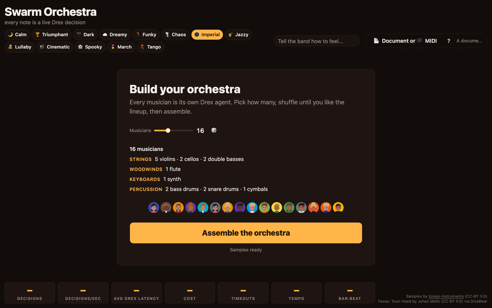
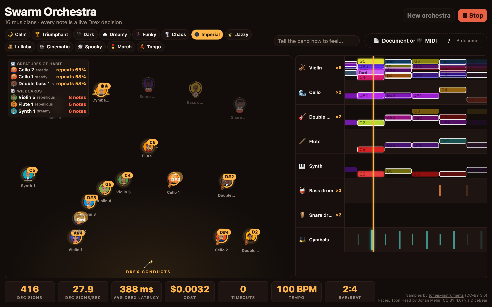
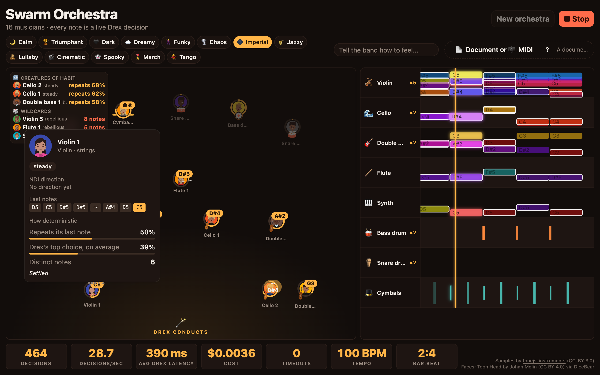
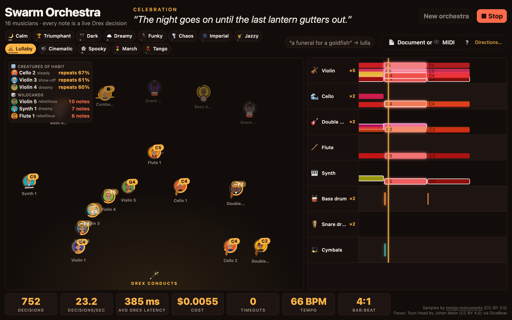
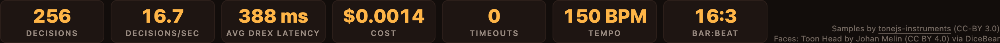

# Swarm Orchestra

An orchestra of AI musicians, as many as you like from 4 to 40, that improvise together live or perform a
score, where every note every musician plays is a Drex decision.

Built by Team Darth Vader for the Swarm Intelligence track at Nace AI's Drexathon. (It would also fit the
Wildcard track: an orchestra of musicians who are all the same decision model, plus a kazoo.)

## Screenshots

**Build your orchestra.** Pick 4 to 40 musicians; every one is its own Drex agent.

**The orchestra playing in the imperial mood.** Faces sit where their section sits on a real stage, each with the
note it just played; the board at the top left names the most repetitive musicians and the wildcards; the lanes
on the right show every decision arriving before it sounds.

**A musician's card.** Its trait, its NDI direction, its last 8 notes and how deterministic it is.

**After a document upload.** NDI split the document into sections; the banner shows the current section and its
quote. The mood box shows the mood Drex picked from "a funeral for a goldfish".

**The stats strip** during "La donna è mobile".

## How it works

Everything runs in the browser, in TypeScript (Vite + React + Tailwind + Tone.js).
There is no app server and no WebSocket. The page keeps the beat clock, builds Drex's
state and questions, calls Drex once per beat (or once per bar in score mode), and
plays the result with Tone.js. The only server is Vite's dev server, whose proxy
forwards `/nace/*` to `console.nace.ai` and adds the API key, so the key never
reaches the browser.

### The orchestra

Before playing, the setup card asks how many musicians you want (4 to 40, 16 by default). "Assemble the
orchestra" draws a roster weighted like a real orchestra: lots of violins, some cellos and double basses, a few
woodwinds, keyboards and percussion, and always at least one violin, one double bass, one flute and one drum.
Shuffle draws a different one.

There are 11 instruments, each with a personality:

| instrument | id | section | personality |
|---|---|---|---|
| Violin | `violin` | strings | romantic, long lines, holds notes |
| Cello | `pad_low` | strings | long held chord tones, changes with the chord |
| Double bass | `bass` | strings | anchors the root, moves stepwise, locks with the bass drum |
| Flute | `flute` | woodwinds | sparse, plays at least one phrase every bar, answers phrases others start |
| Kazoo | `kazoo` | woodwinds | the rebel, loves surprises and odd rhythms, but still listens |
| Harmonium | `pad_high` | keyboards | long held chord tones, avoids the cello's note |
| Synth | `synth` | keyboards | slow soft arpeggios when calm, fast busy runs when the energy is high |
| Bass drum | `kick` | percussion | steady heartbeat, lands on beats 1 and 3, rarely fancy |
| Snare drum | `snare` | percussion | answers the bass drum on beats 2 and 4, fills before a new phrase |
| Cymbals | `hats` | percussion | keep time in eighths, follow the mood's energy |
| Xylophone | `bells` | percussion | sparse sparkle on phrase starts |

Every member of the orchestra is its own Drex agent. Each one also gets a trait (steady, shy, bold, dreamy,
rebellious, show-off, lazy or precise), so two violins are two different musicians. Everyone sits where their
section sits on a real stage: strings on the front arcs (violins on the left, cellos on the right, double basses
at the back right), woodwinds in the middle, keyboards at the back left and percussion in the back row. Each
musician has a face (a DiceBear Toon Head).

The UI shows how deterministic each musician is. A ring around each face fills up the more often that musician
repeats its last note. Click a face for its card: name, instrument, trait, current NDI direction, its last 8
notes, and its stats (repeat rate, Drex's mean top-choice probability, distinct notes played).

### Every beat

Every beat is a quarter note. On each beat, every member gets one Drex question about what to play next; the
questions go out in chunks of 16, all chunks at once. Each question is built from a shared state: the current
mood, the position in the phrase, the current chord, and a compact table of what every musician played on the last
8 beats (4 beats when there are more than 16 musicians). That is how they listen to each other: what the
orchestra just played is in the state Drex reads before every decision. On top of that, each question carries
that member's name, trait, instrument personality and register, and its current NDI direction.

The options for a melodic musician are the notes of the current mood's scale in its instrument's register, plus
`rest` (silent) and `hold` (keep sounding the previous note). Because the options come from the mood's scale, the
orchestra stays in key. Percussion chooses 2-character patterns over the beat's two eighth notes (`x.`, `xx`,
`.x`, `..`, and `xX` with an accent for the cymbals).

Drex returns a probability for each option. The note actually played is sampled from those probabilities using
the mood's temperature (temperature 0 would take Drex's top choice; higher temperatures play the long tail). The
probabilities are kept and shown in the UI.

### Ways to play

- **Improv**: 13 moods, each with its own tempo, scale, sampling temperature and chord loop. The default is
  `imperial`, an original dark march. Or type any sentence into the box ("a funeral for a goldfish") and Drex
  picks the mood itself.
- **Score**: the orchestra performs a piece. The dropdown offers "Imperial March (original)", a march we composed
  for this project (generated by `web/scripts/compose-imperial.ts`), Verdi's "La donna è mobile", Beethoven's
  "Für Elise" and Mozart's "Eine kleine Nachtmusik". "La donna è mobile" comes from the music21 corpus;
  `scripts/export_score.py` exports it once to `web/public/scores/la_donna.json` (35 bars in 3/8, a written part
  in its register for every melodic instrument). In score mode Drex decides per musician, per bar, how to render
  the written part: as written, up or down an octave, ornamented, thinned to a single held note, the melody line,
  or rest, while the percussion chooses a rhythm pattern for the bar.
- **Your own MIDI**: drop any `.mid` file in the upload box, then ▶ Play it. `midiToScore`
  (`web/src/orchestra/midi.ts`) converts it in the browser: `@tonejs/midi` reads the file, bars come from its
  time signature and tempo, and `tonal` names each bar's chord. The highest line goes to the violins, flutes and
  kazoos, the first melody note of each bar to the xylophone, chord tones held to the cellos and harmonium and
  arpeggiated by the synth, and the lowest line to the double basses, each moved into its instrument's register.
  Drum tracks are ignored: the percussion improvises. The piece is split into sections of 8 bars.

### NDI: the document

Upload a document (PDF, Word, HTML, Markdown or text) and Nace's document intelligence (NDI) reads it. NDI returns
the document's sections in order, each with a summary, a mood and a quote, plus a one-sentence direction for every
instrument, which goes into each musician's question for that section. A short document takes about 17 seconds,
and the orchestra keeps playing while NDI reads. "La donna è mobile" ships with cached directions
(`web/public/scores/la_donna_directions.json`, made by NDI from the Wikipedia article), so the demo never waits on
NDI.

### The stage

The main stage is the seating view: every musician's face at its seat, its name below, the note it just played on
a badge, a pulse when it plays, dimmed while it rests, and its determinism ring.

Beside it, the lanes: one horizontal lane per instrument in the orchestra, Guitar Hero style. Time flows right to
left: a segment enters at the right edge the moment Drex decides it, scrolls left, and lights up as it crosses a
fixed playhead. A note sits at a height matching its pitch, colored by pitch class, brighter when Drex was more
confident, with a small hue shift per musician so two violins stay distinguishable; an outline marks the moments
a musician went against Drex's top pick. A stats strip tracks decisions, decisions per second, average Drex
latency, cost, timeouts, tempo and bar:beat.

## Why Drex

A live band has to keep tempo: each beat needs all 11 decisions before it sounds, and the band decides at most
2 beats ahead. One Drex round of 11 decisions took 267 ms at p50, under one beat at every tempo we run (a beat is
455 ms at 132 BPM). Not every round is that fast: the slowest of our 16 took 1.25 s, longer than the 2-beat window
at 132 BPM (909 ms), so in the chaos mood an occasional round arrives late; a round over 2 s times out and the band
falls back to holding. The same 11 questions to an open LLM (Qwen3.8-27B) took 1.9 s at p50, too slow for a live beat.

Measured numbers: 16 sequential beats of the real band's questions (8 calm + 8
chaos, one call per beat with all 11 questions), run from this laptop over the
internet on 2026-11-14 12:45 local. Latencies are rounded up to ms; for 16 samples
the max is the honest p95.

- Drex (drex-latest): one round of 11 decisions takes 267 ms at p50 and 1252 ms at
  p95 (max 1252 ms).
- Drex throughput: 41.3 decisions/second at p50 (11 decisions / 0.266 s).
- Drex cost, computed from the published price ($0.03 per 1M input tokens; output tokens are not billed; the API
  itself reports no cost): 2,740 input tokens per round on average (plus 3,536 unbilled output tokens), so
  $0.0000822 per round, about $0.0066 per minute of music at 80 BPM (calm) and $0.0109 at 132 BPM (chaos). That is
  about 7× less per round than the LLM baseline below ($0.0005947 per round, as reported by DeepInfra).
- LLM baseline (Qwen/Qwen3.8-27B on DeepInfra, temperature 0, json_object,
  thinking off, same state and same 11 questions): 1914 ms at p50 and 6320 ms at
  p95; 0 invalid JSON rounds and 0 invalid decisions out of 176; DeepInfra reported $0.0005947 per round (about
  $0.0476 per minute of music at 80 BPM); max tempo with 2-beat lookahead at p95 is 18 BPM, versus 95 BPM for Drex.

## How we built it

The code was written by Intern, Nace AI's agent harness, with Qwen3.8-27B on
DeepInfra as System 2 doing the work and Drex as System 1 supervising every turn,
directed by Claude Code sessions. So Drex both plays the music and supervised the
agents that wrote it.

## How to run

- Put a `NACE_API_KEY` in a `.env` file at the repo root (the proxy reads it; it
  never reaches the browser).
- `cd web`, then `pnpm install` and `pnpm dev`.
- Open http://localhost:5173, assemble the orchestra, pick what to play in the dropdown (Imperial by default) and
  click ▶ Play (that loads the samples and unlocks audio). The Space bar pauses and resumes; ■ Stop resets.

Hot reload works: the app runs through Vite with HMR, so edits under `web/src` show
up live in the page.

The git tag `classic-11` marks the last version with the fixed band of 11 musicians.

## Credits

- [Drex](https://console.nace.ai) and NDI by Nace AI
- [Tone.js](https://tonejs.github.io) (MIT)
- Instrument samples from [tonejs-instruments](https://github.com/nbrosowsky/tonejs-instruments)
  by Nicholaus Brosowsky, CC-BY 3.0
- Faces: Toon Head by Johan Melin (CC BY 4.0, https://www.johanmelin.com) via [DiceBear](https://www.dicebear.com)
- "Imperial March (original)" composed by Team Darth Vader (CC BY 4.0)
- "La donna è mobile" from the [music21](https://github.com/cuthbertLab/music21) corpus
- "Für Elise" and "Eine kleine Nachtmusik" MIDI from the [Mutopia Project](https://www.mutopiaproject.org)
  (Public Domain; see `demo/midi/README.md`)
- The cached directions for "La donna è mobile" were made by NDI from the Wikipedia article
  ["La donna è mobile"](https://en.wikipedia.org/wiki/La_donna_%C3%A8_mobile) (CC BY-SA 4.0)
- Team: Team Darth Vader
