# Using Intern

The README gets you to a first run. This page is the rest: every way to start a session, the flags, the
model providers and how a working window is chosen, System 1's settings, the tool-call guard's switches and
`config.toml`. [Architecture](architecture.md) explains how the loop works; [capability settings](capability-settings.md)
lists the optional tools and services.

## Starting a session

`intern` on a terminal opens the [terminal UI](tui.md): the transcript, the State System 2 writes
and System 1 judges against, and System 1's decisions turn by turn, with `/models` to pick each.
`-p` runs a task headlessly instead; so does a pipe. With nothing configured it starts on the first of
the harness's known models your keys reach and says so; `/frontier` changes it.

## Modes and flags

```bash
export FIREWORKS_API_KEY=... NACE_API_KEY=...
intern --system2 fireworks/accounts/fireworks/models/nemotron-lightning-3p5-30b-a3b \
  "Find why tests/test_parser.py fails and fix it"      # the terminal UI, with this as the first prompt
intern -p --system2 fireworks/accounts/fireworks/models/nemotron-lightning-3p5-30b-a3b \
  "Find why tests/test_parser.py fails and fix it"      # headless: the reply on stdout
```

| Mode | Command |
|---|---|
| Terminal UI, the default on a terminal: the State and System 1's decisions on screen, model pickers (see [tui.md](tui.md)) | `intern --system2 M ["task"]` |
| One task, readable output, headless | `intern -p --system2 M "task"` |
| One task, JSON events (one per line) | `intern -p --json --system2 M -- "task"` |
| JSON-RPC server over stdio | `intern rpc --system2 M` |
| Agent Client Protocol server (t3code, Zed; see [acp.md](acp.md)) | `intern acp` |
| Event JSON Schema | `intern schema` |
| Keep the command it runs in from `idle_stop_s` while `cmd` runs | `intern hold [--reason TEXT] -- cmd...` |

Useful flags: `--window N` caps the working window, `--max-turns N` sets the turn budget,
`--no-session` keeps the journal in memory, `--session FILE` resumes one, `--no-context-files`
ignores `AGENTS.md`, `SYSTEM2.md` and `SYSTEM1.md` (instruction files are followed literally, with whatever credentials the shell environment
holds: an `AGENTS.md` that says "file an issue" and a tracker key in `env` get a filed issue), `--extension NAME` loads an extension (`tool-summary`, or a
`module:Class`), and `--no-extensions` drops the profile's extensions (each `--extension` still loads;
capabilities such as code search and memory are switched in `[capabilities]`, not by these flags).

Tool calls of eval runs: `--extension tool-summary` ends every run with an `extension` event (`tool-summary`, kind
`summary`) that counts the run's tool calls by tool and by where they failed (`invalid_json`, `unknown_tool`,
`bad_arguments`, `refused`, `stopped`, `failed`, `crashed`, `interrupted`), and lists each call that did not succeed;
`-p --json` writes it with the other events. It is off by default and changes nothing the run does. The same
summaries come from journals, for any run: `uv run evals/tool_calls.py [journal or folder ...] --failures
failures.jsonl` (by default every journal in `~/.intern/sessions`; not for `--no-session` runs, whose journal is kept
in memory).

Stopping it: Ctrl-C (SIGINT) aborts the run in `-p`. SIGTERM or SIGHUP, in `-p` and `rpc` as in the terminal UI and
`acp`, ends the run as an abort does: the command it is running is stopped with everything it started, `run_end` says
`aborted`, and the process exits with 128 + the signal (143 for SIGTERM). Only SIGKILL leaves commands running.

An abort (Esc in the terminal UI, `session/cancel`, `abort`) does not wait for the tool that is running: a `find`, a
`grep`, a search or a query is dropped there and then, and its result says the run was aborted. One thing goes on,
an index being built for `decision_code` or `decision_files`: it finishes behind the prompt and is kept, and the next
search waits for it.

## Models

A model is `provider/model`. Everything after the first slash is sent to the provider as is.

| Provider | Base URL | Key |
|---|---|---|
| `openrouter` | openrouter.ai (Claude asks for prompt caching, which Anthropic does only when asked) | `OPENROUTER_API_KEY` |
| `fireworks` | api.fireworks.ai | `FIREWORKS_API_KEY` |
| `together`, `deepinfra`, `groq` | their public endpoints | `<NAME>_API_KEY` |
| `openai` | api.openai.com, native Responses API (encrypted reasoning replayed) | `OPENAI_API_KEY` |
| `anthropic` | api.anthropic.com, native Messages API (signed thinking replayed, prompt caching) | `ANTHROPIC_API_KEY` |
| `ollama`, `llamacpp`, `lmstudio`, `vllm` | localhost defaults | none |

Every base URL can be overridden with `<NAME>_BASE_URL`, and `config.toml` can add providers.

**Local models.** On a Mac with Apple silicon, run System 2 on [Kapitsa](https://github.com/nace-ai/kapitsa),
the recommended local engine: it decodes Qwen and Nemotron faster than Ollama, llama.cpp and MLX on most Macs.
[local-models.md](local-models.md) goes from install to a first task:

```bash
brew install nace-ai/tap/kapitsa
kapitsa serve --model 35b --private                 # in its own terminal; 9b on a 16-24 GB Mac
printf '[providers.kapitsa]\nbase_url = "http://127.0.0.1:8000/v1"\n' >> ~/.intern/config.toml
intern --system2 kapitsa/qwen3.6-35b-a3b
```

Keys are read from the environment, and from `~/.intern/.env` (`KEY=value` a line) for those the
shell does not export: one file, every project, every entry point; an exported key wins over the file.
To keep a key out of plain-text files, put it in the [secrets store](secrets.md) instead: the OS keychain
or your password manager, named in `[secrets]`, and redacted from what the agent's commands print.

**Profiles** (`src/intern/profiles/*.toml`) hold per-model data: window, output cap, sampling,
thresholds, provider quirks and enabled extensions. The most specific `match` wins over
`default.toml`; your own profiles go in `~/.intern/profiles/`.

**Working window.** Each model runs at the smallest of its advertised window (profile, then the
provider's `/models`, then llama.cpp's `/props`, then 32k; a lookup that times out, is rate-limited or fails on the
server is tried twice more first, and falling back to 32k is shown as a warning with the reason), its measured
effective window, and
`--window` (an ACP session can set its own cap with `context_window`). All thresholds are fractions of the working window, so the same profile holds at 32k and
at 256k; one tool result is also held to the profile's `max_tool_result_tokens` (20,000), so a 1M window does not let
one output fill a sixth of it. The working window bounds the prompt; the reply may use whatever the model's advertised
window leaves (`output_reserve` of it, at most the profile's `max_output_tokens`, and at most the output
cap the provider's listing reports for the model, as Anthropic's and OpenRouter's do), so a small
`--window` does not starve a thinking model's reply and a 1M-window model is never asked for more output
than it allows. Each reply cut off at that cap doubles it for the rest of the run, up to 8 times
`output_reserve`, within the same limits: a thinking model whose hard turns outgrow the reserve gets the room on
the next turn instead of reasoning to the limit again.

**System 2 and System 1.** System 2 (`--system2`) is the agent model that reasons and calls tools.
System 1 (`--system1`) answers the harness's small typed questions (choice, score, noul) fast, and is
required: by default it is a decision model from the console (`drex-latest`, key in `$NACE_API_KEY`). A
session that cannot set it up, or whose System 1 does not answer when it opens, is refused with the
reason; there is no heuristic stand-in. An ask System 1 fails mid-run is retried with backoff for up to
30 minutes, then the run stops with `system1_unavailable`. A model provider that keeps failing with
retryable errors (rate limits, an overloaded server) is waited out the same way before the run stops with
`provider_error`; [`model_retries = false`](capability-settings.md#model-retries) stops it at the first failure
instead, for a gateway that retries itself. `--system1 drex-max-v1.1` picks another console model;
`--system1 decisions:<model>[,<fallback>...]` a decision model on the decisions API (OpenRouter: `~typesafe/jev-latest`, `nace-ai/drex-max`, ...; key in `$OPENROUTER_API_KEY`).
`intern models` lists every choice the console and the decisions API serve. The old names
`--model`/`-m`, `--decider`, `model =` and `[decider]` still work.

**The tool-call guard.** It is a capability, off by default: no tool call is checked or refused, not even `sudo` or
a force push, and text the agent reads (a web page, a file) can talk it into sending your keys out. Turn it on for
a session with `/caps guard` (the ACP `cap.guard` option), or for every session with
[`[capabilities.guard] enabled = true`](capability-settings.md#guard); `system1 = false` there runs the fixed rules
without System 1's judgement. System 1 is required either way, for supervision and the other asks. With it on,
before a tool runs, fixed rules refuse
the clearly dangerous: deleting `/`, `~`,
a parent of the working directory or a `.git`, wiping a disk, piping a download into a shell, force-pushing,
discarding uncommitted work, reading or sending credentials and `.env` files, `sudo`, and writing into `.git/`,
credential or shell-startup files. These rules are code and need no model. System 1
then judges the other calls that can do harm against the session: what the user asked, what the agent did
and what came back. A blocked call
returns a refused result and the run continues. See [architecture](architecture.md#system-2-and-system-1).
On a disposable machine, such as a container the agent runs in as root, `[capabilities.guard] system_writes =
"allow"` lets writes under `/etc`, `/usr` and the other system directories through to System 1's judgement instead
of refusing them; deleting a system directory stays refused.

## Configuration

Everything user-level lives in `$INTERN_HOME` (default `~/.intern`). An empty folder
gives a fully isolated run. `SYSTEM2.md` there replaces
System 2's packaged prompt (`SYSTEM.md`, its old name, is still read). `SYSTEM1.md` there is your guidance for System 1: what work is normal for you and what
you still want to be asked. Every System 1 ask about the session reads it, and the guard counts what it calls
normal as asked when it is on. It is read from there only, never from a project.

```toml
# ~/.intern/config.toml
system2 = "openrouter/qwen/qwen3.8-27b"

[system1]
backend = "console"        # the default: a decision model from the console, key in $NACE_API_KEY
model = "drex-latest"
max_state_tokens = 32768   # the default; longer states keep their head and tail, with a marker
                           # no more than 3/4 of the model's window where the decisions API lists one
retry_window_s = 1800       # the default: a failing System 1 ask is retried for 30 minutes before the run stops
# A decision model on the decisions API instead (OpenRouter, key in $OPENROUTER_API_KEY):
# backend = "decisions-api"
# model = "~typesafe/jev-latest"

[providers.office]
base_url = "http://gpu-box:8000/v1"

[commands]
memory_share = 0.5         # the default: a shell command holding more than half the machine's memory is stopped

[capabilities.guard]
enabled = false            # the default: no call is checked; true (or /caps guard) turns the guard on
system1 = true             # the default: System 1 judges what the fixed rules let through; false: the rules only
system_writes = "refuse"   # the default; "allow" in a disposable container leaves /etc, /usr writes to System 1
```

Optional tools and services share the saved `[capabilities]` settings. See
[capability settings and session lifetime](capability-settings.md) for search,
URL reading, background processes, browser, MCP, Docker, secret references and
model fallback/budgets. Existing defaults stay unchanged. Python clients should
use `async with session` or call `await session.aclose()` when finished; the CLI
and RPC server handle this automatically.

## Code search

With code search, a repository becomes a tree System 1 can search: `decision_code` returns the
places where a question's subject is defined or would be changed. It is a capability, off by default
and turned on only by `[capabilities.code_search] enabled = true` in `~/.intern/config.toml`
([capability settings](capability-settings.md#code-search)). It asks System 1, which every session has.

<picture>
  <source media="(prefers-color-scheme: dark)" srcset="assets/code-search-diagram-dark.svg">
  
</picture>

```bash
uv tool install "intern-agent[code-search] @ git+https://github.com/nace-ai/intern"
printf '[capabilities.code_search]\nenabled = true\n' >> ~/.intern/config.toml
intern --system2 M "Where is the retry policy decided?"
intern index                                  # the same index ahead of time, with a progress bar (optional)
```

The index is `.intern/index.json` in the working directory, built before the first turn when it is missing (seconds;
a progress bar on a terminal) in a git repository, and elsewhere (a home folder, Downloads) only when the agent
first searches, refreshed after edits, and kept out of git by a line in `.intern/.gitignore`. In a git
repository it holds the files git sees: what `.gitignore` keeps out of git is not indexed or searched.
Symbolic links are not followed, and files named like credentials (`prod.env`, `credentials.json`, `id_rsa`,
`*.pem`, anything under `.aws/` or `.ssh/`) are left out; the index file is readable by you alone.
A folder that is not a repository but holds some (several checkouts side by side) is not indexed whole:
`decision_code` searches one repository at a time, given as `scope`, each from its own index.

A place it returns is a class or a function, with its lines, in Python, JavaScript, TypeScript, Go, Rust, Java, C,
C++, C#, Ruby, PHP, Swift, shell and SQL (a table, a view, a function); a section in Markdown; a top-level key in a
config file. Code in another language, and a file that defines nothing, is found by windows of 120 lines.

## Workspace

With the workspace, a folder of office files becomes a tree System 1 can search: the agent indexes the
folder (`index_files`; PDFs, Word documents, workbooks and tables, with a progress bar on a terminal), then
`decision_files` returns the places a question needs, `sql` queries the tables and `read` shows documents as text
(`[ocr]` adds OCR of scanned pages). `grep` finds a line inside a PDF or a Word document too, in that text, and names
its page (`report.pdf:page 4:Total due 1,250 EUR.`). A capability like code search, off by default and turned on only by
`[capabilities.workspace] enabled = true` ([capability settings](capability-settings.md#workspace)).
It loads beside code search: in a repository with a folder of documents, the code index is `.intern/index.json`
at the root and the documents' index `.decision_workspace/` in their folder.

<picture>
  <source media="(prefers-color-scheme: dark)" srcset="assets/files-search-diagram-dark.svg">
  
</picture>

```bash
uv tool install "intern-agent[workspace,ocr] @ git+https://github.com/nace-ai/intern"
printf '[capabilities.workspace]\nenabled = true\n' >> ~/.intern/config.toml
intern --system2 M --system1 decisions:nace-ai/drex-max "Which quarter had the highest revenue?"
intern index --documents [folder]             # the same index ahead of time (OCR can take minutes)
```

## From a clone

```bash
git clone https://github.com/nace-ai/intern && cd intern
uv sync --all-extras
uv run intern --help
```

The checks to run before a push are in [CONTRIBUTING](../CONTRIBUTING.md).
