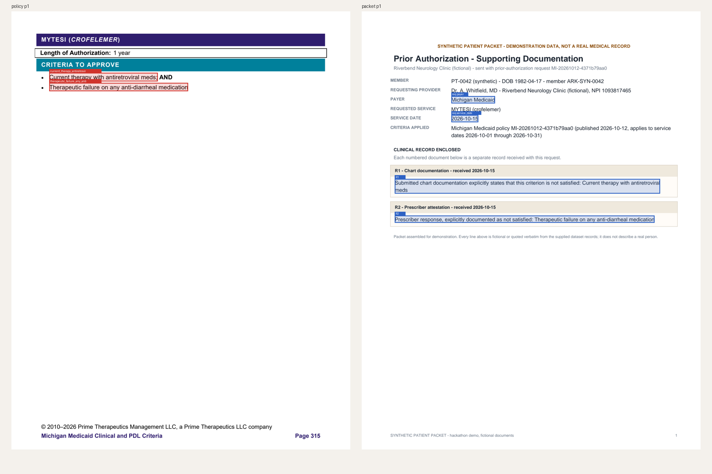

# BillProof — Drexathon 2026, Track 1, Apex Predator: Drex vs. the Giants

The yes/no judgment in a bill audit, a prior-authorization checklist, or an appeal is usually given to a frontier model. Here those questions go to Drex, dollars and published rules stay in code, and the result is measured against Qwen3.8-Max on DeepInfra. Track 1 asks whether Drex can take those frontier-model decisions and be faster, cheaper, or more accurate. The lines below are that comparison against Qwen3.8-Max on DeepInfra.

- Prior authorization: 100.0% vs Qwen3.8-Max 95.7%, 60× cheaper per 1,000 cases, 17× faster at the median.
- Appeals: a tie on accuracy, 72.3% vs Qwen3.8-Max 70.8%, 105× cheaper, 12× faster.
- Hard bills, synthetic, the BillProof system: 96.3% vs Qwen3.8-Max 88.9%, 113× cheaper, 137× faster.
  Qwen did not get the code-computed fee, patient-responsibility, and balance facts. Drex alone is 86.2% (2,673/3,101).

Against GPT-6.1 Sol, accuracy is a tie or a loss; on prior authorization both are 100%, and the gain there is cost ($0.0557 vs $6.26 per 1,000). See "Where this does not win".

Demo from a checkout: run the Quickstart commands, then open http://127.0.0.1:8000. No keys; the page starts in Demo.

## What it does

- Reads a prior-authorization packet or a bill packet (bill, explanation of benefits, denial, plan).
- Cites the page region behind each extracted field.
- Asks Drex a fixed list of typed questions, with a probability on every answer.
- Applies published AND/OR criteria, CMS unit limits, bundling edits, and the fee schedule in code. Models do not set a dollar amount.
- Drafts a dispute or appeal from reviewed clauses. Quotes in the letter are document text.

| Set | n | Drex / BillProof system | Qwen3.8-Max (DeepInfra) | Cost per 1,000 cases (× cheaper) | Median latency (× faster) |
|---|---|---|---|---|---|
| Prior authorization, whole case | 370 | Drex 100.0% (370/370), CI 98.97–100.00% | 95.7% (354/370), CI 93.09–97.32% | 60× ($0.0557 vs $3.32) | 17× (400 ms vs 6.70 s) |
| Appeals, overturn yes/no | 400 | Drex 72.3% (289/400), CI 67.67–76.41% | 70.8% (283/400), CI 66.11–74.99% | 105× ($0.00815 vs $0.856) | 12× (377 ms vs 4.52 s) |
| Hard bills, line verdict | 100 bills, 3,101 lines | BillProof system 96.3% (2,985/3,101), CI 95.53–96.87% | 88.9% (2,756/3,101), CI 87.72–89.93% | 113× ($0.584 vs $65.84) | 137× (895 ms vs 123.0 s) |

Copied from the headline table in [docs/RESULTS.md](docs/RESULTS.md).

## Glossary

- **EOB.** Explanation of benefits.
- **MUE.** CMS (Centers for Medicare & Medicaid Services) Medically Unlikely Edits are the unit limits.
- **NCCI.** Medicaid NCCI procedure-to-procedure edits are code pairs that should not be billed together.
- **Whole case.** The decision and every criterion fact match gold.
- **Appeal accuracy.** The yes/no overturn choice matches the recorded decision; an invalid answer counts wrong.
- **Line verdict.** A line is disputed when any of duplicate, units over the MUE, NCCI, fee, or EOB is yes, or patient responsibility is no.
- **Wilson interval.** A 95% interval on the counted units.
- **Lane.** One model or system answering the same questions.

## How to read this table

Prior authorization and appeals are Drex alone. The hard-bill row is the BillProof system and received the code-computed fee, patient-responsibility, and balance facts the recorded Qwen lane did not.

Appeals differ by 6 of 400. The intervals overlap, and that comparison is a tie; on prior authorization the intervals do not overlap. No paired p-value for Drex against Qwen is stored.

Wilson intervals on the hard-bill row are on lines, and lines in one bill are not independent.

Drex prior-auth and appeal costs are recorded.

The hard-bill system cost is the mean recorded list cost, or the recorded cost when that field is absent.

Qwen costs are DeepInfra's estimate, or list price.

Drex's own hard-bill cost, not the system row, is the stored token cost at $0.03 per million input tokens.

Full labels are in [docs/RESULTS.md](docs/RESULTS.md).

Model-only lanes share the case and the question text, and the hard-bill system row receives the computed facts. Case ids were frozen before the scored call. GPT cutoffs were frozen on a validation sample before the 370-row development-file panel was scored.

The 370 prior-auth requests are one state's development file, and Drex and GPT-6.1 Sol are both at ceiling there, so cost and latency are what separate them on that set. On hard bills the line verdict was defined after the first all-or-nothing scores saturated and was applied to stored answers with no new call and no tuned threshold. Strict-case accuracy is 0 for several lanes, including the BillProof system at 0 of 100.

### Where this does not win

GPT-6.1 Sol is also 100.0% (370/370) on prior authorization, an accuracy tie; Sol's list cost is $6.26 per 1,000 against Drex's $0.0557. On appeals Sol is 73.5% (294/400) against Drex's 72.3% (289/400); the stored paired test is p=0.70, a tie. On hard bills Sol is 100.0% (3,101/3,101) at $119.04 per 1,000 and Claude Haiku 5.5 is 97.8% (3,034/3,101) at $12.27, both above the BillProof system 96.3% at $0.584.

## Nace products

| Product | In BillProof | Code |
|---|---|---|
| **Drex**, decision model | Scored model `drex-max-v1.1`. `drex-max-finance` is also benchmarked. Typed questions with calibrated confidence. Appeals calibration: Brier 0.177, ECE 0.036, native probabilities. | `src/billproof/adapters/drex.py` |
| **NDI** – Nace Document Intelligence | Upload, split, extract with citations. Ground and crops become the evidence boxes. Measured: 98.9% of 447 leaf cells on six demo packets; bill lines 147/147; EOB lines 168/168. | `src/billproof/adapters/ndi.py` |
| **Drex Search** | Workspaces plus automatic search. Finds the record that proves each criterion. Code checks the quote. Measured: 10 of 10 quotes matched the file and the page on the emergency-CT demonstration. | `src/billproof/search/` |
| **Browser runs** | Finds the insurer policy on a public site. Code checks the quote. Measured: 6 of 9 runs returned a quote code could find on the page. | `src/billproof/browser/runs.py` |
| **Intern**, Nace's agent harness | System 2 is Qwen3.8-27B on DeepInfra. System 1 is Drex (`drex-latest`) supervising every turn. The first recorded session audited three requests and recommended approve, deny, and request documents, matching the criteria those rows were built from. | `scripts/bp_cli.py`, `src/billproof/server/intern_routes.py` |
| **Nace console / API** | `POST /v1/systemone`. `POST /v1/documents/{split,extract,ground}`. Keys are in Quickstart. | `src/billproof/adapters/drex.py`, `src/billproof/adapters/ndi.py` |
| **DeepInfra**, partner, not a Nace product | `Qwen/Qwen3.8-Max` is the headline comparison; `Qwen/Qwen3.8-27B` is Intern System 2 and a one-bill hard-bill prefix; `deepseek-ai/DeepSeek-V4.1-Flash` is the full 100 hard bills, distinct from the shorter ladder run. | `src/billproof/adapters/frontier.py` with `FRONTIER_PROVIDER=deepinfra` |

Two recorded sessions: [session_20261114T185657Z.json](data/intern/session_20261114T185657Z.json), [session_20261114T195537Z.json](data/intern/session_20261114T195537Z.json).

Measurements for NDI, Drex Search, and browser runs are copied from [docs/NACE_PRODUCTS.md](docs/NACE_PRODUCTS.md). Appeals calibration is copied from [docs/RESULTS.md](docs/RESULTS.md). Pipeline: [docs/ARCHITECTURE.md](docs/ARCHITECTURE.md). Scoring rules: [docs/METHODS.md](docs/METHODS.md).

## What a decision looks like

PA-D2, Mytesi (crofelemer). The decision is `criteria_unmet`. `letter.generated_words` is 0. The record is [data/pa_demo/PA-D2/evidence.json](data/pa_demo/PA-D2/evidence.json). No public policy URL is stored for this case. Criteria-gym often states in the record whether a clause is met, so this example shows the citation chain.



Both criteria have `link.verbatim` true, and one is shown: current therapy with antiretroviral meds. Drex's stored confidence is 0.999639. The quote is "Submitted chart documentation explicitly states that this criterion is not satisfied: Current therapy with antiretroviral meds". In [data/pa_demo/PA-D2/prepare.json](data/pa_demo/PA-D2/prepare.json), `criteria_pages` is [315] and the slice is policy_slice.pdf. The letter's "page 1" is page 1 of that slice, source page 315.

The appeal clause:

> Please reconsider the review of MYTESI (crofelemer) under Michigan Medicaid policy MI-20261012-4371b79aa0. The published criterion reads: "Current therapy with antiretroviral meds" (published criteria, page 1). The enclosed packet, record R1 page 1, states: "Submitted chart documentation explicitly states that this criterion is not satisfied: Current therapy with antiretroviral meds" We ask for a written decision addressing whether the documented record satisfies the criterion.

This is the recorded appeal clause for an unmet review, and a person decides whether to send it. The clause does not say the criterion was met. It quotes the record that says the criterion is not satisfied and asks the payer for a written decision.

## Demo

Demo mode replays recorded real results. Every number shown comes from real runs on the benchmarks above. The snapshot is frozen only so a live demo never depends on live APIs. Live mode runs it for real with your own keys. Demo mode is not a fake score.

`MOCK_MODE` is separate. When a key is missing, the adapters use fixtures (`auto` by default). A fixture run is labelled SIMULATED in the UI and is not a model answer. In the results docs, simulated means a row rescored from recorded real answers.

## Quickstart

Run these commands from the root of your copy; there is no hosted demo. Python 3.12 and [uv](https://docs.astral.sh/uv/).

```bash
uv venv .venv --python 3.12
uv pip install -r requirements.txt
cp .env.example .env
scripts/serve.sh
```

`scripts/serve.sh` starts the server at <http://127.0.0.1:8000> (override with `PORT` and `HOST`). Open that URL in a browser. The page starts in Demo. Demo replays the frozen snapshot under `src/billproof/server/static/snapshot/`. No keys and no model calls. Choose **Live**, or open `/?mode=live`, when the keys in `.env` are set. For a Live run that matches the published rows, set `DREX_MODEL=drex-max-v1.1`. The example file uses `drex-max-finance`.

Offline, with no Python app:

```bash
scripts/offline_demo.sh
```

`scripts/offline_demo.sh` defaults to port 8795 and serves <http://127.0.0.1:8795/static/index.html>. That process only serves the static Demo snapshot.

Keys the adapters read, all optional for Demo: `NACE_API_KEY`, `NACE_BASE_URL`, `DREX_MODEL`, `NDI_API_KEY`, `NDI_BASE_URL`, `FRONTIER_PROVIDER`, `FRONTIER_BASE_URL`, `FRONTIER_API_KEY`, `FRONTIER_MODEL`, `DEEPINFRA_API_KEY`, `DEEPINFRA_BASE_URL`, and `DEEPINFRA_MODEL`. The default `NDI_BASE_URL` in `.env.example` is https://ndi-api.nace.ai/api/v1. Nothing in the repository contains a filled key.

For a Live DeepInfra call, set `FRONTIER_PROVIDER=deepinfra`, `DEEPINFRA_API_KEY` (your key), `DEEPINFRA_BASE_URL`, and `DEEPINFRA_MODEL`. The headline model id is `Qwen/Qwen3.8-Max`. The key and the base URL come from your DeepInfra account. The adapter stores no default base URL. `src/billproof/adapters/frontier.py` returns "deepinfra is not configured" when the base URL or the model is empty.

The files in `data/intern/` are recordings. A live Intern run needs the `intern-agent` package (recorded sessions used 0.30.1), which is not in `requirements.txt`.

## Presentation

- [presentation/BillProof_Drexathon_2026.pdf](presentation/BillProof_Drexathon_2026.pdf)
- [presentation/BillProof_Drexathon_2026.pptx](presentation/BillProof_Drexathon_2026.pptx)

Slide images are in `presentation/slides/`.

## Repository layout

```
src/billproof/
  adapters/         Drex, NDI, frontier (including DeepInfra), replay, simulators
  browser/          browser-run tasks and recorded runs
  search/           Drex Search client, ask, per-case corpus
  rules/            CMS lookups, checks, integer-cent money
  decisions/        questions, escalation, lanes, verdicts
  letters/          clause library and assembler
  bench/            metrics, prior-auth score, hard-bill score, runner
  command_center/   queue, what-if, deciding-record probe
  dial/             Drex-first threshold, rescored from recorded answers
  pa_demo/          five-case browser → letter chain
  server/           FastAPI routes and the static UI
  synth/            synthetic bill generator, including the hard set
  pa_whatif/        what-if re-decisions for the PA showcase cases
  results/          read-only results hub (`data/metrics/all_benchmarks.json`) from recorded runs
scripts/            fetch, generate, bench, serve, offline demo
data/               CMS tables, synthetic cases, recorded runs, metrics
docs/               results, methods, architecture, Nace products, reproduce
presentation/       BillProof_Drexathon_2026.pdf, .pptx, and slides/
tests/              pytest suite
```

## Reproduce

Published numbers are the recorded runs behind the results hub. Re-scoring those answers does not make a new model call. A fresh run needs the keys for that lane and writes a new JSONL file under `data/runs/`. Full commands, split into rescore and fresh call, are in [docs/REPRODUCE.md](docs/REPRODUCE.md). Commands assume the repository root.

The files under `data/real/` are described in [data/real/LICENSE_NOTE.md](data/real/LICENSE_NOTE.md) and [data/real/SOURCES.md](data/real/SOURCES.md).

`PYTHONPATH=src .venv/bin/python scripts/g_build_results.py` rebuilds `data/metrics/all_benchmarks.json` and [docs/RESULTS.md](docs/RESULTS.md) from recorded files. Running it overwrites `docs/RESULTS.md`.

`scripts/pa_report.py` defaults to `--split validation`, which is not the headline panel. The headline 370 uses `--split development`: those rows come from the publisher's file named development, and here they are the held-out panel, scored after the GPT cutoffs were frozen on a validation sample. `scripts/hard_outcomes.py` scores recorded hard answers and does not call a model.

`.venv/bin/pytest -q` runs the tests.

## Data and credits

- **Criteria-gym `policy_checklist`** (Hammer Labs). Published Medicaid prior-authorization criteria with synthetic patient facts. The licence is not declared. No dataset URL is stored in this repository. A fresh prior-auth model call needs `data/raw/criteria_gym/development.parquet`, which is not in this repository. Recorded-answer rescoring does not need that file. This repository redistributes the scores and five demo cases, not the source parquet.
- **[Persius/imr-appeals](https://huggingface.co/datasets/Persius/imr-appeals)**, CC-BY-SA-4.0, © Persius / TPAFS. This is the 400-appeal benchmark in [docs/METHODS.md](docs/METHODS.md): 200 overturn and 200 uphold, drawn from the filtered Persius test pool. Credit Persius and the California Department of Managed Health Care.
- **DMHC open-data CSV** for `data/real/`, a different file from the Persius 400. Publisher: California Department of Managed Health Care, Independent Medical Review Determinations, [data.chhs.ca.gov](https://data.chhs.ca.gov/dataset/independent-medical-review-imr-determinations-trend). [data/real/LICENSE_NOTE.md](data/real/LICENSE_NOTE.md) says the CKAN record declares no licence field. [data/real/SOURCES.md](data/real/SOURCES.md) says the shipped subset is 400 items: test 300 (150 overturn / 150 upheld) and dev 100 (50 / 50).
- **CMS** Medically Unlikely Edits, Medicaid NCCI procedure-to-procedure edits, and the Physician Fee Schedule. US government works, public domain.
- **Synthetic bills**, including the hard set, come from this repository's generator.

Third-party data keeps its own licence. The MIT licence covers the code. Details and the evaluation rules are in [docs/METHODS.md](docs/METHODS.md).

BillProof drafts an administrative check of a document. It is not medical advice and not legal advice. A person signs every dispute and every appeal.

## Team

Aldridge Fonseca and Gitika Rath.

## License

Code: [MIT](LICENSE), copyright 2026 Aldridge Fonseca and Gitika Rath.
