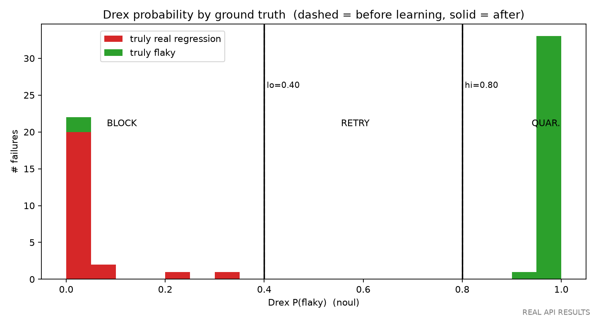
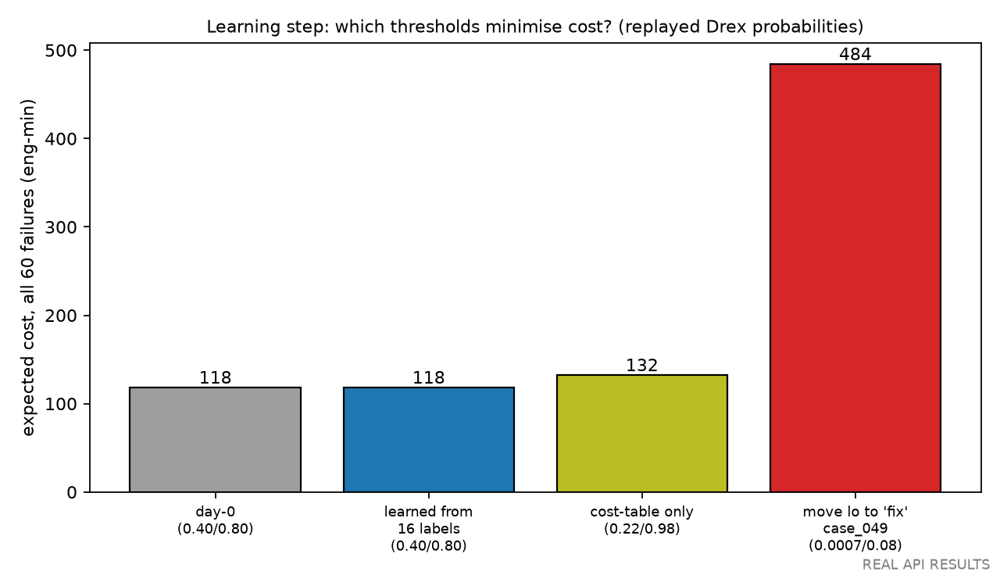
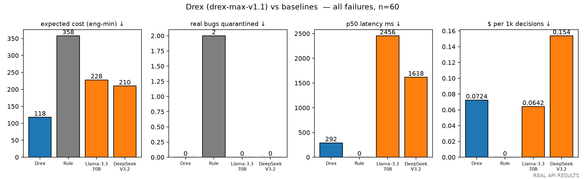

# Calibrated: Flaky or Real? Drex triages your red CI builds

**Nace AI Drexathon 2026 · Apex Predator track · Team Calibrated (Alexandra).** *Take a frontier-LLM task, hand the decisions to Drex, and prove it faster, cheaper, or more accurate.*

Every CI pipeline has a smoke alarm that goes off when you make toast: flaky tests. Teams assume they need a smarter AI to read the logs, but the expensive part is the decision. One wrong quarantine ships a real bug, and one wrong block burns an engineer's hour. Calibrated uses Drex probabilities to make the call — quarantine, retry, or block — based on what each mistake costs.

> **On 60 labeled CI failures, Drex (`drex-max-v1.1`) + a cost-aware policy reached 96.7% accuracy with 0 real bugs quarantined. Expected cost was ~48% lower than Llama-3.3-70B on DeepInfra (118 vs 228 eng-min) and p50 latency was 8x faster (292 vs 2,456 ms).** On the 44 held-out cases, expected cost was 98 vs 176. DeepSeek-V3.2 reached 88.3% accuracy at a cost of 210. A "retry passed ⇒ quarantine" rule quarantined 2 real bugs and cost 358. Per call, Drex costs about the same as Llama ($0.072 vs $0.064 per 1k). The savings come from better decisions, not cheaper tokens. Evidence: [`results/metrics_real.md`](results/metrics_real.md).

## How we used Drex / Intern / NDI / DeepInfra

| Tool | What it does here | Evidence |
|---|---|---|
| **Drex** (`drex-max-v1.1`) | Asks one `noul` question per failure ("is this flaky?") and returns a calibrated P(flaky) that a two-threshold policy turns into QUARANTINE / RETRY / BLOCK. Ran 60 real `POST /v1/systemone` calls. Also served as Intern's System 1 supervisor. | [`results/drex_real.json`](results/drex_real.json), [`drex_decide.py`](drex_decide.py), [`policy.py`](policy.py), [`results/learn_real.json`](results/learn_real.json) |
| **Intern** (Nace agent harness) | Ran the loop headless. System 2 (Qwen3.8-27B on DeepInfra) triaged 3 cases using only our `triage.py` tools. Drex, as System 1, guarded and supervised the run: 16 checks, 0 failed, 6 turns, 39 s. The agent flagged the Drex-vs-human disagreement on case_049. | [`results/intern_excerpt.md`](results/intern_excerpt.md), [`results/intern_run.jsonl`](results/intern_run.jsonl), [`results/intern_actions.jsonl`](results/intern_actions.jsonl), [`AGENTS.md`](AGENTS.md), [`run_intern.sh`](run_intern.sh) |
| **NDI** (Nace Document Intelligence) | Extracted structured fields (error type, test name, duration, retry result, recent fail rate, changed files) from all 60 raw CI logs. | [`results/ndi_real.json`](results/ndi_real.json), [`ndi_extract.py`](ndi_extract.py) |
| **DeepInfra** | Ran the frontier-LLM baselines on the same logs and cost table: Llama-3.3-70B (85.0%, 228 eng-min, RETRY on 41/60) and DeepSeek-V3.2 (88.3%, 210, RETRY on 36/60). It also hosted Intern's System 2 model, Qwen3.8-27B. | [`results/llm_real.json`](results/llm_real.json), [`results/llm2_real.json`](results/llm2_real.json), [`baseline_llm.py`](baseline_llm.py) |

**Key insight:** all 24 real regressions scored P(flaky) ≤ 0.35 and 34 of 36 flaky failures scored ≥ 0.93. No failure fell in the 0.40–0.80 retry band, so Drex + policy retried none. The frontier LLMs hedged with RETRY on 41 of 60 failures. Pitch deck: [`pitch/index.html`](pitch/index.html) ([PDF](pitch/Calibrated_Drexathon.pdf)).

When a CI test fails, someone has to decide whether to **quarantine** it (it's flaky), **retry** it, or **block** the merge (it's a real regression). Teams usually make that call with a yes/no rule or by pasting the log into an LLM. Both give a verdict with no notion of how sure they are, and the two kinds of mistake cost very different amounts:

| truth \ action | QUARANTINE | RETRY | BLOCK |
|---|---|---|---|
| real regression | **120** (bug ships) | 6 | 0 |
| flaky test | 2 | 4 | 25 (needless block) |

*(engineer-minutes, `data/cost_table.csv`)*

This project asks **Drex** one calibrated yes/no question per failure, keeps the raw probability, turns it into an action with two thresholds, and **learns those thresholds from a handful of human corrections** using the cost table. A frontier-class open LLM on **DeepInfra** handles the same task as the baseline.

## Architecture

```mermaid
flowchart LR
  A[CI failure log .log] -->|upload + /v1/documents/extract| B[Nace Document Intelligence]
  A -. fallback .-> B2[local regex extractor]
  B --> C[structured fields: error_type, test_name, duration, retry_passed, recent_fail_rate, changed_files]
  B2 --> C
  C -->|state + noul question, POST /v1/systemone| D[Drex: P(flaky)]
  D --> E{policy.py: p ≥ hi → QUARANTINE / lo ≤ p < hi → RETRY / p < lo → BLOCK}
  E --> F[human outcome / correction]
  F --> G[learn.py: refit lo, hi to minimise cost]
  G --> E
  A -->|same log + cost table| H[DeepInfra LLM baseline]
  E --> I[compare.py: metrics + charts]
  H --> I
```

## Quick start

```bash
python3 -m venv .venv && . .venv/bin/activate && pip install -r requirements.txt

# 1) No keys: full pipeline in MOCK mode (every output is labelled MOCK)
./run_all.sh --mock
python demo.py --offline --mock

# 2) Real: put keys in .env (gitignored), see .env.example
cp .env.example .env   # NACE_API_KEY=nace_sk_..., DEEPINFRA_API_KEY=...
./run_all.sh           # each stage runs for real when its key is present, otherwise falls back to mock
python demo.py --offline        # replays results/*_real.json, so it can't break on stage
python demo.py --live           # re-calls Drex live for the demo case
```

| file | what it does |
|---|---|
| `data/generate.py` | 60 seeded pytest/jest-style CI logs (36 flaky, 24 real, 16 deliberately ambiguous) plus `labels.csv` |
| `ndi_extract.py` | NDI extract with an inline JSON schema; regex fallback; records `path` = `ndi` or `local_regex` for each case |
| `drex_decide.py` | `GET /v1/models` checks the pinned model, then one `noul` question per case; logs raw `noul`, `request_id`, tokens, and latency |
| `policy.py` | two-threshold policy |
| `learn.py` | fits (lo, hi) on the 16 "day-1" human-labelled cases, then replays logged probabilities on the 44 held-out cases |
| `baseline_llm.py` | DeepInfra OpenAI-compatible endpoint, `meta-llama/Llama-3.3-70B-Instruct-Turbo` by default (`LLM_MODEL` overrides it), with the same cost table in the prompt |
| `compare.py` | `results/metrics_<mode>.{md,json}` and `results/charts/<mode>_*.png` |
| `demo.py` | scripted rich terminal demo for one ambiguous failure |
| `triage.py`, `AGENTS.md`, `run_intern.sh`, `intern_excerpt.py` | the same loop as tools for an Intern session, plus a readable replay of the recorded run |

## Verified API shapes

**Drex** (`console.nace.ai/docs/drex/api-reference/systemone`, `/docs/drex/guides/reading-answers`):

```http
POST https://console.nace.ai/v1/systemone
Authorization: Bearer $NACE_API_KEY
X-Nace-Client: drex-flaky/0.1
Content-Type: application/json

{"model": "drex-max-v1.1",
 "state": {"context": "...", "structured_fields_from_ndi": {...}, "log_excerpt": "..."},
 "questions": {"is_flaky": {"type": "noul", "instructions": "Is this failure caused by test flakiness rather than a real code regression? ..."}}}
```

The response is `answers.is_flaky.noul` (P(yes), 0 to 1), along with `confidence` (= max(p, 1-p), which we do not threshold), `usage.input_tokens` (billed; output tokens are not), `evaluation_time_ms`, and `request_id`.

**NDI extract** (`/docs/perception/extract`): upload the `.log` (`client.documents.upload`), then call `POST /v1/documents/extract` with `{"source": {"type": "workspace_file", ...}, "schema": {...}, "instructions": "..."}` and `wait_seconds=60`, polling `GET /v1/documents/jobs/{id}`. The fields come back in `result.data`.

## Results

These are **real** API results from 2026-11-14:
- Drex (`drex-max-v1.1`): 60 `POST /v1/systemone` calls.
- NDI: 60 of 60 extract jobs.
- DeepInfra LLM baselines: 60 calls per model.

The rule baseline is a deterministic local heuristic (retry passed ⇒ quarantine, else block). Mock-mode outputs (`results/*_mock.*`) are synthetic and watermarked.

**REAL API RESULTS**  
Drex model: `drex-max-v1.1` · LLM: `Llama-3.3-70B-Instruct-Turbo, DeepSeek-V3.2 (DeepInfra)` · thresholds {'lo': 0.4, 'hi': 0.8} → {'lo': 0.4, 'hi': 0.8}

### Held-out cases (n=44)

| System | Accuracy (flaky vs real) | Real bugs quarantined | Needless blocks | Retries | Expected cost (eng-min) | p50 latency (ms) | $ / 1k decisions |
|---|---|---|---|---|---|---|---|
| Drex (before learning) | 95.5% | 0 | 2 | 0 | 98 | 277 | $0.0724 |
| Drex (after learning) | 95.5% | 0 | 2 | 0 | 98 | 277 | $0.0724 |
| Rule baseline (retry passed => quarantine, else block) | 93.2% | 1 | 2 | 0 | 218 | 0 | $0.0000 |
| LLM baseline: meta-llama/Llama-3.3-70B-Instruct-Turbo (DeepInfra) | 84.1% | 0 | 2 | 29 | 176 | 2107 | $0.0642 |
| LLM baseline: deepseek-ai/DeepSeek-V3.2 (DeepInfra) | 88.6% | 0 | 2 | 26 | 162 | 1597 | $0.1538 |

### All cases (n=60)

| System | Accuracy (flaky vs real) | Real bugs quarantined | Needless blocks | Retries | Expected cost (eng-min) | p50 latency (ms) | $ / 1k decisions |
|---|---|---|---|---|---|---|---|
| Drex (before learning) | 96.7% | 0 | 2 | 0 | 118 | 292 | $0.0724 |
| Drex (after learning) | 96.7% | 0 | 2 | 0 | 118 | 292 | $0.0724 |
| Rule baseline (retry passed => quarantine, else block) | 93.3% | 2 | 2 | 0 | 358 | 0 | $0.0000 |
| LLM baseline: meta-llama/Llama-3.3-70B-Instruct-Turbo (DeepInfra) | 85.0% | 0 | 2 | 41 | 228 | 2456 | $0.0642 |
| LLM baseline: deepseek-ai/DeepSeek-V3.2 (DeepInfra) | 88.3% | 0 | 2 | 36 | 210 | 1618 | $0.1538 |





### What we learned

- **Drex separates the two classes cleanly.** All 24 real regressions scored P(flaky) ≤ 0.35, 34 of 36 flaky failures scored ≥ 0.93, and **no failure fell in the 0.40–0.80 retry band**. That includes the two real race-condition bugs whose retry *passed* (P = 0.07 and 0.09). A "retry passed ⇒ flaky" rule quarantines both, at 120 eng-min each.
- **The learning step is honest about what it can and can't fix.** The 16 day-1 human labels changed **0** decisions. The cost-minimising refit keeps lo = 0.40 and hi = 0.80, and the band of equally good thresholds is wide: any lo from 0.08 to 0.80, or any hi from 0.40 to 0.93. Held-out cost is 98 → 98.
- **The one confident disagreement doesn't move the thresholds.** That's case_049 or case_058: a flaky order-dependence failure where both retries failed and the PR touched `settings.py`, and Drex gave P ≈ 0.001. The cheapest threshold change that "fixes" it raises total cost on all 60 cases from **118 to 484** eng-min, so the loop keeps the thresholds and sends the pattern to the evidence backlog instead. A useful next fix is to add a "passes in isolation" signal to the state.
- **The cost table alone isn't enough.** If P were perfectly calibrated, the cost table would pick lo = 0.22, hi = 0.98. On these probabilities that costs 110 vs 98 on held-out, because Drex's 0.93–0.98 flaky cases would be retried instead of quarantined. Fitting on labels beats trusting the cost table alone.
- **The frontier LLMs are careful but hedge.** Llama-3.3-70B and DeepSeek-V3.2 never quarantined a real bug, but they chose RETRY on 41 and 36 of 60 failures, which costs 4–6 eng-min each. Drex + policy retried none. Total cost was 118 for Drex vs 228 and 210 for the LLMs, with 292 ms vs 2,456 and 1,618 ms p50 latency.
- **Cost:** NDI cost $0.228 for all 60 logs, as reported by the SDK job cost; some pages were cache hits. Drex used 36,224 input tokens, about $0.004 at an assumed $0.12/M for Drex Max. Drex Max probabilities are not bit-identical between calls (case_007: 0.074 cached vs 0.107 live), so the stage demo replays the logged values.

What the cost table says before any data arrives: if P(flaky) were perfectly calibrated, the expected-cost-optimal cut points would be **lo ≈ 0.22, hi ≈ 0.98**. A wrong quarantine is so expensive that you should only auto-quarantine when Drex is very sure. A yes/no classifier cannot express that. A probability can.

## Running it as an Intern agent

[Intern](https://github.com/nace-ai/intern) is the Nace agent harness. Its **System 2** model does the work by calling tools, and its **System 1**, a decision model, watches every turn and guards tool calls. Here System 1 is **Drex** (`drex:drex-max-v1.1`, from the Nace console) and System 2 is a **DeepInfra** model (default `deepseek-ai/DeepSeek-V3.2`).

```bash
uv tool install --python 3.12 "intern-agent @ git+https://github.com/nace-ai/intern"
./run_intern.sh case_007 case_041 case_049      # needs NACE_API_KEY + DEEPINFRA_API_KEY
```

`AGENTS.md` tells the agent to work only through `triage.py`:
- `extract`: NDI
- `decide`: Drex `noul`
- `act`: the policy
- `truth`, then `feedback`: the human label, then the threshold refit

Every tool call is journaled to `results/intern_actions.jsonl`, and the Intern event stream goes to `results/intern_run.jsonl`. The agent never chooses the action itself. The policy does.

**Recorded run** (`results/intern_excerpt.md`, replay it with `python intern_excerpt.py`):
- System 2: `deepinfra/Qwen/Qwen3.8-27B`. System 1: `drex:drex-max-v1.1`.
- 3 cases (case_007, case_041, case_049), 5 tool-call turns, 15 triage commands. NDI was used for all 3 extractions.
- 16 Drex System 1 checks (guard, supervise, wrap-up), 0 failed. The run completed in 6 turns and 39 s.
- Policy actions: BLOCK, BLOCK, BLOCK. The human labels were real, real, flaky, and the thresholds held at 0.40/0.80.

## License

MIT
