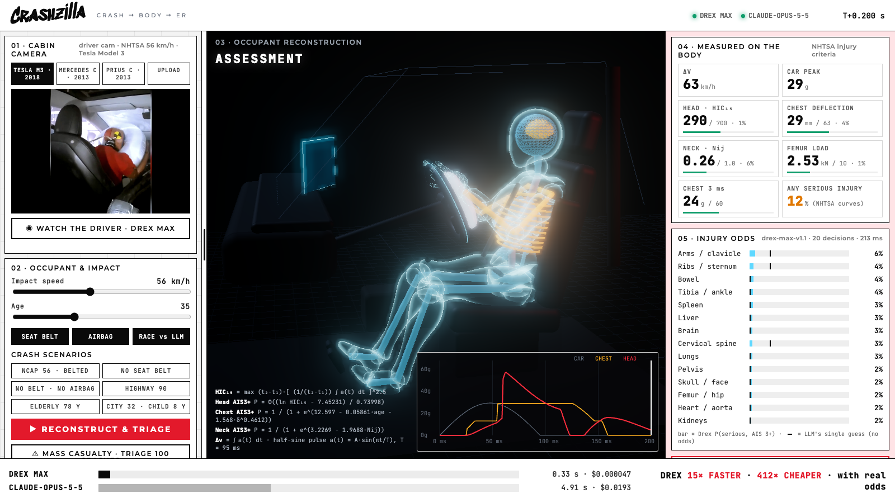

# Crashzilla

**The crash lasts 0.1 s. Crashzilla tells the ER what broke.**

A camera watches the driver. Drex Max reads every frame, crash physics measures what hit the body, and the ER gets injury odds for 14 organs before the ambulance arrives.

Drexathon (Nace AI × Adobe EDU, Nov 14 2026) · Track: **Apex Predator: Drex vs. the Giants** · by Akmal Shovkatov



## What uses what

| Nace tool | Where | What it does here | Evidence |
|---|---|---|---|
| **Drex Max** (images) | `POST /api/frame` → [`server.js`](server.js) | Reads 36 frames of the driver camera, 6 typed questions each: crash phase, airbag, belt, body lean, head contact, violence. **216 decisions per video, about 2.5 s.** | run the dashboard, "Watch the driver" |
| **Drex** (text) | [`lib/triage.js`](lib/triage.js) | 20 typed questions per patient: severity odds for 14 organs + 6 ER calls (destination, trauma team, CT head, C-spine, FAST, blood bank). | [`docs/evidence/benchmark-2026-11-14.json`](docs/evidence/benchmark-2026-11-14.json) |
| **NDI** (Extract) | [`lib/ndi.js`](lib/ndi.js), `POST /api/intake` | Reads a crash / EMS report (PDF, scan, photo) into a JSON Schema: age, belt, airbag, speed, blood thinners, loss of consciousness. Those facts drive the simulation and go to Drex. | `npm run ndi` on [`samples/ems-report-sample.pdf`](samples/ems-report-sample.pdf) (synthetic) |
| **Intern** | [`mcp/server.mjs`](mcp/server.mjs), [`intern/config.example.toml`](intern/config.example.toml) | Crashzilla is an MCP tool server. Intern calls `triage_crash`; Intern's own System 1 (Drex) guards the call and supervises the turn. | real run: [`docs/evidence/intern-run-2026-11-14.jsonl`](docs/evidence/intern-run-2026-11-14.jsonl) |
| **DeepInfra** | `DREX_PROVIDER=deepinfra` in [`lib/triage.js`](lib/triage.js) | Sends the text triage to Drex 2.0 on DeepInfra's System One endpoint. | **Not tested: we had no DeepInfra key.** |

Adobe tools are not used.

## Pipeline

```
driver camera ──► Drex Max ──► impact time, body lean per frame, head contact, est. speed
crash report  ──► NDI ───────► age, belt, airbag, speed, blood thinners
                                   │
                                   ▼
                  occupant physics (public/physics.js, no AI)
                  crash pulse → belt + load limiter → airbag → head/neck → knees
                                   │
                                   ▼
                  HIC15 · chest deflection · Nij · femur load
                                   │
                                   ▼
                  NHTSA NCAP injury-risk curves (no AI)
                                   │
                                   ▼
                  Drex: 14 organ odds + 6 ER calls ──► ER pre-alert
```

The 3D occupant is a rigged human posed by inverse kinematics. During replay its forward lean comes from Drex Max's per-frame reading, synced to the video clock.

## Drex vs a frontier LLM

12 crashes, both models live, same state text, same 20 questions (`npm run benchmark`, raw output in [`docs/evidence`](docs/evidence/benchmark-2026-11-14.json)):

| | Drex Max | Claude Opus 5.5 |
|---|---|---|
| Median time per patient | **0.41 s** | 5.5 s |
| Median cost per patient | **$0.00005** | $0.022 |
| Output | probability for every option | one answer per question |

Both models chose the same ER destination on 9 of 12 crashes. On the other 3, Claude chose a Level II trauma center where Drex chose a community ER (NHTSA joint risk 12 to 28%). We have no ground truth for which is right.

## Checks

`npm test` runs 10 tests: HIC against its closed form, the crash pulse integrating to delta-V, risk-curve monotonicity and a hand-computed anchor, belt / speed / age effects, the 20-question set, and the NDI field mapping.

On three NHTSA 56 km/h tests (Tesla Model 3, Mercedes C-Class, Prius c), Drex Max's speed estimate from the driver camera alone was 52, 55 and 53 km/h.

## Limits

- The occupant model is a simplified lumped-mass model, not a finite-element or multibody dummy model. Its constants were tuned by hand so the belted 56 km/h case lands near published NCAP readings.
- The speed estimate maps Drex Max's "violence" rating to delta-V with a hand-set table. Three clips are not a validation.
- Organ odds are Drex's judgment from the crash readings. They are not validated against hospital outcomes.
- The sample EMS report is synthetic.
- Decision support, not a diagnosis.

## Run

```bash
npm install
cp .env.example .env     # NACE_API_KEY, and ANTHROPIC_API_KEY for the LLM race
npm start                # http://localhost:4310 (landing) and /app (dashboard)
npm test
npm run ndi              # NDI → physics → Drex on the sample report
npm run benchmark        # Drex vs Claude on 12 crashes (server must be running)
```

With Intern:

```bash
uv tool install "intern-agent[mcp] @ git+https://github.com/nace-ai/intern"
# copy intern/config.example.toml to ~/.intern/config.toml and set the paths
intern -p --system2 anthropic/claude-opus-5-5 "A 35-year-old unbelted driver hit a barrier at 56 km/h. Use the crashzilla triage tool. Where should the ambulance go?"
```

## Credits

- Crash footage: NHTSA NCAP tests (U.S. government work).
- Human model: `Xbot.glb` from the three.js examples (MIT).
- three.js, Express, Drex Max and NDI (Nace AI), Intern (Nace AI), Claude Opus 5.5 as the baseline.
