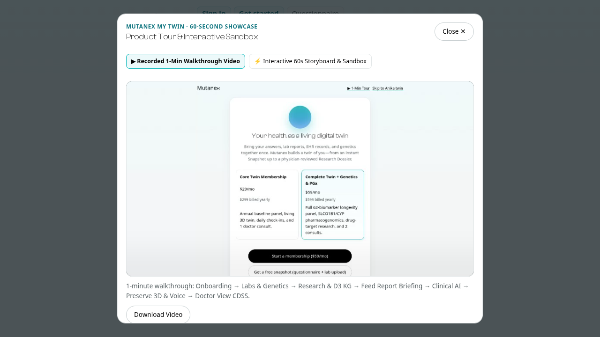
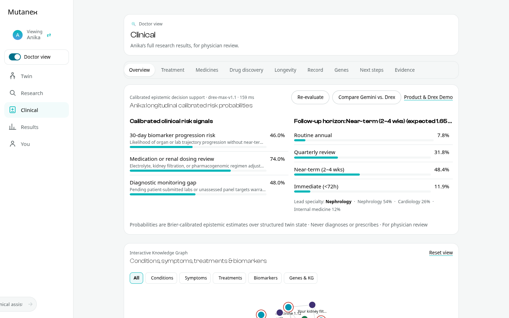
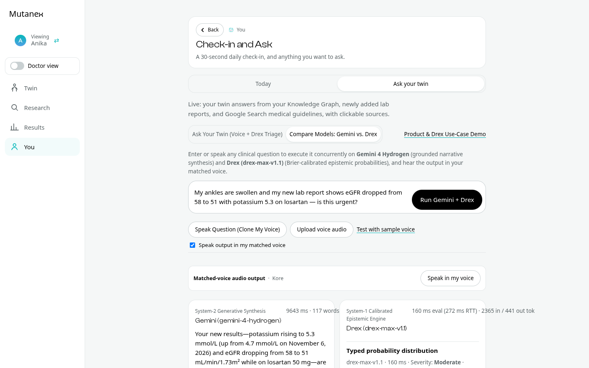

# Mutanex My Twin — Calibrated Clinical Digital Twin with Drex + Gemini

Mutanex My Twin is a patient and clinician Digital Twin portal that pairs **Drex (`drex-max-v1.1`)** as a fast, calibrated System-1 clinical evaluator with **Gemini (`gemini-4-hydrogen`)** as a System-2 narrative synthesizer, plus **matched-voice audio I/O** so the Digital Twin speaks back in the user's own acoustic pitch and timbre.



## Why System-1 Drex + System-2 LLM in Clinical Software

Frontier generative LLMs (GPT-4o/5, Claude, Gemini) write fluent patient explanations grounded in a medical Knowledge Graph, but their self-reported confidence words (*"likely"*, *"urgent"*) are uncalibrated tokens sampled over hundreds of decoding steps (~2–9 s). Clinical workflows require calibrated probabilities (`P` in `[0, 1]`) over explicit typed schemas in a single forward pass (~160–210 ms) to trigger deterministic safety gates, verify OCR lab extractions before mutating a patient's record, and rank longitudinal risk across organ systems.

| Dimension | Drex (`drex-max-v1.1` — System 1) | Frontier LLMs (Gemini / GPT-Class — System 2) |
|---|---|---|
| Output contract | Calibrated `noul` (`P(yes)`) and `choice` distributions (`sum = 1.0`) | Free-text narrative + structured JSON citations |
| Typical latency | **159–211 ms** (all typed questions evaluated in one pass) | **2,000–9,100 ms** (sequential autoregressive token decoding) |
| Clinical role in My Twin | Safety routing, OCR anomaly gating, longitudinal risk quantification | Grounded plain-language synthesis & physician CDSS prose |

## Core Capabilities

### 1. Three Calibrated Drex Clinical Workflows (`server/src/drex.ts`)

All Drex requests call `POST https://console.nace.ai/v1/systemone` (`model: "drex-max-v1.1"`) from the backend proxy using `NACE_API_KEY`:

1. **Check-in, Ask & Onboarding Triage (`POST /v1/drex/triage`)** — Evaluates every patient check-in, symptom note, or question in one pass across 4 typed schemas:
   - `is_urgent` (`noul`): immediate red-flag / clinical escalation probability
   - `needs_clinician_review` (`noul`): probability a physician should review before next routine visit
   - `medication_concern` (`noul`): dosing, interaction, absorption, or adherence signal
   - `primary_domain` (`choice`): `Cardiometabolic & Renal`, `Endocrine & Thyroid`, `Medication & Adherence`, `Symptoms & Acute Care`, or `General Wellness`
2. **Lab Report Verification Gate (`POST /v1/drex/verify-report`)** — Audits multimodal OCR lab extractions (`POST /v1/extract`) before committing biomarkers to the Twin's Knowledge Graph:
   - `has_critical_value` (`noul`), `likely_ocr_artifact` (`noul`), `requires_repeat_testing` (`noul`), and `clinical_priority` (`choice`: `Routine`, `Soon`, `Urgent`)
3. **Doctor View Longitudinal Risk Panel (`POST /v1/drex/clinical-panel`)** — Evaluates the full longitudinal patient bundle in **Doctor View** across 5 calibrated clinical decision questions (`cardiorenal_Trajectory_Risk`, `endocrine_Titration_Needed`, `polypharmacy_Interaction_Risk`, `thirty_Day_Decompensation_Risk`, `recommended_Disposition`).



### 2. Side-by-Side Model Comparison Workbench (`POST /v1/compare`)

Built into **Check-in & Ask** (`#/you/checkin:ask`), the **Gemini vs. Drex (& GPT-Class LLMs)** workbench executes the exact same patient question + Knowledge Graph context concurrently on `gemini-4-hydrogen` and `drex-max-v1.1`, displaying live wall-clock latencies, calibrated probability meters, narrative synthesis with citations, and an architecture comparison matrix.



### 3. Matched-Voice Audio Input & Output (`server/src/gemini.ts`, `patient-portal/src/voice-engine.ts`)

Patients can speak check-ins or questions and hear their Digital Twin answer in a voice matched to their own acoustic profile:
- **Client acoustic analysis**: Measures fundamental pitch ($F_0$ in Hz via autocorrelation) and spectral brightness from the user's microphone recording.
- **Transcription (`POST /v1/voice/transcribe`)**: Transcribes spoken audio with `gemini-3.5-transcribe`.
- **Voice persona calibration (`POST /v1/voice/clone-profile`)**: Extracts vocal delivery descriptors (`gemini-4-hydrogen`) and anchors to the closest base voice.
- **Matched synthesis (`POST /v1/voice/speak`)**: Synthesizes speech via `gemini-3.8-flash-tts` and applies Catmull-Rom 16-bit PCM resampling + low-pass warmth filtering (`matchWavToVoiceProfile`) so the WAV output matches the speaker's measured Hz pitch and timbre.

### 4. Interactive Whole-Product & Drex Unique Case Demo

Accessible from the header (**Product & Drex Demo**), featuring 3 clinical scenarios (*Silent SGLT2i eGFR Dip vs. True AKI*, *Levothyroxine + Calcium Malabsorption*, and *OCR Decimal Shift Gate*), a 1-click live 4-stage pipeline runner hitting both Drex and Gemini APIs, and 1-click navigation into each live view.

## Project Structure

```text
examples/mutanex-mytwin/
├── server/                  # Express + TypeScript backend (Drex System-1, Gemini System-2, Voice DSP, Vitest suite)
├── patient-portal/          # React + TypeScript portal modules (Ask, Compare, Clinical Panel, Feed, Preserve, Onboarding)
├── Mutanex_MyTwin/portal/   # Static portal shell, synthetic patient Knowledge Graph bundles, CSS & sample lab assets
├── docs/                    # UI screenshots
├── .env.example             # Environment variable template (never commit .env)
└── package.json             # npm workspaces root (dev, build, lint, test)
```

## Quickstart

1. **Configure environment variables** (never commit `.env`):
   ```bash
   cp .env.example .env
   ```
   Set `NACE_API_KEY` (from `https://console.nace.ai`) and `GEMINI_API_KEY` in `.env`.

2. **Install dependencies & start localhost server**:
   ```bash
   npm install
   npm run dev
   ```
   Open `http://localhost:3000` (health check: `GET http://localhost:3000/v1/ask/health` -> `{"ok":true,"drex_configured":true}`).

## Verification & Tests

```bash
# Backend unit & API contract tests (23 tests: Drex triage/verify/panel, compare, voice pitch DSP, ask/extract)
npm test

# Frontend clinical logic & Drex calibration helper tests (7 tests)
npx tsx --test patient-portal/src/portal-logic.test.ts

# Full TypeScript typecheck & production bundle build
npm run lint && npm run build
```
