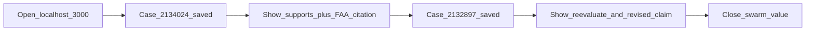

# Demo path, conflicts hunt, gated benchmark

## Scope decisions (locked)

- **Frozen demos:** ACN `2134024` (supported + citation) and ACN `2132897` (second round / revised claim). Do not swap unless a new run strictly improves Scenario B.
- **Primary track:** Swarm Intelligence. Apex Predator only after swarm is solid.
- **Out of scope (explicit skip):** more UI chrome, Nace Intern, Nace Workspaces, expanding ASRS corpus or adding more PDFs for this pass.
- **Git:** when work is done, commit only the demo/evaluation artifacts (no `.env`, no DuckDB/CSV, no bulk `service/runs/`) and **push to** `origin` on branch `demo/path-freeze` from current `master`.

## Task 1 — Demo path (do first)

**Goal:** judges can be walked through a reliable local story in ≤5 minutes without inventing outcomes.

1. Confirm both saved demos still load in the UI:
   - [`dashboard/web/public/demos/2134024.json`](dashboard/web/public/demos/2134024.json)
   - [`dashboard/web/public/demos/2132897.json`](dashboard/web/public/demos/2132897.json)
   - Labels already wired in [`dashboard/web/src/app/page.tsx`](dashboard/web/src/app/page.tsx) (`savedDemos`).
2. Add [`evaluation/DEMO_SCRIPT.md`](evaluation/DEMO_SCRIPT.md) timed to plan §12:
   - 0:00–0:35 problem + 5,127-report July 2023 – June 2024 archive
   - 0:35–1:10 open `2134024`, narrative, related reports, Evidence ready
   - 1:10–3:10 **Open saved run** (preferred live) or one fresh `/analyze` if credits/time allow
   - 3:10–3:55 switch to `2132897` saved second-round / revised claim
   - 3:55–4:30 novelty close (coordination + NDI citations; **no benchmark claims**)
3. Add a short pre-flight checklist in that doc: ports `3000` / `8001` / `8000`, `/health` + `/evidence/status` ready, Nace key present, offline browse still works if analysis is stopped.
4. **Dry-run once** with a timer; note any flaky wording (e.g. “changed from X to X” on unchanged claims) as talk-track caveats only — **do not** spend this pass on UI polish.
5. Align [`evaluation/live_runs.md`](evaluation/live_runs.md) so the two frozen cases are clearly marked as **demo path** cases.

## Task 2 — Capture Evidence `conflicts` (only if time after Task 1)

**Fact:** across existing [`service/runs/`](service/runs/), **zero** Evidence turns have `selected_option: "conflicts"`. Current best swarm proof remains `2132897` (`unresolved` → Coordinator `reevaluate` → revised claim).

1. Add a small offline scanner (e.g. [`evaluation/scan_conflicts.py`](evaluation/scan_conflicts.py)) over `service/runs/*.json` to report any future `conflicts` hits with citation counts.
2. Batch-run a shortlist of taxi/communication/runway cases through live `POST /analyze` (reuse Builder A contexts). Cap attempts (e.g. 8–12 cases) to protect Nace credits.
3. **Success criteria:** Evidence round-1 `selected_option == "conflicts"` **and** ≥1 real `evidence_refs` entry. Then copy that JSON into `dashboard/web/public/demos/`, wire a `savedDemos` label, and document it in `live_runs.md` + DEMO_SCRIPT as optional third beat.
4. **Failure criteria:** no honest `conflicts` found → keep demo on `2132897`; do **not** relabel `unresolved` as conflict.

## Task 3 — OpenAI Apex Predator benchmark (only if swarm is solid)

**Gate:** Task 1 dry-run passed **and** either a real `conflicts` capture **or** explicit acceptance that `2132897` is the swarm-proof story.

If gated **in**:

1. Scaffold under [`evaluation/`](evaluation/) only (Builder A ownership): e.g. `benchmark/README.md`, prompt pack for **one** bounded decision (`pattern_family` **or** `next_action`), same options as Drex in [`agents/questions.py`](agents/questions.py), 20–50 cases max.
2. Compare Drex vs OpenAI on identical incident text + candidates + NDI passages; store raw responses, latency, cost, invalid-output rate. No fabricated wins.
3. Surface in UI only if stored results exist (contract allows optional benchmark read) — otherwise leave UI untouched.
4. If results are mixed/inconclusive: **do not** pivot pitch; stay Swarm Intelligence.

If gated **out:** leave `evaluation/` with DEMO_SCRIPT + live_runs only; pitch never mentions model superiority.

## Task 4 — Explicit skip (document, do not build)

Record in DEMO_SCRIPT (or a 5-line `evaluation/NON_GOALS.md`) that this pass will **not**:

- Extra UI chrome / design iteration
- Nace Intern harness
- Nace Workspaces
- Expanding ASRS month range or adding more guidance PDFs

## GitHub push (end of implementation)

1. Stage: `evaluation/DEMO_SCRIPT.md`, updated `evaluation/live_runs.md`, optional scanner/benchmark stubs, optional new demo JSON under `dashboard/web/public/demos/`, and any intentional `savedDemos` wire-up.
2. Exclude: `.env`, `data/*.duckdb`, `data/*.csv`, bulk `service/runs/`, secrets.
3. Commit on branch `demo/path-freeze`, push `origin`, open PR into `master` with summary + test plan (dry-run checklist).

## Done when

- Two cases frozen and named in docs/UI labels
- 5-minute script exists and has been dry-run once
- Conflicts hunt either produced a cited real conflict demo **or** was honestly abandoned
- Benchmark either gated-in with measured artifacts **or** explicitly skipped
- Skip list written; PR pushed to GitHub
