# PixelDrex

> **An example project built with Intern and Drex** (Drexathon, Nov 14 2026). Intern runs inside the product as
> "god mode": it runs a Drex Life world, reads the report, and rewrites the world's rules until it comes alive, with
> Drex as its System 1 (`pixeldrex/god.py`, logs in `intern_logs/`). Intern was also used as a coding agent on this
> codebase (`scripts/intern.sh`). This folder mirrors https://github.com/mauryantitans/PixelDrex and is a
> self-contained package with its own `pyproject.toml`, tests and lint config.

**GIFs made entirely of decisions.** Drex can't draw. It only answers multiple-choice questions, so every pixel of
every frame is a question, and the answers become animated GIFs.

[](https://github.com/mauryantitans/PixelDrex/actions/workflows/ci.yml)

[](LICENSE)

<p align="center">

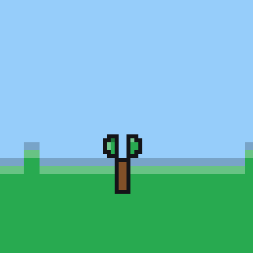
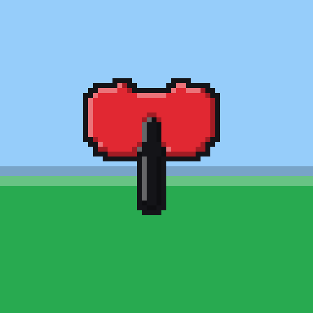

</p>

<p align="center">
<a href="docs/SETUP.md">Setup</a> · <a href="docs/ARCHITECTURE.md">Architecture</a> ·
<a href="CONTRIBUTING.md">Contributing</a> · <a href="https://github.com/mauryantitans/PixelDrex/blob/main/docs/video/pixeldrex_demo.mp4">Demo video</a> ·
<a href="docs/SUBMISSION.md">Drexathon submission</a>
</p>

Built at **Drexathon** (Nace AI, Nov 14 2026) for the Wildcard track.

Two ways a decision model makes a GIF:

- **🎬 Paint it (Scenes) — the main idea.** Type an idea; Drex decides which part of each sprite covers every pixel, what color each part is, and how everything moves. Sprites at 16, 32, 64 (default) or 128 px; 512 px GIFs.
- **🧬 Let it live (Drex Life) — the extension we built next.** Every pixel is a living agent: you describe a world; its laws of physics are plain English; every frame, every pixel asks Drex what it becomes next.

Everything else picks or fixes what the GIF shows: **this week's news** (Keenable) or **any document** (NDI) can define a world, and in **god mode** Intern rewrites a dull world's rules until the GIF comes alive.

## Gallery

One sentence in, one GIF out: 32×32 sprites on a 64×64 canvas, rendered at 512 px. Each is the best of 3 runs.

| | | | | |
|:-:|:-:|:-:|:-:|:-:|
| <br><sub>“a ghost floating through a haunted house”<br>572 decisions · 5.5 s</sub> | <br><sub>“a rocket launching into a starry night sky”<br>880 decisions · 8.7 s</sub> | 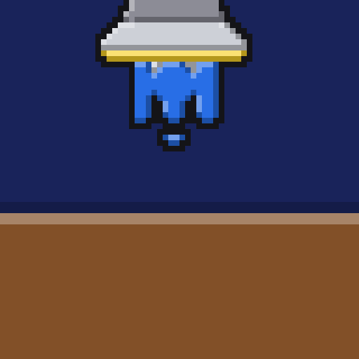<br><sub>“a UFO hovering over a desert at night”<br>819 decisions · 7.8 s</sub> | 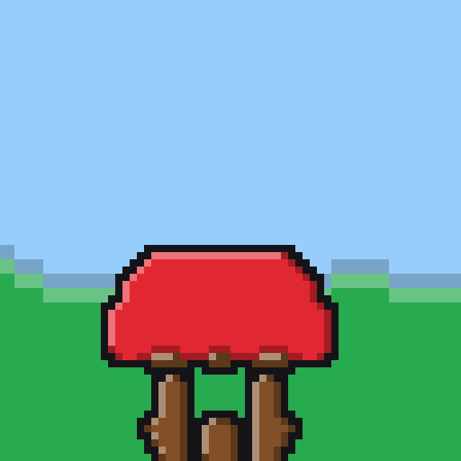<br><sub>“a hot air balloon rising over green hills”<br>560 decisions · 4.3 s</sub> | 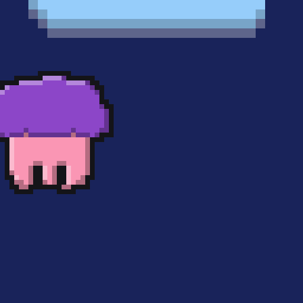<br><sub>“a jellyfish drifting in the deep sea”<br>744 decisions · 6.2 s</sub> |
| <br><sub>“a sapling growing into a big tree”<br>3 poses · 7.0 s</sub> | <br><sub>“a butterfly flapping its wings in a flower garden”<br>2 poses · 6.9 s</sub> | 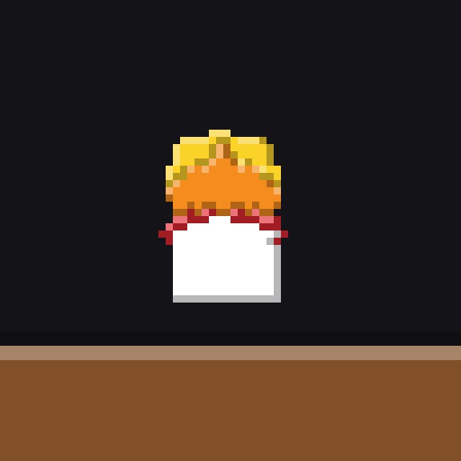<br><sub>“a candle flame flickering in a dark room”<br>2 poses · 9.4 s</sub> | <br><sub>“a jack-o-lantern glowing on a porch at night”<br>2 poses · 11.3 s</sub> | 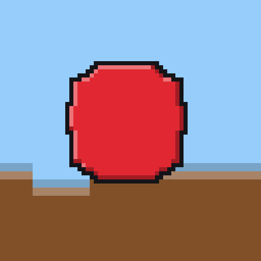<br><sub>“a red ball bouncing on the ground”<br>squash & stretch · 4.3 s</sub> |

Every GIF costs about 1¢ of Drex calls (5–9 calls each).

## 🎬 Paint it: scenes

You type an idea. The director turns it into a scene spec (background, up to 3 sprites with their parts, how each moves). Then every visual decision is made by [Drex](https://console.nace.ai), Nace's decision model, on a 64×64 canvas:

1. **Background** — every pixel of a 16×16 grid is one `choice` question over a 15-color palette, plus 16 "which color covers most of row r?" questions, all in **one** request. Each pixel takes the argmax of P(pixel) × P(row)^0.5, so calibrated row answers fill in areas the pixel answers are unsure about. Then it is enlarged to 32×32 and Drex smooths its edges (below).
2. **Sprite — the right question.** Not "what color is pixel (8, 12)?" but **"which part of the rocket covers pixel (8, 12): nose cone, body, window, fins, flame or empty?"** — plus "what color is the nose cone?" for each part, all in **one** request. The director names each sprite's parts; symmetric sprites (rockets, UFOs, faces, trees) ask only the left half and mirror it. Each part is one solid color, shaded like pixel art (lit top-left edges, shadowed bottom-right) with an outline.

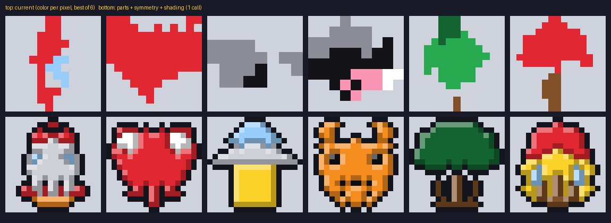

*Top: asking for a color per pixel (best of 6 candidates). Bottom: asking which part covers each pixel — one call per sprite, 6 sprites in 2.5 s.*

**32×32 sprites — local questions, not coordinates.** Asking about 32 rows directly gets noisy (Drex is good at local
judgments, weak at exact positions), and a 16×16 guide image didn't help — Drex reinterpreted it. What works is the trick
Drex Life uses: paint the clean 16×16 shape, enlarge it to 32×32, then let **every edge pixel ask Drex** *"I'm 'body';
north: nose cone, east: empty, … which should I be so the outline is smooth?"* — no coordinates, identical neighbourhoods
share one question, ~1 call per sprite. Backgrounds are smoothed the same way. Scenes are now a 64×64 canvas with 32×32
sprites, rendered at 512 px.

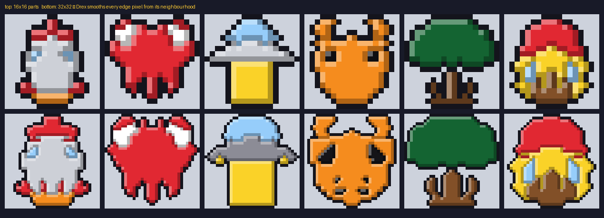

*Top: 16×16. Bottom: the same shapes at 32×32, every edge pixel decided by Drex from its neighbourhood (6 sprites, 3.1 s).*

**64×64 and 128×128.** The same step repeats: 16 → 32 → 64 → 128, one Drex smoothing pass (~1 s, ~1 call) per
doubling. Each pass makes edges smoother and curves rounder; the detail itself still comes from the 16×16 part
layout. **64×64 is the default** — smooth and clean while still reading as pixel art; 128×128 is cleaner still but
looks closer to flat vector art. Choose with `--res 16|32|64|128` or the web app's resolution radio buttons (16 × 16 shows Drex's raw part layout with no smoothing).

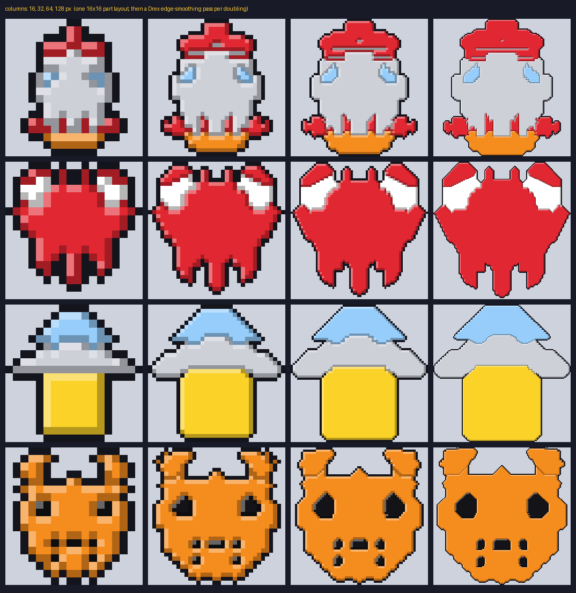

<p>
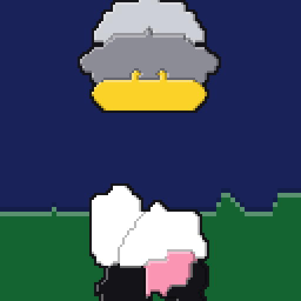
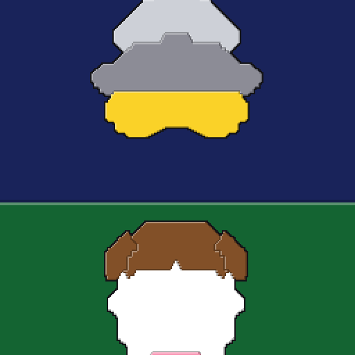
</p>

*Left: 64×64 sprites (11 Drex calls, 10 s). Right: 128×128 sprites (14 calls, 15 s). Both 512 px GIFs.*

3. **Motion** — one request per sprite asks "where is it, and how big, in each of 16 frames?" as `score` questions. Scores are **expected values**, so the motion comes out sub-pixel smooth. The same request also asks how the sprite is **tilted** (it leans into its motion) and its **shape** (stretched when fast, squashed when it lands) — classic cartoon squash and stretch, decided by Drex.

**Things that change, not just move (poses).** Real GIFs change shape: wings flap, flames flicker, a sapling grows
into a tree. The director can give a sprite 2–4 **poses** (same part names, different positions); Drex paints every
pose part by part with shared colors, all poses share one frame so nothing jumps, and the motion request asks
**"which pose is the tree in during frame 7?"** for every frame.

<p>


</p>

At the default 64×64: about 7–11 Drex calls · ~10 s · ~1¢ per 512 px GIF (32×32: 5–8 calls, 5–9 s). Nobody told the rocket to shrink as it flies away — Drex decided that. Front-view sprites come out best; side-view animals are still blobby, so the director prefers front views, keeps scenes to 1–2 sprites, and a nearly empty sprite is repainted once.

```text
$ pixeldrex "a ufo abducting a cow at night"
  [  4.4s] director: 'UFO Abducts Cow' with 2 sprite(s): UFO, Cow
  [  6.6s] background painted (256 pixel decisions)
  ...
  GIF: out/gallery/20261114-210009-ufo-abducts-cow/anim.gif
  1,046 Drex decisions in 8 calls · 8.9s total · Drex ≈ $0.0085 · director $0.00010
```

Options: `--res 16|32|64|128` (sprite resolution, default 64), `--frames N`, `--ms N`, `--no-outline`, `--spec-only` (show the director's plan), `--spec FILE` (re-paint a saved plan), `--json`.

## 🧬 Let it live: Drex Life (the extension)

<p>
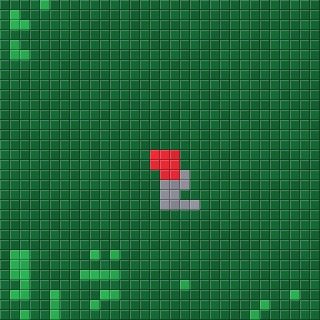
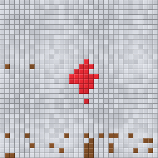
</p>

*Left: "a forest fire: lightning starts fires, fire spreads through trees, burnt ground slowly regrows" — lightning strikes, ragged glowing fire fronts spread, burnt ground regrows to grass and then forest, and new fires keep breaking out, so the world cycles instead of ending. Right: "a zombie outbreak in a city" — the infection spreads in glowing waves and the city turns over.* Nobody animated either one. Replay these exact worlds with `pixeldrex life --world worlds/forest-fire-cycle.json` (or `zombie-outbreak-city.json`).

```bash
.venv/bin/pixeldrex life "a zombie outbreak in a city"
```

1. A **director** LLM (DeepInfra) designs the world: 3–5 cell states with colors, 3–6 rules in plain English, and a starting layout. It never decides a single cell.
2. **Drex seeds the world**: one `choice` question per cell (32×32 = 1,024 questions).
3. **Every step, every cell asks Drex**: *"This cell is currently a tree. Of its 8 neighbours: 5 tree, 2 fire, 1 ash. Following the rules, what is this cell in the next step?"*
   - **Cells in the same situation share one question**, and Drex's answers are **cached across steps** — the world learns its physics from Drex as it goes. The forest fire made **17,280 cell decisions from 191 unique questions** (15 s, $0.004); by the end, each step needed about one new question.
   - The next state is **sampled from Drex's calibrated probabilities**, so "lightning *rarely* strikes" and "ash *slowly* regrows" really are rare and slow. Randomness in the world *is* Drex's uncertainty.
   - If the rules mention directions (sand *falls*, wind blows *east*), cells see which neighbour is where; otherwise only neighbour counts matter, which collapses far more cells into one question.
4. **Rendering** (Drex decides every state; this only decides how a state looks): beveled tiles with a little per-cell texture, a warm glow on cells that just changed (fading over 2 steps) so fire fronts and infection waves light up, and a blended in-between frame for smoother motion.

| World | Grid × steps | Cell decisions | Unique Drex questions | Time | Drex cost |
|---|---|---|---|---|---|
| Forest fire (gallery) | 32×32 × 40 | 41,984 | 1,832 | 22 s | $0.015 |
| Zombie outbreak (gallery) | 32×32 × 40 | 41,984 | 1,350 | 26 s | $0.012 |
| Forest fire (earlier, 24×24) | 24×24 × 30 | 17,280 | 191 | 15 s | $0.004 |

Worlds are designed fresh on every run, so results vary: some runs freeze, burn out or turn to noise. The gallery shows the best runs, and `worlds/` keeps their rules for replay.

### 😇 God mode: Intern rewrites the laws of physics

```bash
.venv/bin/pixeldrex god "a coral reef: coral grows, warm water bleaches coral, fish help bleached coral recover"
```

[Intern](https://github.com/nace-ai/intern), Nace's coding agent, becomes the god of a Drex Life world. It runs the world
(`pixeldrex life --world worlds/<name>.json --report`), reads the report, and if a state died out, the world froze,
or one state took over, it **edits the English rules in the world file** and runs it again — up to 4 times.
Two Drexes are at work: one decides every cell of the universe; the other, as Intern's System 1, supervises the god.

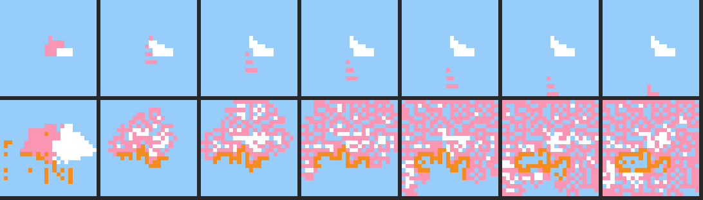

*Top: the director's original rules — a coral blob drips down and the world dies. Bottom: after Intern's 3 rewrites
(fish that can come back on their own, density-based neighbour counts, overcrowding that causes bleaching) — a living
reef where coral spreads, bleaches and recovers, and a school of fish moves through. 4 world runs, 12 Intern turns,
128 s, 29 System 1 (Drex) asks; the full agent log is in `intern_logs/`.*

### 📄 Any document becomes a world (NDI)

```bash
.venv/bin/pixeldrex life --doc docs/samples/coral_reef_field_notes.pdf --save-world worlds/reef.json
.venv/bin/pixeldrex god --world worlds/reef.json      # optional: let Intern fix the physics
```

[NDI](https://console.nace.ai) (Nace Document Intelligence) reads a PDF — a public URL or a local file it uploads, scanned
pages included (OCR) — and **Extract** fills a schema with the document's *actors* and *interactions* (what spreads to,
turns into, kills or helps what, and how fast), each **with citations to the page it came from**. The director turns
those facts into states and rules, and **every rule ends with its source page**:

```text
coral with warm neighbour becomes bleached (p. 1)
rock with coral neighbour becomes coral (p. 1)
rock with seaweed neighbour becomes seaweed (p. 2)
```

In god mode, Intern keeps the document's rules and citations, and tags every law it invents with `(god)` — so each
law of the final world says whether it came from the document or from the god. The sample is a 2-page,
scanned-style field report (`scripts/make_sample_doc.py`); NDI read it in ~18 s and put each fact on the right page.

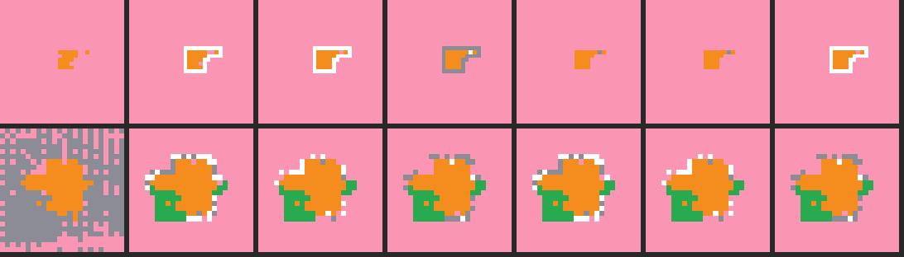

*Top: the world built straight from the field notes froze (a heat patch flickers; the rules were written from the wrong cell's point of view). Bottom: after Intern's rewrites (it also deleted a rule about parrotfish, a state that did not exist) coral recolonises the rock and seaweed takes over the heat-damaged patch — the "phase shift" the notes describe. Intern reported honestly that it narrowly missed its own activity target (185 of 192 changed cells).*


### 📰 This week's news becomes a world (Keenable)

```bash
.venv/bin/pixeldrex life --news "bird flu"
```

[Keenable](https://keenable.ai) searches the last 7 days of news on the topic and reads the top articles in full (its
keyless public endpoints; set `KEENABLE_API_KEY` to use a key). The director turns the reporting into states and rules,
and **every rule cites the articles it came from**. In the web app, tick *"Build the world from this week's news"* in
Drex Life mode and the linked headlines appear under the rules.

<p>
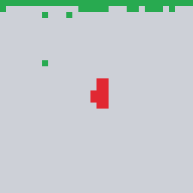
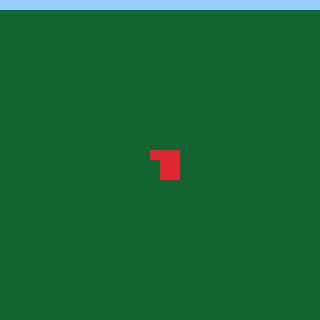
</p>

*Left, "bird flu" on Nov 14 2026: five UK reports (outbreaks near Dereham and Dersingham, a national housing order)
→ `healthy with infected neighbour becomes infected [1, 2, 3]`, `infected becomes culled [2, 3]`,
`healthy with protected neighbour becomes protected [1, 4]` → rings of infection and culling while the protected zone
spreads. Right, "wildfire": reporting on New Hampshire's Wild River Fire → `forest with a fire neighbour often becomes
fire [2, 3]`, `fire with a rain neighbour rarely becomes ash [1, 4]`.*

## Quick start

Full instructions — getting the keys, god mode, configuration, troubleshooting, Windows — are in [docs/SETUP.md](docs/SETUP.md).

```bash
python -m venv .venv && .venv/bin/pip install -e .
cp .env.example .env   # add NACE_API_KEY (console.nace.ai) and DEEPINFRA_API_KEY
.venv/bin/pixeldrex "a rocket launching at night" # a scene (the main idea)
.venv/bin/pixeldrex life "a forest fire"        # Drex Life (a fresh world)
.venv/bin/pixeldrex life --world worlds/forest-fire-cycle.json   # replay a known-good world
.venv/bin/pixeldrex-web                         # web app on http://127.0.0.1:8000
```

The web app has both modes. In **Scene** (the default) you see the director's plan, each layer as it's painted, the motion paths Drex chose, and live decision/cost counters. In **Drex Life** you can describe a new world, build one from this week's news, or **replay a saved world** (one click, known-good rules, fresh Drex decisions), and watch it evolve frame by frame as Drex decides it, with live population bars for each state, the rules, and counters for cell decisions vs unique Drex questions. Everything lands in the gallery.

## Development

```bash
.venv/bin/pip install -e ".[dev]"
.venv/bin/pytest          # offline tests: no API keys or network needed
.venv/bin/ruff check .
```

See [CONTRIBUTING.md](CONTRIBUTING.md) for guidelines.

## Project layout

```text
pixeldrex/              the package
  director.py           idea → scene spec (DeepInfra LLM)
  parts.py              sprites from part questions, poses, Drex edge smoothing (16 → 128)
  pixels.py             scene engine: background, motion (position, size, tilt, squash, pose), compositing
  life.py               Drex Life: worlds, per-situation questions, probabilistic steps
  news.py, ndi.py       worlds from this week's news (Keenable) or any document (NDI), with citations
  god.py                god mode: Intern rewrites a world's rules until it comes alive
  drex.py, llm.py       Drex and DeepInfra clients
  cli.py, web.py, web/  the `pixeldrex` commands and the web app (FastAPI + server-sent events)
worlds/                 saved worlds you can replay
tests/                  offline test suite
scripts/                Intern runner, sample-PDF maker, demo-video recording
  experiments/          the experiments behind the design (colors vs parts, 16 → 128, large images)
docs/                   setup, architecture, gallery, pitch deck, demo video, submission
intern_logs/            every Intern run: JSON events and replies
```

## License

MIT
