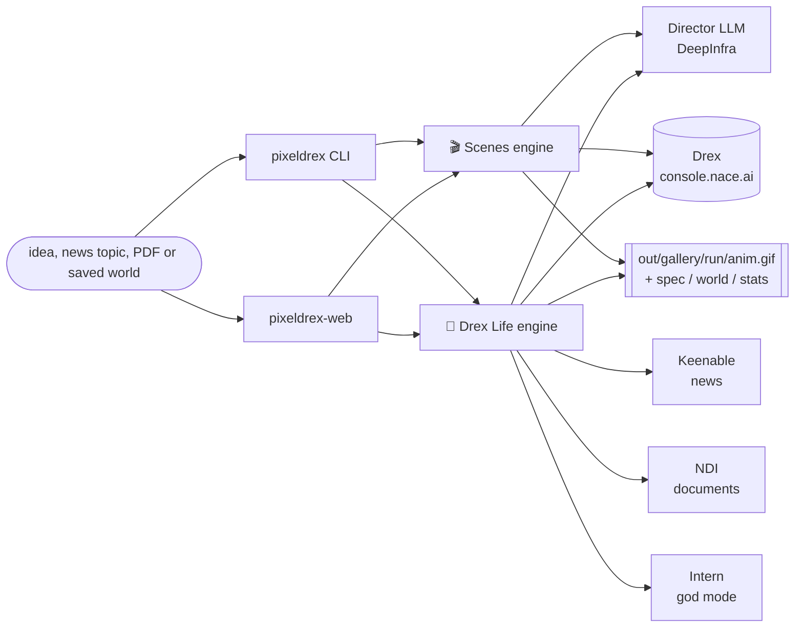
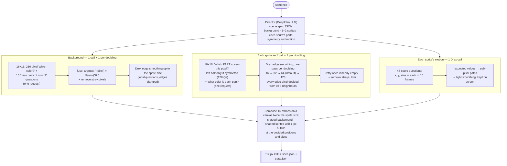
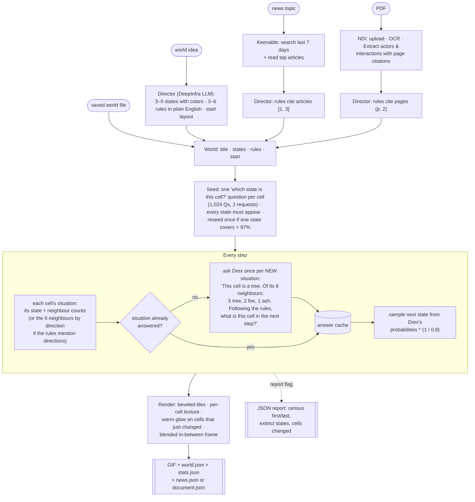
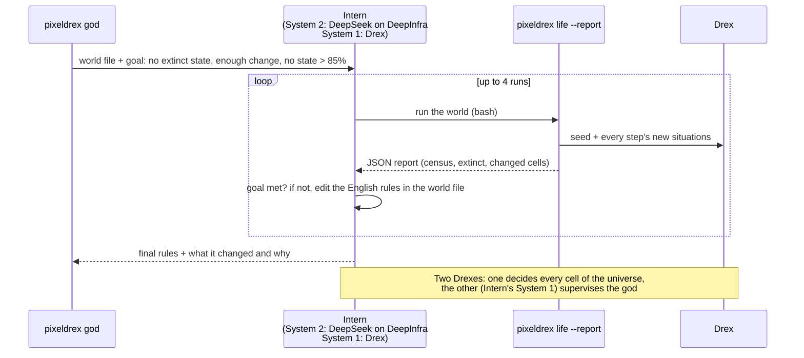

# How PixelDrex works

PixelDrex makes animated GIFs where every visual decision is made by **Drex**, Nace's decision model. Drex can't draw:
it answers typed multiple-choice questions about a piece of text (and up to 8 images) with **calibrated
probabilities**. So everything here is a question:

| Drex question type | Answer | Used for |
|---|---|---|
| `choice` — pick one label | label + probability per label | which part covers a pixel, a part's color, a cell's next state |
| `score` — place on an ordered scale | expected level (a float) + distribution | a sprite's x, y and size in every frame |
| `noul` — yes / no | probability of yes | (smoke tests) |

There are two engines that turn those answers into GIFs:

1. **🎬 Scenes — "paint it"** (the main idea): one sentence in, an animated pixel-art scene out.
2. **🧬 Drex Life — "let it live"** (the extension): a world whose laws of physics are plain English; every frame,
   every pixel asks Drex what it becomes next.

An LLM **director** (on DeepInfra) plans each GIF — what to paint, which states a world has — but it never decides a
single pixel. Drex makes every visual decision.



---

## Shared building blocks

| File | What it does |
|---|---|
| `pixeldrex/drex.py` | Async Drex client. `ask(state, questions, images)` sends one `POST /v1/systemone`; `ask_many` splits more than 512 questions into parallel requests. Caps requests in flight (8 on the free tier), retries `429` / `5xx` / `529` with backoff, and tracks calls, questions, tokens, latency and cost. Helpers `choice()`, `score()`, `noul()` build questions; `image_to_b64()` encodes images. |
| `pixeldrex/llm.py` | DeepInfra client (OpenAI-compatible): `chat()` for the directors (JSON mode), vision, and FLUX images (experiments only). |
| `pixeldrex/cli.py` | `pixeldrex`, `pixeldrex life`, `pixeldrex god`; streams progress, saves every run to `out/gallery/`. |
| `pixeldrex/web.py` + `web/index.html` | FastAPI app; runs stream to the page as server-sent events. One run at a time, so Drex stays under its in-flight limit during a live demo. |

Drex limits the design works around: **512 questions per request**, 8 images per request, 4 MiB per request,
8 requests in flight on a free account.

---

## 1. 🎬 Scenes — paint it

**In:** one sentence, e.g. *"a ufo abducting a cow at night"*.
**Out:** a 16-frame, 512 × 512 px GIF. Sprites are 16, 32, 64 (default) or 128 px (`--res`) on a canvas twice that
size.
**Cost:** at 64×64, about 7–11 Drex calls, ~10 s, ~1¢ (32×32: 5–8 calls, 5–9 s).



### The steps

1. **Director** (`director.py`) — one DeepInfra call. Turns the sentence into a `SceneSpec`: a background described as
   2–3 flat color areas, 1–2 sprites, and for each sprite its **parts** (e.g. a rocket: nose cone, body, window, fins,
   flame — each with where it sits), whether it is **left-right symmetric**, and how it **moves**. It prefers
   front-facing subjects, uses only palette colors, and turns abstract ideas into a concrete visual metaphor.
2. **Background** (`pixels.paint_background`) — one request asks all 256 pixels *"what color is the pixel at row r,
   column c?"* **and** 16 row questions *"which color covers most of row r?"*. Each pixel takes
   `argmax P(pixel color) × P(row color)^0.5`: calibrated row answers fill in areas the pixel answers are unsure about
   (a floor the pixel answers half-forgot). Stray pixels are removed, then the background goes through the same
   edge smoothing as sprites (below), treating the picture's border as continuing outward.
3. **Sprites, part by part** (`parts.paint_parts`) — the key insight. Instead of *"what color is pixel (8, 12)?"*
   (Drex is weak at exact positions and 15-way color guesses), each pixel is asked
   **"which part of the rocket covers the pixel at row 8, column 12: nose cone, body, window, fins, flame, or
   empty?"** — parts are meanings, so Drex knows a nose cone goes on top. In the same request, each part gets
   *"what color is the rocket's nose cone?"*. Symmetric sprites ask only the left half and mirror it, so a 16×16
   sprite is 128 pixel questions plus a few color questions: one request.
4. **32×32 by local questions** (`parts.smooth_upscale`) — asking about 32 rows directly got noisy, and a 16×16 guide
   image made it worse (Drex reinterpreted the shape). Instead the 16×16 sprite is enlarged to 32×32 and every
   **edge** pixel asks, with no coordinates at all: *"This pixel is currently 'body'. Around it: north nose cone,
   east empty, south body, … which should it be so every outline is smooth and natural?"* Pixels with the same
   neighbourhood share one question, so a sprite needs about one request. Symmetric sprites stay mirrored.
   The pass repeats once per doubling — 16 → 32 → 64 (the default) → 128 — each about 1 s and 1 call. Every pass
   makes edges smoother and curves rounder; the detail itself comes from the 16×16 part layout.
5. **Safety** — a sprite that comes out less than 12% filled is repainted once as a symmetric front view; stray pixels
   (fewer than 2 same-part neighbours) are removed; empty margins are trimmed.
6. **Motion** (`pixels.motion`) — one request per sprite with 3 × 16 `score` questions: *"where is the center of the
   rocket horizontally in frame 5 of 16?"* (11 position levels), the same for vertical, and *"how big is it?"*
   (5 size levels described as fractions of the canvas). Scores are **expected values**, so positions come out as
   smooth fractions — the rocket rising *and shrinking with distance* was Drex's own decision. Paths get a light
   3-tap smoothing and are kept at least ~90% on screen.
7. **Compose** (`pixels.compose`) — for each frame: the background with pixel-art shading (lit top edges, shadowed
   bottom edges), then each sprite resized to its decided size, shaded per part (lit top-left, shadowed bottom-right)
   with a 1-px dark outline, pasted at its decided position. Frames are scaled ×8 to 512 px and saved as a GIF.

### Calls for one scene

| Step | Drex calls | Questions (typical) |
|---|---|---|
| Director | 0 (1 DeepInfra call) | — |
| Background 16×16 + smoothing | 1 + 1 per doubling (2 at 32, 3 at 64, 4 at 128) | 272 + unique edge situations |
| Each sprite: 16×16 parts + smoothing | 1 + 1 per doubling (+ a retry if nearly empty) | ~130 + unique edge situations |
| Each sprite's motion | 1 | 48 |
| **Total, 2 sprites at 32 / 64 / 128** | **8 / 11 / 14** | ~1,050 / ~1,350 / ~1,300 |

### Files

| File | Role |
|---|---|
| `pixeldrex/director.py` | idea → `SceneSpec` (title, scene, background, sprites with parts / symmetric / motion) |
| `pixeldrex/parts.py` | `paint_parts` (part questions + colors), `smooth_upscale` (local edge questions), `paint_parts_res` (16 → 32 → 64 → 128), `tidy`, shading and outline rendering |
| `pixeldrex/pixels.py` | `paint_background` (pixel × row fusion), `motion` (score questions), `compose`, `shade_background`, `scene_gif` (orchestrates everything in parallel), plus the earlier color-per-pixel painter kept for comparison |
| `scripts/experiments/parts_test.py`, `parts32_test.py`, `parts_res_test.py` | the experiments behind the design (color vs parts, 16 vs 32, the 16 → 128 ladder) |

### Known limits

- Side-view subjects (a running cat, a jumping whale) come out blobby: symmetry and "which part" both work best for
  front views. The director prefers front views for this reason.
- Large, detailed images painted pixel by pixel don't work — plain downscaling beat it (`scripts/experiments/big.py`,
  `scripts/experiments/ref_test.py`, [result](gallery/large_image_experiment.png)). PixelDrex sticks to small iconic sprites.

---

## 2. 🧬 Drex Life — let it live

**In:** a world idea, this week's news on a topic, a PDF, or a saved world.
**Out:** a 32 × 32 grid animated for 40 steps (81 frames with in-between frames), 320 × 320 px.
**Cost:** a 40-step world is ~42,000 cell decisions from ~1,000–2,000 unique Drex questions, 15–30 s, ~1–2¢.



### The steps

1. **A world** (`life.World`) is a title, 3–5 **states** (each a palette color and a meaning), 3–6 **rules in plain
   English**, and a starting layout. It comes from:
   - **the world director** (`life.design_world`): rules are about a cell and its neighbours; spreading and recovery
     are written as chances (*"often catches fire"*, *"sometimes regrows"*); every state has a way back so the world
     keeps cycling; movement is always written as two rules (the cell left and the cell entered), because all cells
     update at once;
   - **this week's news** (`news.py`): Keenable searches the last 7 days and reads the top articles; each rule ends
     with the articles it came from, e.g. `healthy with infected neighbour becomes infected [1, 2, 3]`;
   - **a document** (`ndi.py`): NDI uploads (or links) the PDF, OCRs scanned pages, and Extract fills a schema of
     *actors* and *interactions* with page citations; each rule ends with its page, e.g.
     `coral with warm neighbour becomes bleached (p. 1)`;
   - **a saved world** (`worlds/*.json`) — known-good rules, replayed with fresh Drex decisions.
2. **Seed** (`life.seed`) — Drex places the starting layout: one `choice` question per cell (*"at the start, which
   state is the cell at row r, column c?"*), 1,024 questions in two requests. Every state must appear; if one state
   still covers more than 97% of the grid, it reseeds once with a stronger hint.
3. **Step** (`Life.step`) — every cell needs a next state, but Drex is asked **once per unique situation**, not once
   per cell. A situation is the cell's state plus how many of each state surround it — or, if the rules mention
   directions (*falls*, *north*, *wind*), the 8 neighbours by direction. Answers are **cached across steps**, so the
   world *learns its physics* from Drex: the forest fire made 17,280 cell decisions from 191 questions, and by the end
   each step needed about one new question.
4. **Sample** — the next state is drawn from Drex's calibrated probabilities, sharpened slightly (temperature 0.8).
   *"Lightning rarely strikes"* and *"ash slowly regrows"* really are rare and slow: the randomness in the world is
   Drex's own uncertainty.
5. **Render** (`Life.image`) — Drex decides every state; the renderer only decides how a state looks: beveled tiles,
   a ±6% per-cell texture, a warm glow on cells that changed in the last 2 steps (fire fronts and infection waves
   light up), and a 50/50 blended frame between steps. Each run also records a per-step census and changed-cell count
   for the `--report`.

### God mode — Intern rewrites the laws of physics



`god.py` launches Intern headless (`intern -p --json`) with a task prompt, streams its events (commands it runs,
rules it rewrites, System 1 nudges), and collects every world report. Rules that came from a document keep their
`(p. N)` citation; rules Intern invents are tagged `(god)`. Full logs are in `intern_logs/`.

### Files

| File | Role |
|---|---|
| `pixeldrex/life.py` | `World`, `design_world` (director), `seed`, `situation` / `_question` (the per-situation question), `Life.step` (cache + sampling), `Life.image` (rendering), `run_life` |
| `pixeldrex/news.py` | Keenable search + fetch → a world whose rules cite articles |
| `pixeldrex/ndi.py` | NDI upload / URL → Extract with citations → a world whose rules cite pages |
| `pixeldrex/god.py` | god mode: Intern as the world's god |
| `worlds/*.json` | saved worlds (replay with `--world` or the web app's replay buttons) |
| `scripts/intern.sh`, `scripts/intern_log.py` | run Intern headless on this repo and log it |

### Known limits

- Worlds are designed fresh each run, so results vary: some freeze, burn out or turn to noise. Replay a saved world
  for a reliable demo.
- Some idea types don't suit a grid (rock-paper-scissors came out as noise; falling sand needs the two-rule movement
  pattern and a good starting pile).

---

## Interfaces

### Command line

| Command | Engine |
|---|---|
| `pixeldrex "idea" [--res 16\|32\|64\|128] [--frames N] [--ms N] [--spec FILE] [--spec-only] [--json]` | Scenes |
| `pixeldrex life "idea" \| --world F \| --news TOPIC \| --doc PDF [--size N] [--steps N] [--temp T] [--report] [--save-world F]` | Drex Life |
| `pixeldrex god "idea" \| --world F [--max-runs N]` | Drex Life + Intern |
| `pixeldrex-web` | both, in the browser |

### Web app (`pixeldrex/web.py`)

| Endpoint | What |
|---|---|
| `GET /` | the page (Scene and Drex Life tabs) |
| `GET /api/paint?idea=…&res=64` | runs a scene; server-sent events: `spec`, `background`, `sprite`, `motion`, `done`, `result`, `error` (each with running Drex usage) |
| `GET /api/life?idea=… \| news=1 \| world=name` | runs a world; events: `world`, `sources` (news), `frame` (PNG + census per step), `result`, `error` |
| `GET /api/worlds` | saved worlds that can be replayed |
| `GET /api/gallery` | past runs |
| `GET /files/<run>/anim.gif` | gallery files |

### Outputs

Every run writes `out/gallery/<time>-<title>/`: `anim.gif`, `stats.json` (decisions, calls, seconds, cost, motion
tracks or the Life report), and `spec.json` (scenes) or `world.json` (Life), plus `sheet.png`, `sprite*.png` and
`background.png` for scenes, and `news.json` / `document.json` for cited worlds.

## Repo map

```text
pixeldrex/          the package
  drex.py           Drex client                 llm.py      DeepInfra client
  director.py       scene director              parts.py    part-based sprites + Drex edge smoothing
  pixels.py         scene engine                life.py     Drex Life engine
  news.py           Keenable worlds             ndi.py      NDI document worlds
  god.py            Intern god mode             cli.py      the commands
  web.py, web/      the web app
worlds/             saved worlds
tests/              offline test suite (no API keys needed)
scripts/            Intern runner, sample-PDF maker, demo-video recording and stitching
  experiments/      the experiments behind the design (colors vs parts, 16 → 128, large images)
intern_logs/        every Intern run
docs/               SETUP, ARCHITECTURE, SUBMISSION, deck, video, gallery, sample PDF
```
