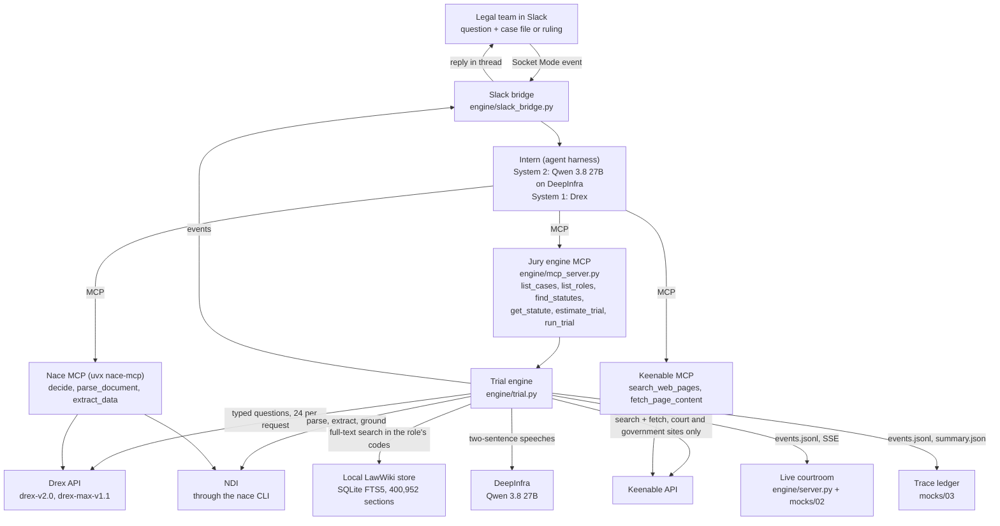

# Architecture

The Slack bridge and the pages send a request through Intern when it is installed and its keys are set (`engine/intern_runner.py`); otherwise, or when Intern stops before the trial, they call the trial engine directly and say so.

## How one Intern run stays visible

Intern waits for `run_trial` to return, so its own output says nothing while the jurors vote. Three files in the session folder (`runs/<stamp>-intern/`) close that gap:

| File | Written by | Read by |
|---|---|---|
| `trial_run_id` | jury MCP server, the moment the trial starts | the runner, which then follows `runs/<run_id>/events.jsonl` line by line |
| `mcp_calls.jsonl` | jury MCP server, one line per tool call (name, plain arguments, time, ok) | the runner: the record of what Intern really called |
| `stream.jsonl` | the runner | Slack bridge, page streams, trace ledger (`GET /api/run`): Intern's steps, tool calls and the trial's events in one numbered trace |

Intern's own lines are kept whole in `intern.jsonl` with key values masked. The runner starts Intern in the empty session folder, not in the repository, and passes keys only through the environment.

## One trial, in order

| Step | Module | Decided by | Requests |
|---|---|---|---|
| Read the upload | `engine/ndi.py` | NDI (fields, page citations); Drex Max checks a photo is legible | NDI job |
| Intake | `engine/trial.py::_intake` | Drex: who asks, jurisdiction, claim type, practice group and area | 1 |
| Legal team | `engine/roles.py` | Case setting, else Drex's pick, else the caller's override. Sets the juror question, the standard of proof, the statute scope and the 5 next-step options | 0 |
| Statutes | `engine/lawstore.py`, `_statutes` | Store ranks sections inside the team's codes; Drex scores each candidate | 1 |
| Public guide | `engine/keenable.py`, `_web` | Code: https and a court or government host. Drex: on point? instructions for an agent? | 1 |
| Four phases | `_run` | Drex: next argument, objection, argument strength, 12 juror votes | 4 per phase |
| What-if | `_what_if` | Drex: 12 votes for each of 5 flipped facts | 5 |
| Next step | `_next_steps` | Drex: one of the team's 5 steps; is a needed document missing? | 1 |

About 182 decisions in 28 requests and 71,000 input tokens per trial; the case brief is billed once per request.

## Rules the design keeps

- Decisions come only from Drex. Language models write short speeches from an argument that is already chosen, and code checks the speech (length, no new numbers).
- Counts do not depend on answers: the same questions are asked whatever Drex says, so `--estimate` matches the live run.
- Untrusted input stays out of the jurors' state until checked: an uploaded photo (legibility), a web page (host check in code, two Drex checks, 1,200 characters at most, labelled "not law").
- Keys live only in `.env` (git-ignored, mode 600) and in the child process environment. Requests that carry a key go only to `nace.ai` hosts and never follow a redirect to another site.
- A low-confidence answer is flagged for a person; the run reports how many (33 of 182 in the reference run).
- Every run is replayable: each request and response is saved under `runs/<run_id>/requests/`.
