# VICE EXCHANGE

> **The game is our own.** VICE EXCHANGE is an original game: our own city (Coral Bay, in 2D and 3D in the browser), our own authoritative server, market, agents and rules, with nothing to install. Separately, the repo contains an optional extra client that connects the open-source, MIT-licensed project Open Theft Auto to the same server (`integrations/ota-bridge`); it is not needed to play or judge the game, and its code and assets are not included here.

VICE EXCHANGE is a trading floor inside an original neon city, Coral Bay, where every agent thinks for itself.
Nine agents decide with a real Nace Drex `choice` call built only from their own private memory: two witnesses, two
informants, two traders, two police officers, and a fugitive, Ryder, who plays the outlaw by himself. Every outlaw is a
tradable fictional ticker whose value and bounty grow the longer it survives. The other agents report it, sell what
they know, trade it and hunt it; capture sets the ticker to exactly V$0. Humans can join as outlaws, as hunters (alone
or in a crew) or as spectators. It was built for the Nace AI Drexathon, Swarm Intelligence track: "Build systems where
multiple agents coordinate, compete, or negotiate, with Drex making every agent's calls." The pitch, mapped to those
words, is in [`docs/PITCH.md`](docs/PITCH.md).

**V$ are fictional, nonredeemable game credits. There is no real money, no cash-out and no payment code anywhere in this repository.**

More documentation: [`docs/DEMO_SCRIPT.md`](docs/DEMO_SCRIPT.md) (the five-minute live demo),
[`docs/ARCHITECTURE.md`](docs/ARCHITECTURE.md) (diagrams, events, commands, state machines, security, honesty rules)
and [`docs/spec/`](docs/spec/) (the three draft spec documents this build started from, unchanged).

How to read this file: it states what the code does today and what a test or a run proves. It was written on
2026-11-14 while the repository was still changing; the last check against the working tree was at about
13:40 PST. "Live run for this document" means a run made by the documentation author on that day against a
private server on a spare port, with the real keys from `.env`. Each such run is one observation on one machine.

## What works today

Status values: **verified by automated test**, **verified by a live run**, **implemented but unverified**, **not built**.

| Feature | Status | Evidence |
|---|---|---|
| Several browsers share one authoritative room: join, synchronized movement, one ordered event log | Verified by automated test and by a live run | `apps/server/test/socket.test.ts`; two Chrome pages in the demo rehearsal (`docs/DEMO_SCRIPT.md`) |
| Eight NPCs in four roles with stable ids; one open job at a time | Verified by automated test | `apps/server/test/acceptance.test.ts` ("seeded room") |
| A job completes exactly once and raises notoriety and reference value (AT-01) | Verified by automated test and by a live run | `acceptance.test.ts` AT-01; rehearsal: V$106 -> V$194 on the job |
| Private NPC memory; knowledge spreads only by message, with source and hop count (AT-02) | Verified by automated test and by a live run | `acceptance.test.ts` AT-02, `apps/server/src/agents/brains.test.ts`; live two-hop chain witness -> informant -> trader |
| Perception needs 14 m and line of sight | Verified by automated test | `acceptance.test.ts` (FR-011) |
| Real Drex decisions with probabilities, confidence, request id and latency (AT-03) | Verified by a live run | `cd apps/server && npx tsx src/decisions/liveSmoke.ts`; about 80 live Drex decisions across the runs for this document. No automated test calls the real API. |
| Meta model API as a labeled LLM baseline | Verified by a live run | Same command; experiment and shadow runs |
| Low-confidence guardrail keeps Drex's numbers and applies the safe action | Verified by automated test; seen once in a live run | `apps/server/src/decisions/scheduler.test.ts`; one live decision with confidence 0.05 was labeled "DREX unsure -> safe action" |
| Provider failure becomes a labeled fallback and the room keeps running (AT-07) | Verified by automated test | `acceptance.test.ts` AT-07, `scheduler.test.ts` (timeout, 429, circuit breaker, budget). Not exercised against a real provider outage for this document. |
| A decision that arrives after the world moved on is rejected (FR-025) | Verified by automated test; seen in a live run | `acceptance.test.ts`; live: an informant's `relay` and an officer's `pursue` were rejected with "subject was captured before the decision arrived" |
| Market: price formula, one-share orders, cooldown, position cap, no partial mutation (AT-04) | Verified by automated test | `apps/server/src/economy/economy.test.ts`, `acceptance.test.ts` AT-04 |
| NPC orders use the same settlement path as human orders | Verified by automated test and by a live run | `acceptance.test.ts` (FR-036); live trader buys at V$95 and V$134 |
| Capture is atomic, the ticker is exactly V$0, the bounty is paid once (AT-05) | Verified by automated test and by a live run | `acceptance.test.ts` AT-05; live: hunter bounty V$98, V$103 and V$105 in three runs, a replayed command returned `duplicate: true` |
| Police NPCs capture through their own Drex decisions | Verified by a live run | Capture 24.8 s after the job by an officer that chose `pursue` |
| Respawn gives a new character and ticker; the old listing stays halted with its history (AT-06) | Verified by automated test and by a live run | `acceptance.test.ts` AT-06; live: `ACE-02` at V$95 beside `ACE-01` halted at V$0 |
| Escape: heat decays, the character is no longer wanted | Verified by a live run | Escape 59.8 s after the job while hidden; price V$163 -> V$168 |
| Seeded reset (FR-060) | Verified by automated test | `acceptance.test.ts`, `socket.test.ts` |
| Replay: folding the stored log, with no model call, reproduces wallets, listings and outcomes (AT-08) | Verified by automated test and by a live run | `apps/server/src/persistence/store.test.ts`, `acceptance.test.ts`; `/replay/verify` returned `ok: true` in six live rooms; `npm run replay -- VICE-64` |
| Causal chain from job to trade and to capture (FR-061) | Verified by automated test and by a live run | `acceptance.test.ts`, `apps/server/test/causality.test.ts`; 21 linked rows highlighted in the timeline |
| Scheduler: bounded concurrency, queue cap, per-minute budget, deadline, circuit breaker | Verified by automated test | `scheduler.test.ts` |
| Director rights, session re-attach, nickname reclaim, 8 humans per room, 8 rooms | Verified by automated test | `apps/server/test/rooms.test.ts` |
| Command validation, origin allow-list | Verified by automated test | `socket.test.ts`, `apps/server/test/commandSchema.test.ts` |
| Per-socket rate limit (40 commands a second) | Implemented but unverified | `apps/server/src/transport/socket.ts`; no test sends that many |
| Three-mode experiment: scripted, Meta, Drex | Verified by a live run | `cd apps/server && URL=http://localhost:3001 npx tsx test/liveExperiment.ts 45` |
| Background Meta comparison for each live Drex decision (shadow) | Verified by automated test and by a live run | `apps/server/test/shadow.test.ts`; 7 of 8 and 5 of 5 agreement in two live rooms |
| NDI grounding: nine quoted rules from a real police order in every police decision | Verified by automated test and by a live run | `apps/server/src/policy/*.test.ts`; `npm run ndi:ingest`; live police decisions carried 9 citations |
| Browser UI: 3D city, 2D city, market, agent inspector, event timeline, swarm graph, decision cards, ticker tape, crash sequence, director panel | Verified by a live run | Screenshots from the demo rehearsal in headless Chrome. The 3D view rendered there on the second attempt; an earlier attempt during development fell back to the 2D map, which is the designed behaviour on failure. |
| WORLD view: the Godot client embedded in the browser, joined as the page's own player | Seen in a headless run | `apps/web/src/components/WorldFrame.tsx`, `apps/server/test/companion.test.ts`. Needs a local Web export (356 MB, not in the repository); first load 38 s, 7 to 17 fps measured under heavy load; never run in a real Chrome window; mouse look unconfirmed |
| Godot world client (native) | Verified by a live run, headless only | `godot --headless --path integrations/open-theft-auto -- --vice-check ...` printed `VICE_BRIDGE_OK`; windowed play was captured by its author in `integrations/ota-bridge/frames/` and was not run for this document |
| Fugitive agent "Ryder": a Drex-driven outlaw with its own ticker that thinks every 6 s (`do_job`, `lay_low`, `flee`, `fire`), acts through the same commands as a human and respawns 12 s after capture | Verified by automated test; present in the live room (`RYD-02` listed at 13:56); a full live hunt not yet watched | `apps/server/src/demo/Fugitive.ts`, `apps/server/test/fugitive.test.ts` (8 tests); `FUGITIVE=0` turns it off |
| 3D camera: drag to orbit, scroll to zoom, `C` presets, `V` reset; WASD follows the camera | Seen in a real run | Direction error 0 degrees at six camera angles, measured from the server snapshot; right-drag and pinch not driven |
| Parked cars are solid: 26 cars shared by server, 3D and 2D; players slide along them, NPCs route around them | Verified by automated test and seen in a real run | `apps/server/test/cars.test.ts` (12 tests); 3D run stopped at the car edge. Moving traffic is scenery |
| Stun pulse (`F`): 6 charges, 16 m, 3 s stun, no damage; an outlaw's shot adds heat and is witnessed by NPCs | Verified by automated test; hunter stunning an outlaw seen in a real 2D run | `apps/server/test/weapon.test.ts` (10 tests). Outlaw firing back, stun-then-capture and the 3D tracer: not yet seen in a browser |
| Hunter crews: join by HUD field or `&crew=NAME`, up to 4; bounty split among crewmates within 25 m; stunning a crewmate and capturing within 12 s is a double-cross | Verified by automated test; joining seen in a real run | `apps/server/test/crew.test.ts`. The split and the double-cross: not yet seen in a browser |
| Traders decide on a ticker when a crew forms against it; an outlaw's gunfire travels as "Shots fired" in gossip and relays | Verified by automated test | `apps/server/test/crew-swarm.test.ts`. Not yet seen in a browser |
| Informant side deals: `sell_to_crew` or `warn_outlaw` for a V$40 fee, with a recorded side switch | Verified by automated test | `apps/server/test/crew-swarm.test.ts`. Tips are ordinary room events, not private; the fee is a counter, not wallet credits. Not yet seen in a browser |
| Godot world: left mouse fires the stun pulse, `F` takes a car or boards a helicopter parked in the district | Seen in real runs with two Godot clients | Stills and a 22 s clip in `integrations/ota-bridge/frames/`. Shots were sent through the trigger's function by a test driver; altitude is not sent to the server; crews are ignored |
| UDP stream for the native Godot client: poses up and world state down at 30 Hz on port 3002, WebSocket for everything reliable | Verified by automated test and by a headless client | `apps/server/test/udp.test.ts` (8 tests); 29 Hz received, 0% loss. Smoothness not compared in a window; the browser WORLD view stays on WebSocket |
| Demo videos with narration | In the repository; being re-recorded | `demo/vice-exchange-demo.mp4` (3:00) and `demo/vice-exchange-npcs.mp4` (0:53) are the first cut: 2D footage at 3 to 6 fps with a synthetic voice. See `demo/README.md` |
| End-to-end harness in three Chrome contexts with live providers | Verified by a live run, with failures | `npm run e2e`; see "End-to-end report" below |
| Persistent rooms across a server restart, accounts, matchmaking, cloud deployment | Not built | A restart starts a fresh `VICE-42`; logs of earlier runs stay in SQLite |
| Pre-recorded fallback video (spec section 9) | In the repository | `demo/` (two narrated cuts) and `integrations/ota-bridge/frames/*.mp4` (two 3D world clips) |

### End-to-end report

`e2e/out/report.json` is overwritten by every `npm run e2e`. The harness and the product were both changing
while this file was written, and three reports read during that time gave three different results:

| Report started (UTC) | Checks passed | Failed or blocked |
|---|---|---|
| 20:59:42 | 76 of 79 | `S02.socket-building` (a pose inside a building was accepted), `S05.inspector` (the click on the map did not select the NPC; the inspector content itself was correct), `S10.store` |
| 21:04 (cited by the build lead, not read for this document) | all 12 scenario steps passed | one extra socket-level check, `SX.pose-into-building` |
| 21:11:34 | 69 of 74 | `S02.pixels`, `S07.capture` (no officer came within sight of the staged outlaw in 60 s, so it never became wanted), `S08.respawn` (blocked by S07), `S11.ui`, `S12.captures` |
| 21:30 | 11 of 13 scenario steps | `S03.socket-idempotent` (failed on the provider-failure instance) and `S07.socket-concurrent` (blocked: the scripted hunters' test moves were rejected as too fast). 12 live decisions: 10 Drex, 2 guardrail, 0 fallback; Drex median 355 ms; shadow 12 of 12 agreed, Meta median 722 ms |

Measured in the 21:11 run: 9 live Drex decisions across all four roles, median round trip 341 ms; shadow
comparison 10 of 10 in agreement, medians 341 ms for Drex and 715 ms for Meta. Read the current file before you
quote it.

## Quick start

Prerequisites:

- Node.js 22.13 or later. `package.json` declares `"node": ">=22.13"` because persistence uses the built-in
  `node:sqlite`. Everything in this document was run on Node 26.13.0 with npm 11.20.0 on macOS; older versions in
  the allowed range were not tried.
- Google Chrome for the browser client.
- A Nace API key for live Drex. A Meta model API key is optional.

```bash
npm install
cp .env.example .env
# edit .env: set NACE_API_KEY, and META_API_KEY if you have one
npm run dev
```

`npm run dev` starts the game server on port 3001 and the web app on port 5173. Open `http://localhost:5173`.

Variables read from `.env` (names only; the values never leave the server):

| Variable | Meaning | Default |
|---|---|---|
| `NACE_API_KEY` | Nace key for Drex and NDI. Without it the room starts in scripted mode and says so. | empty |
| `NACE_DEFAULT_DECISION_MODEL` | Drex model alias | `drex-latest` |
| `META_API_KEY` | Meta model API key (`LLAMA_API_KEY` is accepted as an alias) | empty |
| `META_BASE_URL` | Meta API base URL | `https://api.meta.ai/v1` |
| `META_DECISION_MODEL` (or `META_MODEL`) | Meta model | `muse-ember-1.0` |
| `SHADOW_META` | In Drex mode also ask Meta in the background, never applied. Acts only when both keys exist. | on |
| `PORT` | Server port | `3001` |
| `WEB_ORIGIN` | Extra browser origin allowed to connect | `http://localhost:5173` |
| `DATABASE_URL` | SQLite file, or `:memory:` | `./data/vice-exchange.sqlite` |
| `GAME_TICK_HZ` | World tick rate | `10` |
| `NPC_DECISION_CONCURRENCY` | Provider calls in flight per room | `4` |
| `MAX_DECISION_CALLS_PER_MIN` | Provider call budget per room and provider | `30` in code, `60` in `.env.example` |
| `DEMO_DIRECTOR_SECRET` | Grants director controls to a join that presents it. Empty: the server prints a per-run secret at boot. | empty |

The web dev server also reads `VICE_SERVER` (proxy target, default `http://localhost:3001`).

### Deep links

The join screen reads these query parameters:

| Parameter | Effect |
|---|---|
| `nick` | Nickname, up to 16 characters |
| `role` | `OUTLAW`, `HUNTER` or `SPECTATOR` |
| `room` | Room code. The server creates `VICE-42` at boot. |
| `auto=1` | Join without clicking (needs `nick`) |
| `create=1` | With `auto=1`: create a new private room instead of joining |
| `view` | `3d` (the default), `2d` or `world` |

```text
http://localhost:5173/?nick=Ace&role=OUTLAW&room=VICE-42&auto=1
```

### Two players

On one machine, open two browser windows. Each tab keeps its own session.

```text
http://localhost:5173/?nick=Ace&role=OUTLAW&room=VICE-42&auto=1
http://localhost:5173/?nick=Hawk&role=HUNTER&room=VICE-42&auto=1
```

From a second laptop on the same network, replace `localhost` with the network address Vite prints when it
starts (for example `http://192.168.0.126:5173/`). The second laptop talks only to that address; Vite forwards
to the game server.

Controls: W A S D or the arrow keys move. E does the job at the marker (outlaw) or captures a wanted outlaw
within 2.5 m (hunter). R respawns after a capture. In the 3D view the keys are relative to the camera.

### Demo-director controls

Seeded reset, incident trigger, mode switch and experiment are director commands. A player is the director when
one of these is true:

- it is the first browser **on the server's own machine** to join `VICE-42` (the page must be opened through `localhost`);
- it created the room ("Create new room" or `create=1`);
- it entered the director secret under "Demo director secret (optional)" on the join form. The secret is
  `DEMO_DIRECTOR_SECRET`; when that is empty the server prints one for the run in its console.

Running the experiment additionally needs the secret or the server's own machine, because it spends real provider budget.

## npm scripts

Run from the repository root. "Checked" says what was done for this document.

| Command | What it does | Checked |
|---|---|---|
| `npm install` | Installs all three workspaces | Not run (dependencies were already installed) |
| `npm run dev` | Server in watch mode and web app together, through `concurrently` | Not run as one command: ports 3001 and 5173 were in use by other processes. Its two halves were run separately on spare ports. |
| `npm run dev:server` | Server in watch mode (`tsx watch`) | Run on a spare port: `PORT=3478 DATABASE_URL=:memory: npm run dev:server`; `/health` answered |
| `npm run dev:web` | Vite dev server | Run on a spare port: `VICE_SERVER=http://localhost:3477 npm run dev:web -- -- --port 5477`; the page and the proxied `/health` answered |
| `npm run start:server` | Server without watch mode | Run on a spare port; used for every live run in this document |
| `npm run typecheck` | `tsc --noEmit` in every workspace | Run: exit code 0 for contracts, server and web |
| `npm test` | Server test suite (vitest) | Run at 13:57: 247 tests in 24 files, all passed |
| `npm run build` | Production build of the web app | Run with the output redirected to a scratch folder: built in 3.6 s, with Vite's warning that two chunks exceed 500 kB |
| `npm run replay` | Lists recorded runs. `npm run replay -- <roomCode or roomId> [runId]` prints a run rebuilt from SQLite. | Both forms run against a scratch database: "57 events, 8 recorded decisions, 0 model calls made" |
| `npm run ndi:ingest` | Runs the policy ingestion once and prints the document, the NDI job ids and the facts. `-- --force` pays for new jobs, `-- --json` prints JSON, `-- --no-color` prints plain text. | Run without `--force`: cache hit, no NDI call, 3 ms |
| `npm run e2e` | End-to-end harness: its own server and web server, three Chrome contexts, writes `e2e/out/` | Not run for this document (it was being run by its author on its own ports); its reports are cited above |

Workspace-only scripts: `npm run preview -w @vice/web` (Vite preview of a build) was not run.

Manual live checks (real provider calls):

```bash
cd apps/server
npx tsx src/decisions/liveSmoke.ts                      # one Drex and one Meta decision through the scheduler
URL=http://localhost:3001 npx tsx test/liveClient.ts 25  # a private room: job, buy, 25 s of swarm, replay verify
URL=http://localhost:3001 npx tsx test/liveExperiment.ts 45
```

To run a second server beside a running one:

```bash
PORT=3301 DATABASE_URL=:memory: npm run start:server
```

## How the swarm works

```mermaid
%%{init: {"theme": "base", "themeVariables": {"fontFamily": "ui-sans-serif, system-ui, sans-serif", "fontSize": "14px", "primaryColor": "#140a33", "primaryTextColor": "#f6f1ff", "primaryBorderColor": "#c77dff", "lineColor": "#c77dff", "clusterBkg": "#07041a", "clusterBorder": "#4cc9f0", "titleColor": "#f6f1ff", "edgeLabelBackground": "#07041a", "tertiaryColor": "#07041a"}}}%%
flowchart LR
  O(["OUTLAW, a human<br/>one tradable ticker"])

  subgraph WIT["WITNESSES choose: report, gossip, ignore"]
    direction TB
    W1["Marisol Vega<br/>dock fisher, trusts the police"]
    W2["Otis Brandt<br/>plaza vendor, distrusts the police"]
  end
  subgraph INF["INFORMANTS choose: relay, withhold"]
    direction TB
    I1["Lena Okoye<br/>sells tips for a cut"]
    I2["Dex Marlowe<br/>relays only what he believes"]
  end
  subgraph TRA["TRADERS choose: buy, sell, hold"]
    direction TB
    T1["Priya Castellan<br/>momentum, risk-seeking"]
    T2["Rook Halvorsen<br/>risk-averse"]
  end
  subgraph POL["POLICE choose: investigate, patrol, pursue"]
    direction TB
    P1["Sgt. Imani Duarte<br/>by the book"]
    P2["Ofc. Cole Renner<br/>aggressive"]
  end
  X(["THE EXCHANGE<br/>server-side house counterparty"])

  O -. "seen within 14 m<br/>with line of sight" .-> WIT
  W1 -- "gossip, hop 1" --> I1
  W2 -- "gossip, hop 1" --> I2
  I1 -- "relay, hop 2" --> T1
  I1 -- "relay, hop 2" --> T2
  I2 -- "relay, hop 2" --> T2
  WIT == "report to the nearest officer" ==> POL
  POL == "wanted bulletin, to every NPC" ==> TRA
  TRA -- "one-share orders" --> X
  X -. "price of the ticker" .-> O
  POL -- "pursue and capture: ticker to V$0" --> O

  classDef human fill:#3a0a2a,stroke:#ff5fa2,stroke-width:3px,color:#fff0f7;
  classDef wit fill:#3a2a06,stroke:#ffd166,stroke-width:2px,color:#fff8e1;
  classDef inf fill:#2a0f45,stroke:#c77dff,stroke-width:2px,color:#f6f1ff;
  classDef tra fill:#06302a,stroke:#5dfdcb,stroke-width:2px,color:#eafff9;
  classDef pol fill:#06243a,stroke:#4cc9f0,stroke-width:2px,color:#e9fbff;
  classDef exch fill:#07041a,stroke:#5dfdcb,stroke-width:3px,color:#eafff9;
  class O human;
  class W1,W2 wit;
  class I1,I2 inf;
  class T1,T2 tra;
  class P1,P2 pol;
  class X exch;
  style WIT fill:#1a1303,stroke:#ffd166,stroke-width:2px,color:#fff8e1
  style INF fill:#150826,stroke:#c77dff,stroke-width:2px,color:#f6f1ff
  style TRA fill:#031a17,stroke:#5dfdcb,stroke-width:2px,color:#eafff9
  style POL fill:#04131f,stroke:#4cc9f0,stroke-width:2px,color:#e9fbff
```



### The roster

The roster is fixed (`apps/server/src/demo/seedScenario.ts`). Positions are in metres on a 120 x 80 map.

| Id | Name | Role | Where | Persona | Tells |
|---|---|---|---|---|---|
| `npc_w1` | Marisol Vega | Witness | (40, 64), the marina | Dock fisher, civic-minded, trusts the police | Lena Okoye |
| `npc_w2` | Otis Brandt | Witness | (55, 45), Neon Plaza | Plaza vendor, distrusts police, loves to gossip | Dex Marlowe |
| `npc_i1` | Lena Okoye | Informant | (33, 52) | Sells tips to traders for a cut | Priya Castellan, Rook Halvorsen |
| `npc_i2` | Dex Marlowe | Informant | (62, 30) | Cautious, relays only what he believes | Rook Halvorsen |
| `npc_t1` | Priya Castellan | Trader, V$2,000 | (17, 31) | Momentum trader, risk-seeking | nobody |
| `npc_t2` | Rook Halvorsen | Trader, V$2,000 | (30, 41) | Risk-averse, sells on bad news | nobody |
| `npc_p1` | Sgt. Imani Duarte | Police | patrols (32..62, 28..44) | By the book | nobody |
| `npc_p2` | Ofc. Cole Renner | Police | patrols (77..92, 28..44) | Aggressive | nobody |

Both patrols stay north of the marina on purpose, so the police learn about the first job from the witness and
not by walking past it.

### What each role can choose

The server offers only the actions that are legal at that moment (`apps/server/src/agents/roles.ts`).

| Role | Options | Offered only when | Scripted rule | Safe action (fallback, guardrail) |
|---|---|---|---|---|
| Witness | `report`, `ignore`, `gossip` | `gossip` needs an informant contact | `report` | `ignore` |
| Informant | `relay`, `withhold` | always both | `relay` | `withhold` |
| Trader | `hold`, `buy`, `sell` | `buy` needs room under the 10-share cap and enough credits; `sell` needs at least one share | `hold` | `hold` |
| Police | `investigate`, `patrol`, `pursue` | `pursue` needs the officer's own direct sighting, at most 10 s old | `pursue` with a sighting, otherwise `investigate` | `patrol` |

What an action does: `report` sends a REPORT message to the nearest officer. `gossip` sends a GOSSIP message to
the witness's informant contact. `relay` sends a RELAY message to each of the informant's trader contacts.
`buy` and `sell` place a one-share order on the subject's ticker. `investigate` walks to the last known
location, `pursue` chases and captures, `patrol` returns to the beat.

### What triggers a decision

| Event | Who decides |
|---|---|
| `NPC_OBSERVED`: an incident seen directly, or an officer seeing a wanted character | that NPC |
| `AGENT_MESSAGE_DELIVERED`: a report, gossip or relayed tip arrived | the recipient |
| `BULLETIN_PUBLISHED`: police made a character wanted | every trader and every other officer |
| `LISTING_OPENED`: a new outlaw joined or respawned | every trader |

One decision is in flight per NPC, with a 3.5 s cooldown; a newer trigger waits and is retried on the next
ticks. The room creates the incident: after a job, or when the director presses "Trigger incident".

### Private memory and messages

- Each NPC has its own memory of at most 30 entries. An entry records the fact type, the subject, the event that
  created it, who it came from, how it arrived (`DIRECT`, `MESSAGE`, `BULLETIN`, `DOCUMENT`), the hop count, an
  expiry time and a provenance belief.
- Belief by source: direct 0.95, report 0.8, gossip 0.7, relay 0.5, bulletin 0.9. It is not a model confidence.
- Lifetime by type: sighting 60 s, incident 180 s, rumor 120 s, bulletin 180 s, listing 600 s.
- A message is recorded as `AGENT_MESSAGE_SENT`, delivered 900 ms later, and only then written into the
  recipient's memory with `hop = sender's hop + 1` and a link to the sender's memory.
- A report that reaches an officer, or an officer seeing an incident itself, publishes a wanted bulletin: heat
  +30, and a bulletin memory for every NPC. One bulletin per character per 20 s.
- The state sent to the model has fixed keys: `role`, `name`, `persona`, `goal`, `what_just_happened`,
  `my_memories` (the NPC's own, at most 8), `my_contacts`. Traders also get `my_wallet` and `public_market`.
  Police also get `department_policy` (the NDI citations).

After the provider answers, the action is checked against the world as it is now. If the room was reset, the
subject was captured, the listing is halted, the trader has nothing left to sell, or the officer no longer has a
fresh sighting, the decision ends as `REJECTED` and nothing happens.

### How to inspect a decision

- Click an NPC in the city, or its chip under AGENT INTELLIGENCE. The card shows the question, the offered
  actions, the chosen action, who decided, and, when a provider answered, the per-label probabilities, the
  confidence, the round-trip and model time, the provider request id and the token counts. "Exactly what this
  NPC told the model" opens the JSON that was sent. KNOWS lists the NPC's memories with source, hop and belief.
- Click any row of the EVENT TIMELINE to highlight everything that caused it and everything it caused. "every
  step" also shows the request and delivery events.
- The SWARM GRAPH tab draws who saw what, who told whom and who decided what.
- Over HTTP: `GET /api/rooms/VICE-42/agents/npc_w1/trace` returns the same data as JSON.

## Market rules

All numbers are `RULES` in `packages/contracts/src/constants.ts`; the arithmetic is in
`apps/server/src/economy/index.ts`. These are game tunables, not a financial model.

```text
reference      = 100 + 15 * notorietyPoints + 60 * completedMissions + 2 * floor(survivalSeconds / 5)
survivalFactor = clamp(0.95 - 0.007 * heat + 0.02 * successfulEscapes, 0.15, 0.98)
sentiment      = clamp(1 + 0.03 * netBuyUnits, 0.75, 1.25)     netBuyUnits = buys - sells in the last 60 s
spot           = max(1, round(reference * survivalFactor * sentiment))
ask = spot                bid = max(1, floor(spot * 0.97))
captured       => status HALTED_CAPTURED, spot = bid = ask = 0 exactly, for good
bounty         = max(50, round(0.5 * reference))               paid once, to a human captor
```

`survivalSeconds` is whole seconds since the character spawned and stops at capture. A new listing therefore
opens at `round(100 * 0.95) = 95`.

| What happens | Effect |
|---|---|
| A job is completed | notoriety +2, missions +1 (reference +90), heat +12; the next job appears 20 s later at the next of five spots |
| Every 5 s alive | reference +2 |
| A report reaches police, or police see an incident | heat +30, at most once per 20 s |
| An officer sees a wanted character | heat +6, at most every 5 s per officer |
| Heat reaches 30 | the character is WANTED and can be captured |
| No heat gain for 6 s, no officer in sight, no officer investigating or pursuing | heat decays 1 per second; falling below 30 is an escape (escapes +1) |
| Heat cap | 100 |

Trading guardrails, all enforced on the server:

- One share per order. At most 10 shares per wallet per ticker. One order per wallet and ticker every 2 seconds.
- Humans and trader NPCs start with V$2,000. Integers only. No short selling, no transfers.
- A buy fills at the ask, the price before the order's own impact. A sell fills at the bid, 3 percent lower, so a buy followed by a sell cannot profit from its own price impact.
- Rejections, in the order they are checked: `UNKNOWN_TICKER`, `ACTOR_NOT_ALLOWED`, `LISTING_HALTED`, `INVALID_QTY`, `COOLDOWN`, `POSITION_LIMIT` or `INSUFFICIENT_FUNDS` (buy), `INSUFFICIENT_SHARES` (sell). A rejected order changes nothing.
- Every order carries a `commandId`. Replaying one returns the first result with `duplicate: true`.
- The server is the counterparty. There is no order book.

Capture: the captor is a human hunter pressing E, or a police NPC in pursuit. The target must be WANTED, within
2.5 m, in line of sight, and the captor must not have tried in the last 1.5 s. In one synchronous step the
character becomes CAPTURED, the listing is halted at 0 and a human captor is credited the bounty. An NPC captor
is not paid. Shares of a halted ticker stay in the wallet at V$0. Hunters have a wallet and no ticker.

## How decisions are labeled

`decisionSource` is set by the scheduler and never changed afterwards.

| `decisionSource` | Meaning | Inspector badge | What the card shows |
|---|---|---|---|
| `drex` | Drex was called and its label was applied | `DREX · live` | Probability bars, model, confidence, round trip, model eval, request id, tokens |
| `drex_low_confidence_guardrail` | Drex was called, its confidence was under 0.1, the safe action was applied | `DREX unsure → safe action` | Drex's real numbers, plus "Provider answered X; applied Y instead" |
| `meta` | Meta's model was called and its label was applied (Meta mode) | `META LLM · live` | Model, round trip, request id, tokens, and "This provider does not return probabilities, so none are shown" |
| `scripted` | Scripted mode: a fixed rule, no provider call | `SCRIPTED rule` | "No model was called for this decision" |
| `fallback` | The provider was not configured, failed, timed out, was over budget or its circuit was open; the safe action was applied | `FALLBACK rule` | The error type and message; "No model was called for this decision (drex was attempted)"; no bars, no confidence |
| `replay` | Reserved for decisions served from a recorded log | `REPLAY (recorded)` | The label exists in the contract and the UI. No code path produces it today. |

The header badge is built by the scheduler: `SCRIPTED`, or `DREX:` / `META:` followed by `PENDING` (no provider
answer yet in this run), `LIVE` (the provider answered the latest decision) or `FALLBACK` (the key is missing,
the circuit is open, or the latest decision was a fallback). A second badge `PENDING n` counts decisions in
flight. Timeline rows carry the same label, for example
`Marisol Vega chose "report" [DREX · live · conf 0.97 · 475 ms]`. The decision cards over the city, the ticker
tape, the swarm graph and the Godot HUD use the same source field; only `drex` is ever shown as Drex.

About Drex's `confidence`: in every live call examined for this document it equalled the top label's probability
minus the mean of the other labels' probabilities. With two labels that is the gap between them, for example
buy 0.611 and hold 0.389 give 0.222. This is an observation, not a documented guarantee. The guardrail threshold
of 0.1 therefore catches only near coin-flips.

## The three experiment modes

The room runs in one of three modes, switched by the director (`DREX`, `META LLM`, `SCRIPTED`). The mode
applies to new decisions and is shown in the header.

| Mode | Who decides | Provider calls |
|---|---|---|
| `drex` | Nace Drex (`drex-latest`, which answered as `drex-max-v1.1`) | one per decision, deadline 3 s |
| `meta` | Meta's model (`muse-ember-1.0`), prompted for one JSON label | one per decision, deadline 8 s |
| `scripted` | Fixed rules (table above) | none |

"Run scripted vs Meta vs Drex" starts three headless rooms on the room's seed, one per mode, each with the same
scripted outlaw: a bot that walks to the open job at 40 percent of player speed, completes it and then stands
still. They run in real time for up to 45 seconds and stop early once every lane's outlaw has been captured.
The table reports, per mode: decisions, real model calls, fallbacks, median and 95th percentile round trip of
the real calls, messages, longest rumor chain, NPC trades, whether a witness reported to police, whether the
outlaw was captured and how long after the job, peak and final price, and the actions taken by role.

What it measures: how the same scenario plays out under fixed rules, under a general LLM and under Drex, and
what each decision costs in time. What it does not measure: which is better. Each result carries this caveat,
and the UI prints it under the table:

> One real-time run per mode on the same seed and bot path. Model decisions are not deterministic and timing
> differs between runs: this is a demonstration, not statistical evidence.

Numbers observed, each from a single run:

| Run | Scripted | Meta | Drex |
|---|---|---|---|
| Live run for this document, 12:48 PST, before the police dispatch delay existed | 9 decisions, 0 calls, 0 NPC trades, captured after 10.0 s | 9 calls, median 812 ms, p95 1575 ms, 1 NPC trade, captured after 12.0 s | 9 calls, median 291 ms, p95 536 ms, 2 NPC trades, captured after 11.2 s |
| End-to-end run, 21:11 UTC, 20 s per mode | 7 decisions, 0 calls, 0 NPC trades, not captured within 20 s | 7 calls, median 745 ms, p95 1371 ms, 1 NPC trade | 7 calls, median 403 ms, p95 618 ms, 2 NPC trades |

In all six lanes the witness chose `report` and there were no fallbacks. Other measurements made for this
document: one Drex call through `liveSmoke.ts` took 360 ms round trip with 126.5 ms of provider evaluation time,
and one Meta call took 1222 ms. Across about 80 live Drex decisions a round trip took between 189 ms and 966 ms;
the median of a run was between 263 ms and 619 ms. Meta calls took between about 0.5 and 1.6 s. Meta returns no
probabilities, so those fields are `null`. These are observations from a few runs on one machine, not a benchmark.

In Drex mode the live room also asks Meta the same question in the background when both keys are set
(`SHADOW_META`). The Meta answer is attached to the trace as "Shadow meta ... agrees / disagrees · not applied"
and is never applied to the world.

## Optional: NDI document grounding

`apps/server/src/policy` brings one real public document into the police NPCs' decisions through Nace NDI.

- Document: San Francisco Police Department, Department Notice 24-068 with Department General Order 5.25 "Foot
  Pursuits" (Rev. 03/06/24, Eff. 05/08/24), 5 pages, fetched from the department's own website. The URL and a
  SHA-256 pin are in `apps/server/src/policy/document.ts`; a download with a different hash is refused.
- The PDF and the NDI results are stored under `data/ndi/`, which is git-ignored. The repository holds the URL,
  the hash and the short quotes shown below, not the document.
- One real NDI run produced the facts (recorded in `data/ndi/ingest-log.jsonl` on the build machine at
  2026-11-14T20:46:50Z by the module's author): upload, a Parse job, then an Extract job on that parse, 11.1
  seconds in all, USD 0.06 as reported by the API. NDI returned nine of nine requested fields, each with a page
  number.
- Each quote must be found word for word in NDI's own parse of that page or it is rejected. The nine quotes are
  NDI's output; how the game uses each rule is our reading and is labeled as ours.
- The server loads the cached result at boot in a few milliseconds and logs
  `[policy] 9 NDI policy facts ready ... (cached result of NDI job ...)`. With no key and no cache, or after a
  failed job, the policy view is `null`, `/health` says `policyLoaded: false`, and nothing is substituted.

Where it shows: every police decision's state contains `department_policy` with the nine rules, the decision
card lists them as citations with page number, field name and NDI job id, the director panel shows the line
"POLICY DOC ... parsed by NDI (job ...) · 9 facts", the timeline has one `POLICY_INGESTED` event per run, and
`GET /api/policy` returns the document, job ids, facts, pages and regions. Checked in a live run: an officer's
`investigate` decision carried all nine citations and used 1,153 input tokens, against 365 for a witness.

Run it yourself:

```bash
npm run ndi:ingest              # uses the cache when there is one; otherwise runs and pays for the two NDI jobs
npm run ndi:ingest -- --force   # always runs new jobs
```

The draft spec asked for a fictional PDF written by the team. A real document was used instead because the
hackathon gives bonus points for NDI on real-world documents.

## Optional: Godot world client

`integrations/ota-bridge` turns the open-source Godot project Open Theft Auto into a 3D client of this server.
The server stays authoritative; the Godot client renders the swarm inside that game's city and sends the same
validated commands a browser sends, through a plain WebSocket at `/bridge` (`apps/server/src/bridge/index.ts`).

What is in this repository: `vice_bridge.gd` (an autoload script), `apply.py` (an installer that copies it and
makes small guarded edits to the upstream checkout, all inactive unless the game is started with `-- --vice`),
`README.md`, and `frames/` (captures from the running client). The upstream game is not committed:
`integrations/open-theft-auto/` is git-ignored.

```bash
brew install --cask godot
git clone --depth 1 https://github.com/mehulkapadia5/open-theft-auto.git integrations/open-theft-auto
python3 integrations/ota-bridge/apply.py
godot --headless --path integrations/open-theft-auto --import
# with the server running:
godot --path integrations/open-theft-auto -- --vice --vice-windowed --vice-name=ACE --vice-role=OUTLAW --vice-room=VICE-42 --vice-url=ws://127.0.0.1:3001/bridge
```

Keys in that client: W A S D move, E takes the job or captures, R respawns, `]` buys one share, `[` sells one.
More options and what its author verified are in `integrations/ota-bridge/README.md` and `.swarm/board/GODOT.md`.

Checked for this document (Godot 4.7.2, headless, against a private server):
`godot --headless --path integrations/open-theft-auto -- --vice-check --vice-url=ws://127.0.0.1:3477/bridge --vice-room=NEW`
joined a private room, received 8 NPCs and ticks, bought a share (V$2,000 -> V$1,902), walked to the job,
completed it, was reported and became wanted (heat 42), and exited with `VICE_BRIDGE_OK`. Windowed play, the
capture banner and the neon look were not run for this document; they appear in the author's frames.

Limits to know: the server computes perception and line of sight on its own map, which only roughly matches the
Godot city's buildings. A bridge client's position is checked for map bounds and speed (45 m/s) but not for
buildings. A bridge client never becomes the director by joining first.

The browser's `WORLD` view embeds a Web export of the same client. The export is a local build under
`apps/web/public/world/` (git-ignored). It was not opened for this document.

## Deviations from the draft spec

The draft is in `docs/spec/`. Each row is a deliberate difference.

| Deviation | Reason |
|---|---|
| Event types are `DECISION_REQUESTED` and `DECISION_RESOLVED`, not `DREX_DECISION_*` | The same events carry scripted, Meta and fallback decisions; the type must not say Drex when Drex did not decide. |
| Only outlaws are listed. Hunters have an avatar and a wallet but no ticker. | A hunter cannot be captured and would be a riskless asset. |
| Survival adds 2 to the reference value every 5 seconds (24 a minute), not 8 a minute | Growth must be visible in a five-minute demo, and it honours the founder's rule that the longer a character lives the more it is worth. |
| The captor's bounty is half the target's reference value, minimum V$50 | A founder rule added after the spec: a later capture pays more. |
| Sells fill 3 percent below spot | A buy followed by a sell cannot profit from its own price impact. |
| Node's built-in `node:sqlite` replaces better-sqlite3; npm workspaces replace pnpm | No native build and nothing extra to install. |
| Three job spots moved a few metres: the dock (47, 66) to (47, 60), Neon Plaza (52, 46) to (52, 48), the loft alley (78, 15) to (78, 23) | Every job stands on open ground in both the browser map and the Godot city. |
| Police acting on second-hand information wait 10 seconds and search at half walking pace; heat does not cool while an officer is on the case | Demo pacing: the message chain and the market react before a capture. |
| A Meta LLM mode and a background shadow comparison were added to the scripted and Drex modes | A general-LLM baseline for the comparison. |
| The low-confidence threshold is 0.1 | Drex's confidence behaves like a margin, so a higher threshold would override many clear answers. |
| Storage is three tables (events, decisions, experiments), not the thirteen in the draft; rooms are not restored after a restart | State is rebuilt and checked by folding the event log; restoring a live room was out of scope. |
| The seeded reset is a socket command (`demo.reset`), not `POST /api/demo/:roomId/reset` | Director rights are tied to a socket session. |
| Extra commands: `room.create`, `player.pose`, `demo.setMode`, `demo.runExperiment` | Private rooms, external world clients, the mode switch and the experiment. |
| `CHARACTER_ARCHIVED` is emitted at respawn, not at capture | The captured character stays visible as CAPTURED until its player takes a new life. |
| NDI reads a real police order, not a fictional PDF | The hackathon's bonus is for real-world documents. |
| The browser opens in the 3D city; the 2D map is the fallback and a toggle | The 3D view became stable enough to lead; the app falls back to 2D by itself if WebGL fails. |

## Known limitations

- **Room state is in memory.** Events, decision traces and experiments persist in SQLite. A server restart
  starts a fresh `VICE-42`; an earlier run can be read with `npm run replay` but not resumed.
- **The seed does not randomize anything yet.** It is stored, shown and passed to experiments, but every room
  starts from the same fixed roster, spawn points and job order, so all seeds give the same initial setup. What
  varies between runs is model output and timing.
- **Model decisions are not reproducible.** Replay folds recorded events; it does not re-ask a model.
- **The demo depends on model choices.** The two-hop gossip chain happens when the plaza witness chooses
  `gossip` and the informant chooses `relay`. Both did in the runs for this document; nothing guarantees it.
- **One measurement each.** Every latency and timing in this file comes from one or a few runs on one machine.
- **Pose clients are not checked against buildings.** `player.pose` from a bridge client is checked for map
  bounds and speed only. Browser clients are checked against buildings as well.
- **A disconnected player's avatar and ticker stay in the world**, capturable and still gaining survival value,
  until the player rejoins with the same nickname and role or the director resets the room.
- **Shared provider limits.** The live room's Meta shadow calls and an experiment's Meta lane draw on one Meta
  rate limit, and all rooms draw on one Nace account. Running several at once can produce labeled fallbacks.
- **The HTTP read API has no authentication.** Anyone who can reach the server can read snapshots and decision
  traces. There is no TLS, no accounts, no protection against a hostile player on the same network.
- **No fallback video, no cloud deployment, no accounts, no persistent multi-room backend, no matchmaking.**
  No Adobe tooling was used.
- **Not verified for this document:** a human playing the full five-minute script in one take; the WORLD view;
  the windowed Godot client; a real provider outage (failure handling is covered by tests with injected failures
  and by the end-to-end run with an invalid key); `npm install` on a clean machine; any Node version other than 26.13.0.
- **Declared but unused:** the decision status `VALIDATED`, the decision source `replay`, and the price reasons
  `LISTING_OPENED` and `SENTIMENT_DECAY` exist in the contracts and are never produced.

## Third-party credits and licenses

Services, called from the server only:

- Nace Drex (decisions) and Nace NDI (document parsing and extraction), through `nace-sdk`.
- Meta's model API, as a labeled LLM baseline.

Libraries (licenses as declared in each package's `package.json` in `node_modules`):

| Package | Version | License |
|---|---|---|
| `nace-sdk` | 0.8.0 | Apache-2.0 |
| `express` | 5.3.0 | MIT |
| `socket.io`, `socket.io-client` | 4.8.4 | MIT |
| `ws` | 8.21.3 | MIT |
| `zod` | 4.6.7 | MIT |
| `react`, `react-dom` | 19.3.1 | MIT |
| `three` | 0.187.0 | MIT |
| `@react-three/fiber` | 9.8.2 | MIT |
| `@react-three/drei` | 10.7.9 | MIT |
| `zustand` | 5.1.0 | MIT |
| `vite`, `@vitejs/plugin-react` | 8.3.8, 6.3.0 | MIT |
| `vitest` | 5.1.0 | MIT |
| `tsx` | 4.23.15 | MIT |
| `typescript` | 7.0.2 | Apache-2.0 |
| `concurrently` | 10.0.7 | MIT |
| `playwright-core` | 1.65.1 | Apache-2.0 |

Other material:

- **Open Theft Auto** by mehulkapadia5, MIT License (`integrations/open-theft-auto/LICENSE` in a local checkout),
  and the **Godot Engine**. Used only by the optional world client. Neither is included in this repository. The
  bridge's README says the human figures it uses are upstream's CC-BY models and that bridge mode does not use
  upstream's superhero-suit content or its original player model. The licenses of the art inside the upstream
  project were not reviewed for this document.
- **SFPD Department General Order 5.25**, a public record published by the San Francisco Police Department. It
  is not redistributed here; short attributed quotes appear in the UI and in `.swarm/board/NDI.md`.
- The web UI asks for the font "Inter" by name and falls back to system fonts. No font file is bundled.

The city of Coral Bay, its map, its characters and their names are original to this project. The browser city is
drawn in code. This project does not use, include or depend on any commercial game's code or assets.
