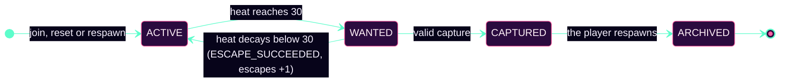
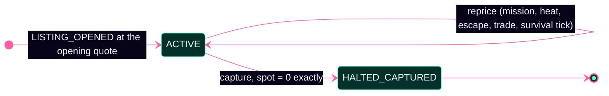
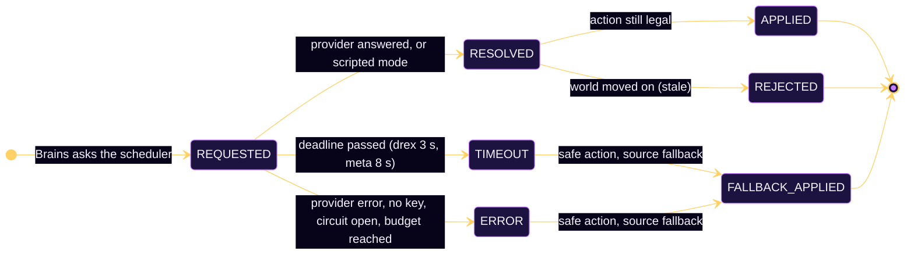
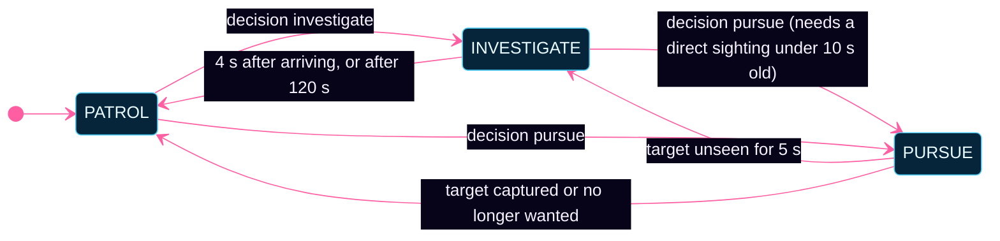

# VICE EXCHANGE architecture

This document describes the code as it stands in this repository. Every statement was checked against the
working tree on 2026-11-14 (last pass at about 13:40 PST). Where a number was measured, the section says how.
The draft design this build started from is kept unchanged in [`docs/spec/TECHNICAL_DESIGN.md`](spec/TECHNICAL_DESIGN.md);
the places where the build differs are listed in the README under "Deviations from the draft spec".

## 1. The shape of the system

One Node process owns the whole simulation. Browsers and the optional Godot client only render what the server
sends and submit commands. A model never writes state: it returns a label, and the server decides whether that
label is still a legal action.

```mermaid
%%{init: {"theme": "base", "themeVariables": {"fontFamily": "ui-sans-serif, system-ui, sans-serif", "fontSize": "14px", "primaryColor": "#140a33", "primaryTextColor": "#f6f1ff", "primaryBorderColor": "#c77dff", "lineColor": "#c77dff", "secondaryColor": "#0b0720", "tertiaryColor": "#0b0720", "clusterBkg": "#0b0720", "clusterBorder": "#4cc9f0", "titleColor": "#f6f1ff", "edgeLabelBackground": "#0b0720"}}}%%
flowchart LR
  subgraph CLIENTS["CLIENTS: render and send intents, never decide"]
    direction TB
    WEB["Browser app<br/>apps/web<br/>2D neon city, 3D city, market,<br/>agent inspector, timeline, director"]
    GODOT["Godot world client (optional)<br/>integrations/ota-bridge"]
  end

  subgraph SERVER["ONE AUTHORITATIVE NODE PROCESS: apps/server"]
    direction TB
    subgraph EDGE["transport/ and bridge/"]
      direction LR
      SIO["Socket.IO gateway<br/>zod validation, 40 cmd/s"]
      WSB["World bridge<br/>WebSocket /bridge"]
      HTTP["HTTP read API<br/>/health, /api/..."]
    end
    ROOMS["rooms/RoomManager<br/>join, reclaim, director rights,<br/>one 10 Hz timer per room"]
    ENGINE["engine/RoomEngine<br/>commands, tick, perception, heat,<br/>messages, capture, event log"]
    subgraph SWARM["THE SWARM"]
      direction LR
      BRAINS["agents/Brains<br/>triggers, legal actions,<br/>re-check before applying"]
      MEMORY["agents/MemoryStore<br/>private memory per NPC"]
      SCHED["decisions/scheduler<br/>queue, deadline, budget,<br/>circuit breaker, honest labels"]
    end
    ECON["economy/<br/>price, orders, halt, bounty"]
    POLICY["policy/<br/>NDI document facts"]
    METRICS["metrics/<br/>measured numbers only"]
    STORE["persistence/<br/>node:sqlite, append-only"]
    REPLAY["replay/<br/>fold the log, no model calls"]
    EXP["demo/experiment<br/>three headless rooms + bot"]
  end

  subgraph PROVIDERS["EXTERNAL SERVICES: server-side keys only"]
    direction TB
    DREX["Nace Drex<br/>POST /v1/systemone<br/>typed choice"]
    META["Meta model API<br/>chat completions<br/>LLM baseline"]
    NDI["Nace NDI<br/>parse + extract<br/>with citations"]
  end

  DB[("SQLite file<br/>data/vice-exchange.sqlite")]

  WEB <-->|"command + ack, snapshot,<br/>10 Hz tick, ordered events"| SIO
  WEB -->|"read only"| HTTP
  GODOT <-->|"same commands, slim state"| WSB
  SIO --> ROOMS
  WSB --> ROOMS
  HTTP --> ROOMS
  ROOMS --> ENGINE
  ENGINE -->|"every event"| BRAINS
  BRAINS -->|"recall(own id)"| MEMORY
  ENGINE -->|"writes memories"| MEMORY
  BRAINS -->|"question, options,<br/>own state only"| SCHED
  SCHED -->|"final trace"| BRAINS
  BRAINS -->|"message, order, activity"| ENGINE
  SCHED -->|"choice call"| DREX
  SCHED -->|"choice call"| META
  ENGINE --> ECON
  POLICY -->|"citations for police"| BRAINS
  POLICY -->|"once, then cached"| NDI
  ENGINE -->|"every event"| METRICS
  ENGINE -->|"every event and trace"| STORE
  STORE --> DB
  REPLAY -->|"reads"| STORE
  EXP -->|"builds rooms"| ENGINE

  classDef client fill:#06243a,stroke:#4cc9f0,stroke-width:2px,color:#e9fbff;
  classDef core fill:#2b0b3f,stroke:#ff5fa2,stroke-width:2px,color:#fff0f7;
  classDef swarm fill:#06302a,stroke:#5dfdcb,stroke-width:2px,color:#eafff9;
  classDef side fill:#1c1340,stroke:#c77dff,stroke-width:2px,color:#f6f1ff;
  classDef ext fill:#3a2a06,stroke:#ffd166,stroke-width:2px,color:#fff8e1;
  class WEB,GODOT client;
  class SIO,WSB,HTTP,ROOMS,ENGINE core;
  class BRAINS,MEMORY,SCHED swarm;
  class ECON,POLICY,METRICS,STORE,REPLAY,EXP side;
  class DREX,META,NDI,DB ext;
  style CLIENTS fill:#050b1a,stroke:#4cc9f0,stroke-width:2px,color:#e9fbff
  style SERVER fill:#07041a,stroke:#ff5fa2,stroke-width:3px,color:#fff0f7
  style EDGE fill:#120726,stroke:#ff5fa2,stroke-width:1px,color:#fff0f7
  style SWARM fill:#031a17,stroke:#5dfdcb,stroke-width:2px,color:#eafff9
  style PROVIDERS fill:#1a1303,stroke:#ffd166,stroke-width:2px,color:#fff8e1
```

Colour key: aqua = clients, pink = the authoritative command path, green = the swarm, purple = supporting
modules, gold = things outside the process.

Three rules hold the design together:

1. **Drex decides, code enforces.** `decisions/` returns a trace with a label. `agents/Brains.ts` re-checks the world
   and applies the label through the same `RoomEngine` methods a human command uses. The scheduler never touches room state.
2. **Observation before memory.** `engine/RoomEngine.ts` is the only writer of memories, and it writes one only
   for a direct observation, a delivered message, a published bulletin or a new listing.
3. **One ordered log.** Every change is an event with a sequence number, a cause and a story id. The log is what
   the timeline shows, what SQLite stores and what replay folds.

## 2. One causal chain, end to end

The diagram follows one story id from a job at the dock to a zeroed ticker. Each arrow is a real call or a real
event type. A chain like this was observed in live runs while these docs were written (section 9 lists them).

```mermaid
%%{init: {"theme": "base", "themeVariables": {"fontFamily": "ui-sans-serif, system-ui, sans-serif", "fontSize": "13px", "actorBkg": "#2b0b3f", "actorBorder": "#ff5fa2", "actorTextColor": "#fff0f7", "actorLineColor": "#7b5cff", "signalColor": "#5dfdcb", "signalTextColor": "#f6f1ff", "labelBoxBkgColor": "#140a33", "labelBoxBorderColor": "#c77dff", "labelTextColor": "#f6f1ff", "loopTextColor": "#ffd166", "noteBkgColor": "#3a2a06", "noteBorderColor": "#ffd166", "noteTextColor": "#fff8e1", "activationBkgColor": "#06302a", "activationBorderColor": "#5dfdcb", "sequenceNumberColor": "#07041a"}}}%%
sequenceDiagram
  autonumber
  participant P as Outlaw browser
  participant E as RoomEngine
  participant W as Witness (Marisol Vega)
  participant S as Scheduler
  participant D as Nace Drex
  participant C as Police (Sgt. Duarte)
  participant T as Trader (Priya Castellan)
  participant X as Economy
  participant H as Hunter browser

  rect rgb(7, 4, 26)
    Note over P,E: 1. A human acts
    P->>E: command mission.interact (commandId)
    E->>E: validate role, range 2.5 m, mission open
    E-->>P: ack ok
    E->>X: reprice, reason MISSION then HEAT
    Note over E: MISSION_COMPLETED, MARKET_PRICE_UPDATED, INCIDENT_OCCURRED
  end

  rect rgb(3, 26, 23)
    Note over E,D: 2. One NPC sees it and decides from its own memory
    E->>W: memory INCIDENT, sourceKind DIRECT, hop 0
    Note over E,W: NPC_OBSERVED (only NPCs within 14 m with line of sight)
    W->>S: request(question, report | gossip | ignore, own state)
    Note over W,S: DECISION_REQUESTED
    S->>D: systemOne choice call (deadline 3 s)
    D-->>S: label, probabilities, confidence, request id, eval time
    S-->>W: trace, decisionSource drex
    W->>E: re-check, then sendMessage REPORT to the nearest police NPC
    Note over W,E: DECISION_RESOLVED, AGENT_MESSAGE_SENT (hop 1), AGENT_ACTION_APPLIED
  end

  rect rgb(26, 19, 3)
    Note over E,T: 3. Knowledge spreads only through recorded messages
    E->>C: after 900 ms: memory INCIDENT, sourceKind MESSAGE, hop 1
    Note over E,C: AGENT_MESSAGE_DELIVERED
    C->>E: publishBulletin: heat +30, character WANTED
    Note over E: WANTED_STATUS_CHANGED, MARKET_PRICE_UPDATED (HEAT), BULLETIN_PUBLISHED
    E->>T: memory WANTED_BULLETIN, sourceKind BULLETIN
    E->>C: memory WANTED_BULLETIN, sourceKind BULLETIN
  end

  rect rgb(20, 10, 51)
    Note over C,X: 4. Two more agents decide, with different incentives
    par trader
      T->>S: request(hold | buy | sell if it holds shares)
      S->>D: choice call
      D-->>S: label and numbers
      S-->>T: trace
      T->>E: placeNpcOrder (same settlement path as a human order)
      E->>X: executeOrder, reprice
      Note over E,X: TRADE_EXECUTED, MARKET_PRICE_UPDATED (TRADE)
    and police
      C->>S: request(investigate | patrol | pursue only with a fresh sighting)
      S->>D: choice call
      D-->>S: label and numbers
      S-->>C: trace
      C->>E: setNpcActivity INVESTIGATE (dispatch delay 10 s, then on foot)
    end
  end

  rect rgb(43, 11, 63)
    Note over E,H: 5. Capture is one synchronous section
    H->>E: command capture.attempt (commandId)
    E->>E: target WANTED, within 2.5 m, line of sight, cooldown 1.5 s
    E->>X: bountyFor, haltListing (spot = 0), credit captor once
    E-->>H: ack ok, bounty
    Note over E: CAPTURE_SUCCEEDED, LISTING_HALTED, MARKET_PRICE_UPDATED (CAPTURE, spot 0)
  end
```

Things the diagram leaves out for space: every event is also appended to SQLite and fed to metrics before it is
broadcast; a police NPC that sees the wanted character itself decides again and may choose `pursue`, after which
the engine chases at 7.5 m/s and attempts the same capture; a witness may choose `gossip` instead, which starts the
two-hop chain witness -> informant -> trader.

## 3. Module map

The ports are defined in `apps/server/src/domain.ts`. Each module is built against a port and exports a factory;
`engine/compose.ts` wires them into a room.

| Folder | Responsibility | Port it implements (`domain.ts`) |
|---|---|---|
| `packages/contracts/src` | Shared types, the event envelope and payloads, zod command schemas, `RULES`, `CITY_MAP`, mission and spawn points, geometry helpers. Consumed as TypeScript source by server and web. | none (shared contract) |
| `apps/server/src/config.ts` | Reads `.env` once, exposes a typed `config`. `publicConfigSummary()` returns booleans only. | none |
| `apps/server/src/index.ts` | Entry point: director secret, optional policy module, `createApp`, graceful shutdown. | none |
| `apps/server/src/engine/RoomEngine.ts` | The authoritative room: state, `dispatch()`, 10 Hz `tick()`, perception, heat, message delivery, police movement, capture, event emission, snapshots. | `WorldPort` (used by the brains) |
| `apps/server/src/engine/compose.ts` | Composition root: one memory store, metrics object and scheduler per room. | none |
| `apps/server/src/engine/pathfinding.ts` | Grid A* over `CITY_MAP` so officers and the bot walk around buildings. | none |
| `apps/server/src/engine/fallbacks.ts` | Small built-in implementations of the ports (in-memory persistence, scripted-only scheduler, and so on) used by tests. | all ports, as stand-ins |
| `apps/server/src/rooms/RoomManager.ts` | Rooms by join code, the three ways to join, director rights, nickname uniqueness, the 8-human cap, the per-room timer. | none |
| `apps/server/src/transport/app.ts` | Express app, HTTP read API, Socket.IO server, CORS allow-list, mounts the bridge and the experiment runner. | none |
| `apps/server/src/transport/socket.ts` | Command gateway (validation, rate limit, sessions) and all broadcasts. | none |
| `apps/server/src/bridge/index.ts` | Plain WebSocket at `/bridge` for external world clients. Same schema and the same `dispatch()` as Socket.IO. | none |
| `apps/server/src/agents/Brains.ts` | Decides when an NPC thinks, asks the scheduler, re-checks the world, applies the action, records the trace. | `BrainsPort` |
| `apps/server/src/agents/MemoryStore.ts` | Bounded private memory per NPC. | `MemoryPort` |
| `apps/server/src/agents/roles.ts` | Per role: the question, the legal options right now, the scripted and safe actions, and the state the model may see. | none (used by Brains) |
| `apps/server/src/decisions/scheduler.ts` | Queue, concurrency cap, deadline, per-minute budget, circuit breaker, low-confidence guardrail, shadow comparison, provider badge. | `SchedulerPort` |
| `apps/server/src/decisions/providers.ts` | The two real providers: Drex through `nace-sdk`, Meta through `fetch`. | `DecisionProvider` (twice) |
| `apps/server/src/economy/index.ts` | Pricing, order settlement, listing halt, bounty, wallet and listing views. Pure: mutates the state it is given, no I/O, no events. | `EconomyPort` |
| `apps/server/src/persistence/index.ts` | SQLite store for events, decision traces and experiments. Never throws into the engine. | `PersistencePort` |
| `apps/server/src/metrics/index.ts` | Counters and latency statistics derived from events and traces. | `MetricsPort` |
| `apps/server/src/replay/` | `projectEvents`, `verifyReplay`, and the `npm run replay` CLI. | none (reads `PersistencePort`) |
| `apps/server/src/policy/` | One real document -> NDI Parse and Extract -> verified quotes -> citations for police decisions. CLI `npm run ndi:ingest`. | `PolicyPort` |
| `apps/server/src/demo/` | The NPC roster (`seedScenario.ts`), the scripted bot outlaw, the three-mode experiment runner. | none |
| `apps/web/src` | React client: `App.tsx`, `components/`, `state/gameStore.ts` (zustand), `net/socketClient.ts`, `lib/format.ts`, `scene/canvas` (2D), `scene/three` (3D). | none |
| `apps/web/e2e` | An earlier two-browser smoke script (`smoke.mjs`) with a small Chrome DevTools driver. | none |
| `e2e/` | The end-to-end harness behind `npm run e2e`. It starts its own server and web server and writes `e2e/out/report.json`. | none |
| `integrations/ota-bridge` | The Godot side of the optional world client: one autoload script and an installer that patches a checkout of the upstream project. | none |

### Network ports and addresses

| What | Default | Set by |
|---|---|---|
| Game server (HTTP, Socket.IO, `/bridge`) | 3001, bound to `0.0.0.0` | `PORT` |
| Web dev server (Vite) | 5173, strict, reachable on the LAN | `apps/web/vite.config.ts`; `--port` on the command line overrides it |
| Vite proxy target | `http://localhost:3001` | `VICE_SERVER` |
| Godot bridge URL | `ws://127.0.0.1:3001/bridge` | `--vice-url=` |

The browser only ever talks to the Vite origin. Vite proxies `/socket.io`, `/api` and `/health` to the game server.

## 4. The event log

### Envelope

Every authoritative event has this shape (`packages/contracts/src/events.ts`):

| Field | Meaning |
|---|---|
| `schemaVersion` | Always `1`. |
| `eventId` | `evt_000048`. Unique within one room instance and run. |
| `roomId` | `<join code>@<suffix>`, unique per room instance and per server boot, for example `VICE-42@mwgvltl7bdee`. The code people type is `roomCode`. |
| `runId` | `run_001`, then `run_002` after a seeded reset. |
| `serverSequence` | Strictly increasing per room, across resets. Clients detect gaps with it. |
| `time` | ISO wall-clock time, for audit. |
| `simTimeMs` | The rule clock used for all game logic (injectable in tests). |
| `type` | One of the 30 types below. |
| `actorId` | A player id, character id, NPC id, or `server`, `exchange`, `director`, `ndi`. |
| `causationId` | The event that directly caused this one, or `null`. |
| `correlationId` | A story id (`story_0003`) shared by every event of one causal story. |
| `payload` | Typed per event type. |

### Event types

| Type | Emitted when |
|---|---|
| `ROOM_CREATED` | A room boots. |
| `ROOM_RESET` | The director runs a seeded reset; a new `runId` starts. |
| `MODE_CHANGED` | The director switches drex, meta or scripted. |
| `PLAYER_JOINED` | A player joins or re-attaches (`reconnect` says which). |
| `PLAYER_LEFT` | A player's socket goes away. |
| `WALLET_OPENED` | A human joins as outlaw or hunter, or a trader NPC is seeded. |
| `CHARACTER_SPAWNED` | A character is created (join, reset, respawn). |
| `LISTING_OPENED` | An outlaw character gets its ticker. Hunters are not listed. |
| `MISSION_SPAWNED` | A job appears (at boot, then 20 s after the previous one was completed). |
| `MISSION_COMPLETED` | An outlaw within 2.5 m interacts with an open job. |
| `INCIDENT_OCCURRED` | After a job (`kind: MISSION`) or the director's trigger (`kind: SIGHTING`). Lists the observers. |
| `NPC_OBSERVED` | An NPC got a direct memory: an incident it saw, or a police officer seeing a wanted character. |
| `AGENT_MESSAGE_SENT` | An NPC sent a REPORT, GOSSIP or RELAY. Carries the hop count and the source memory. |
| `AGENT_MESSAGE_DELIVERED` | 900 ms later the recipient's memory was written. |
| `BULLETIN_PUBLISHED` | Police made a character wanted and told every NPC. |
| `DECISION_REQUESTED` | An NPC asked for a decision (offered actions, state hash, mode). |
| `DECISION_RESOLVED` | The decision came back, from whatever source. Carries the source label and provider data or nulls. |
| `AGENT_ACTION_APPLIED` | The chosen action was applied. |
| `AGENT_ACTION_REJECTED` | The chosen action was no longer legal and had no effect. |
| `MARKET_PRICE_UPDATED` | Spot or reference moved. `reason` is `MISSION`, `HEAT`, `ESCAPE`, `TRADE`, `SURVIVAL_TICK` or `CAPTURE`. |
| `TRADE_EXECUTED` | One share changed hands (human or NPC). |
| `TRADE_REJECTED` | An order failed validation; nothing changed. |
| `WANTED_STATUS_CHANGED` | Heat crossed 30 upward, or the character escaped. |
| `ESCAPE_SUCCEEDED` | A wanted character's heat decayed below 30. |
| `CAPTURE_SUCCEEDED` | A capture went through. |
| `CAPTURE_REJECTED` | A capture attempt failed a check. |
| `LISTING_HALTED` | The captured character's listing was halted at exactly 0. |
| `CHARACTER_ARCHIVED` | At respawn: the captured character becomes `ARCHIVED`. |
| `CHARACTER_RESPAWNED` | The player has a new character and a new ticker. |
| `POLICY_INGESTED` | Once per run when NDI policy facts are loaded. |

The price reasons `LISTING_OPENED` and `SENTIMENT_DECAY` exist in the `PriceReason` type but no code emits them today.

## 5. Commands

Clients send one Socket.IO event, `command`, with an acknowledgement callback. The payload is validated with
`clientCommandSchema` (zod, `packages/contracts/src/commands.ts`). The bridge accepts the same objects wrapped as
`{ t: "cmd", n, cmd }`.

| Command | Fields | Who | Notes |
|---|---|---|---|
| `room.create` | `nickname`, `role`, `requestId`, `seed?`, `directorSecret?` | anyone | Makes a private room `VICE-nn`; the creator directs it. |
| `room.join` | `roomCode`, `nickname`, `role`, `requestId`, `sessionToken?`, `directorSecret?` | anyone | Token re-attach, then nickname reclaim, then a fresh player. |
| `player.move` | `dirX`, `dirZ` in [-1, 1] | outlaw, hunter | Intent only. The server integrates position at 9 m/s and normalises diagonals. |
| `player.pose` | `x`, `z` | outlaw, hunter | For external world clients. Rejected outside the map or faster than 45 m/s. |
| `mission.interact` | `missionId`, `commandId` | outlaw | Must be within 2.5 m of an open job. |
| `market.buy`, `market.sell` | `ticker`, `qty: 1`, `commandId` | outlaw, hunter | Settled by the economy module. |
| `capture.attempt` | `targetCharacterId`, `commandId` | hunter | See the capture rules in the README. |
| `character.respawn` | `commandId` | a captured outlaw | New character id and ticker. |
| `demo.reset` | `commandId`, `seed?` | director | Seeded reset. |
| `demo.incident` | `incidentType: "SIGHTING"`, `commandId`, `targetCharacterId?` | director | An incident at the outlaw's position. |
| `demo.setMode` | `mode`, `commandId` | director | drex, meta or scripted. |
| `demo.runExperiment` | `commandId`, `durationSec?` (20 to 180, default 45) | director | Starts the three-mode comparison. |

Every command that changes money, missions, capture or life state carries a `commandId` of 8 to 64 characters.
`RoomEngine.dispatch()` caches the acknowledgement per `(playerId, commandId)` and returns it again with
`duplicate: true`, without executing anything, when the same id is replayed.

An acknowledgement is `{ ok, id, duplicate?, error?: { code, message, reason? }, result? }`. Error codes:
`INVALID_COMMAND`, `NOT_JOINED`, `ROOM_NOT_FOUND`, `ROOM_FULL`, `FORBIDDEN`, `RATE_LIMITED`, `NOT_ALLOWED_FOR_ROLE`,
`MISSION_UNAVAILABLE`, `OUT_OF_RANGE`, `CHARACTER_INACTIVE`, `TRADE_REJECTED`, `CAPTURE_REJECTED`, `NOT_CAPTURED`,
`MOVE_REJECTED`, `INTERNAL`. Trade and capture failures put the precise reason in `error.reason`.

### Server pushes

| Socket.IO event | Payload | When |
|---|---|---|
| `room.snapshot` | `RoomSnapshot` | Join, reset, respawn, player join or leave, policy loaded. |
| `world.tick` | positions, heat, status, NPC activity | 10 times a second. |
| `event` | one `GameEvent` | Every event, in `serverSequence` order. |
| `agent.update`, `listing.update`, `character.update`, `mission.update` | the changed view | When that object changed. |
| `wallet.update` | `WalletView` | Only to the owner's socket. |
| `provider.status`, `metrics.update` | badge and health, measured metrics | Once a second. |
| `experiment.update` | `ExperimentResult` | Every 2 s while an experiment runs, and when it ends. |

### HTTP read API

All routes are read-only and unauthenticated.

| Route | Returns |
|---|---|
| `GET /health` | `ok`, `drexConfigured`, `metaConfigured`, `rooms`, `defaultRoom`, `mode`, `badge`, `shadowMeta`, `policyLoaded`, `bridgeClients`, the credits notice. Booleans only for keys. |
| `GET /api/rooms/:code/snapshot` | The full room snapshot. |
| `GET /api/rooms/:code/events?after=&limit=` | Events of the current run after a sequence number (limit up to 1000). |
| `GET /api/rooms/:code/agents/:id/trace` | One NPC's view, its decision traces (including the exact state sent to the model) and its messages. |
| `GET /api/rooms/:code/replay/verify` | Folds the event log and compares it with live state. |
| `GET /api/experiments` | The last experiment results. |
| `GET /api/policy` | Where the police policy came from: document, NDI job ids, facts with page and quote. |
| `GET /api/policy/xray.svg` | An SVG picture of the document as NDI parsed it; 404 until facts are loaded. |

## 6. State machines

### Character

A character can only be captured while `WANTED`. `CAPTURED` is terminal for that character: respawn creates a
new character with a new id and a new ticker, and the old one is kept as `ARCHIVED`.

### Listing

The transition is one way. `economy.haltListing` returns `null` for a listing that is already halted, `reprice`
ignores halted listings, and every order on one is rejected with `LISTING_HALTED`. Holdings in a halted ticker
stay in the wallet and are valued at V$0.

### Decision

The scheduler sets `RESOLVED`, `TIMEOUT` or `ERROR`. `Brains.resolve()` then sets the final status that the
`DECISION_RESOLVED` event carries: `APPLIED`, `FALLBACK_APPLIED` (when the source is `fallback`) or `REJECTED`.
A fallback whose safe action is itself no longer legal ends as `REJECTED`. The status `VALIDATED` exists in the
type but is never set. A decision that came back from Drex with a confidence under 0.1 is `APPLIED` with source
`drex_low_confidence_guardrail` and the safe action.

Reasons a resolved decision is rejected (`staleReason` in `agents/Brains.ts`): the room was reset, the label was
not offered, the subject was captured in the meantime, the listing is halted, the trader has no shares left to
sell, the officer no longer has a fresh sighting for `pursue`, or the witness has no informant contact.

### Police activity

`INVESTIGATE` on second-hand information waits 10 s (`RULES.policeDispatchDelayMs`) and then walks at 1.5 m/s
(`npcWalkSpeed x policeSearchPaceFactor`). An officer with its own fresh sighting, or one that just lost a chase,
leaves at once at 3 m/s. `PURSUE` moves at 7.5 m/s, follows live sight up to 21 m with line of sight, and attempts
a capture whenever it is within 2.5 m. Heat does not decay while any officer is investigating or pursuing that character.

### Provider health

`UNCONFIGURED` (no key) -> `LIVE` (last call succeeded) -> `DEGRADED` (the last call failed) -> `DOWN` (circuit
open). Three consecutive failures, or one `auth` or `credit` error, open the circuit for 15 s; decisions requested
meanwhile fall back with `circuit_open`. The header badge says `LIVE` only in the `LIVE` state.

## 7. Persistence and replay

`apps/server/src/persistence/index.ts` uses Node's built-in `node:sqlite` in WAL mode. There are three tables:

| Table | Key | Content |
|---|---|---|
| `events` | unique `(room_id, run_id, server_sequence)`, `INSERT OR IGNORE` | Every event, payload as JSON. |
| `decisions` | primary key `(room_id, run_id, id)`, upsert | One row per decision with the full trace JSON; saved when requested and again when final (and again when a shadow result arrives). |
| `experiments` | primary key `id`, upsert | Experiment results. |

Every write is wrapped: a failure is logged once per kind and swallowed, so a broken database cannot stop the
room. `DATABASE_URL=:memory:` is supported.

What is stored and what is not:

- Stored: the complete event log and every decision trace of every room instance, keyed by the unique `roomId`.
- Not stored: live room state. On a restart the server creates a fresh `VICE-42` with a new `roomId`; it does not
  load an earlier room back. The earlier run stays readable with `npm run replay`.
- In memory, a room keeps the latest 20,000 events, 500 messages and 200 trades.

Replay (`apps/server/src/replay/index.ts`) is a pure fold. `projectEvents` reads `WALLET_OPENED`,
`CHARACTER_SPAWNED`, `LISTING_OPENED`, `MARKET_PRICE_UPDATED`, `TRADE_EXECUTED`, `WANTED_STATUS_CHANGED`,
`CAPTURE_SUCCEEDED`, `LISTING_HALTED` and `CHARACTER_ARCHIVED` and rebuilds wallets, holdings, listings and
character outcomes. It makes no model call and reads no clock. `verifyReplay` compares that projection with live
state and lists every mismatch. Two entry points use it:

- `GET /api/rooms/:code/replay/verify` on a running server (it reads from the store when the store has at least as many events as memory).
- `npm run replay -- <roomCode|roomId> [runId]` offline, straight from SQLite.

Replay reproduces economic outcomes from recorded events. It does not re-run the simulation and it does not
re-ask a model, so it proves the log is sufficient and consistent, not that a second live run would match.

A seeded reset (`demo.reset`) cancels pending decisions, clears memories and the idempotency cache, starts a new
`runId`, keeps `serverSequence` increasing and re-creates connected players with the same player ids. The seed is
stored and reported, but no rule draws random numbers from it today: every room starts from the same fixed
roster, spawn points and mission order, so every seed gives the same initial setup.

## 8. Security model

This is a demo for a trusted network. What is enforced:

| Concern | How | Where |
|---|---|---|
| Provider keys stay on the server | Read from `.env` into `config`; never sent in any snapshot, event or HTTP response; `/health` exposes booleans. | `config.ts`, `transport/app.ts` |
| Error text cannot leak a key | Provider error messages are redacted and cut to 300 characters before they are stored or broadcast; the policy module redacts its logs. | `decisions/scheduler.ts` (`redactSecrets`), `policy/ndi.ts` (`redact`) |
| Input validation | Every command is parsed by a zod discriminated union: types, lengths, enums, ranges. Unknown commands are `INVALID_COMMAND`. | `packages/contracts/src/commands.ts`, `transport/socket.ts` |
| Rate limits | Token bucket per socket: 40 commands/s, burst 80. Bridge: 60/s, burst 120, frames up to 8 KB. HTTP bodies and Socket.IO messages up to 64 KB. | `transport/socket.ts`, `bridge/index.ts`, `transport/app.ts` |
| Browser origins | Socket.IO accepts this machine, private LAN ranges, `.local` hosts and `WEB_ORIGIN`; other web origins are refused. | `originAllowed` in `transport/app.ts` |
| Director rights | The creator of a `room.create` room; the first browser to join the boot-time room `VICE-42` (never a bridge client); anyone presenting the director secret, compared with `timingSafeEqual`. A room code alone grants nothing. | `rooms/RoomManager.ts` |
| Sessions | Opaque 24-byte random tokens issued by the server. The same token re-attaches to the same player. A nickname reclaim works only for a disconnected player of the same role, issues a new token and never carries director rights. | `rooms/RoomManager.ts` |
| Server authority | Clients send movement intent, not positions; prices, wallets, heat and capture are computed on the server. Pose clients are checked for map bounds and speed. | `engine/RoomEngine.ts` |
| Idempotency | One acknowledgement per `(playerId, commandId)`. | `RoomEngine.dispatch` |
| Private data | Wallet updates go only to the owner's socket. | `transport/socket.ts` |
| Model output | A returned label must be one of the offered options (checked in the provider and again in the scheduler), and the action is re-validated against current state before it is applied. | `decisions/providers.ts`, `decisions/scheduler.ts`, `agents/Brains.ts` |
| External document | The policy PDF is fetched from a pinned URL and refused unless its SHA-256 matches the pin; the SVG built from it is served with a sandboxing content security policy. | `policy/document.ts`, `transport/app.ts` |

What is not there: accounts, passwords, TLS, authentication on the HTTP read API, or protection against a
hostile player on the same network. Anyone who can reach the server can read snapshots and decision traces,
including NPC memories. `player.pose` does not check buildings, so an external world client can report a position
inside one (the end-to-end run records this as a failed check).

## 9. How the honesty rules are enforced in code

The brief's rule is: a value is labeled Drex only if Drex was really called, fallbacks are labeled fallback,
missing provider data is `null`, and an NPC's model input contains only that NPC's own knowledge.

| Rule | Mechanism | File |
|---|---|---|
| Only a real Drex answer is labeled `drex` | `decisionSource` is set to the provider name in exactly one place: the success branch after `provider.decide()` resolved with an offered label. | `apps/server/src/decisions/scheduler.ts` (`start`) |
| Fallbacks carry no numbers | `fallback()` sets source `fallback`, the safe action and an `errorType`; confidence and probabilities are never assigned on that path. | `apps/server/src/decisions/scheduler.ts` |
| Scripted mode calls nothing | In scripted mode the job resolves on a timer with `provider: null`; no provider object is touched. | `apps/server/src/decisions/scheduler.ts` (`request`) |
| The guardrail keeps the real answer | For a Drex confidence under `RULES.decisions.lowConfidenceThreshold` the source becomes `drex_low_confidence_guardrail`, the applied action is the safe one, and `providerChoice`, confidence, probabilities, request id and latency stay as Drex returned them. | `apps/server/src/decisions/scheduler.ts` |
| Missing provider data is `null` | The Meta provider returns `confidence: null, probabilities: null, providerEvalMs: null`. The Drex provider copies a field only when the API returned it with the right type. | `apps/server/src/decisions/providers.ts` |
| The event type does not claim a provider | Decisions are `DECISION_REQUESTED` and `DECISION_RESOLVED`; the source is a payload field. | `packages/contracts/src/events.ts` |
| An NPC reasons only over its own knowledge | `memory.recall(npc.id, now)` returns one NPC's unexpired entries; `buildPlan` builds the state from those, the NPC's wallet and contacts and public market data. Fixed keys per role. | `apps/server/src/agents/MemoryStore.ts`, `apps/server/src/agents/roles.ts`, `apps/server/src/agents/Brains.ts` (`think`) |
| Knowledge moves only by recorded events | Memories are written inside `incident`, `deliverMessages`, `publishBulletin`, `policeSight` and `spawnCharacter`, each tied to the event that announces it. | `apps/server/src/engine/RoomEngine.ts` |
| The badge cannot say LIVE while failing | `status()` builds `"<MODE>: LIVE"` only when the provider's health state is `LIVE`; otherwise `FALLBACK`. Scripted mode is always `SCRIPTED`. | `apps/server/src/decisions/scheduler.ts` |
| The UI shows provider numbers only when there are some | `traceHasProviderData()` gates the model, confidence, latency and request id line; probability bars need real probabilities; other sources print "No model was called for this decision". | `apps/web/src/lib/format.ts`, `apps/web/src/components/AgentInspector.tsx` |
| Metrics are measured | Latency statistics are computed from decisions that have a provider and a numeric latency, and are `null` without samples. | `apps/server/src/metrics/index.ts` |
| The comparison never overclaims | Every experiment result carries the fixed caveat text; the table prints it under the rows. | `apps/server/src/demo/experiment.ts`, `apps/web/src/components/DemoDirector.tsx` |
| Policy facts are NDI output or nothing | `view()` is non-null only after a real NDI Extract result is loaded; each quote must be found word for word in NDI's own parse of the page or it is rejected; the status says `ndi_live` or `ndi_cache`. | `apps/server/src/policy/index.ts`, `apps/server/src/policy/facts.ts` |
| Credits are fictional | One constant, `CREDITS_NOTICE`, is shown on the join screen, above the timeline, in `/health` and in the Godot HUD. No package in any `package.json` is a payment library. | `packages/contracts/src/constants.ts` |

Tests that pin these rules: `apps/server/test/acceptance.test.ts` (AT-02 private memory, AT-07 fallback labeling
with a real scheduler and a failing provider), `apps/server/src/decisions/scheduler.test.ts` ("scripted mode never
calls a provider", "meta mode reports null probabilities, never invented ones", "low confidence applies the safe
action but keeps the real provider numbers"), `apps/server/src/persistence/store.test.ts` ("does not persist
anything resembling an API key") and `apps/server/test/socket.test.ts` (the `/health` body contains no key material).

### Live runs behind the diagrams

These were run by the docs author on 2026-11-14 against a private server on a spare port, with the real keys
from `.env`. Each is a single run, not a benchmark.

| Run | What happened |
|---|---|
| Dock job with a hunter next to the outlaw | Witness chose `report` through Drex (confidence 0.97, 367 ms round trip). Wanted 1.4 s after the job. The hunter's capture paid a bounty of V$98 (half of the reference value 196) exactly once; a replay of the same `commandId` returned `duplicate: true`. Respawn gave `ACE-02` at V$95 and left `ACE-01` halted at V$0. `/replay/verify`: ok, 59 events, no mismatches. |
| Dock job, outlaw stands still, no hunter | Wanted after 1.1 s. Both officers chose `investigate` and announced a 10 s dispatch. First police sighting at 23.0 s, Drex `pursue` at 23.3 s, police capture at 24.8 s, bounty 0 (an NPC captor is not paid). Police decision state carried 9 NDI citations. |
| Director incident next to the plaza vendor | Only the vendor observed it (3.3 m). Drex: witness `gossip` (0.944), informant `relay` (0.590), trader `hold` (0.948). Message hops 1 and 2. Only those three NPCs held a memory of it afterwards. |
