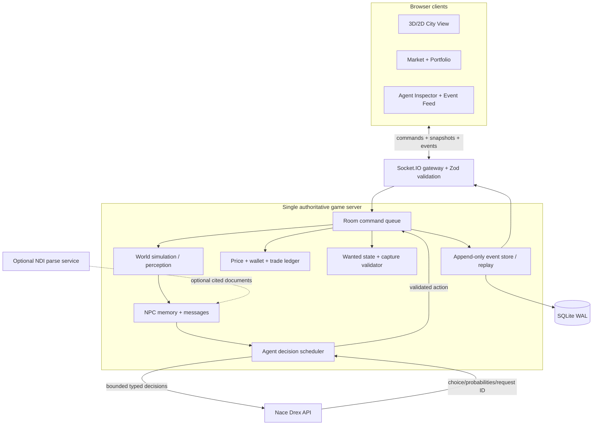
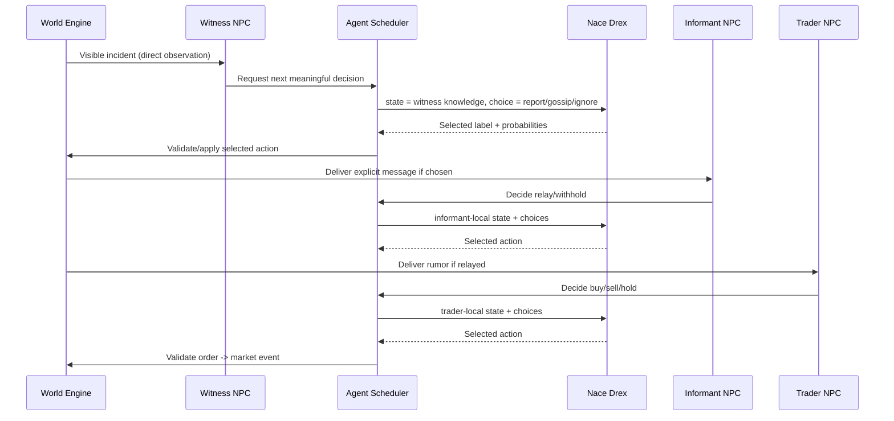

# VICE EXCHANGE — Technical Design Document (TDD)

**Status:** PROPOSED / awaiting approval | **Version:** 0.1 | **Date:** 2026-11-14  
**Design objective:** Deliver a demonstrable Drex-powered agent economy, two-player sync and an atomic stock-to-zero capture rule **without depending on a full GTA engine port**.  
**Related:** `VICE_EXCHANGE_PRD.md` · `VICE_EXCHANGE_REQUIREMENTS.md`

> This is an implementation design, **not** proof that an integration already works. Sample code is illustrative and must be compiled/tested against the installed SDK version. Vendor facts and links are listed at the end.

## 1. Architecture summary and design choices

| Area | Choice for hackathon H0 | Rationale |
|---|---|---|
| Client | Vite + React + TypeScript | Fast iteration and reusable dashboard components |
| World rendering | React Three Fiber / Three.js with low-poly original assets; fallback HTML Canvas 2D | GTA-inspired feel without game asset/legal/integration risk |
| API / multiplayer | Node.js 20+ + Express + Socket.IO | One server process, simple WebSocket room management |
| Shared contracts | TypeScript types + Zod input validation | Prevent cross-client payload drift |
| State authority | Server owns world, action validity, wallet, positions, capture, prices | Prevent client cheating and inconsistent simulations |
| Persistence | SQLite (WAL) via `better-sqlite3`; optional in-memory snapshots | Local demo-friendly, transactional event/trade history |
| AI decisions | Official `nace-sdk`, server-side `systemOne` / typed `choice` | Real Nace Drex scores to select NPC actions |
| AI fallback | Deterministic safe rules + **visible `fallback` label** | Game remains functional during API issues; no false attribution |
| Testing | Vitest (logic) + Playwright or two-browser manual E2E | Fast tests of economy, capture and causality |
| External docs | NDI/Perception optional P1 | Bonus only after H0 works |

### Critical design principles

1. **Drex decides; code enforces.** A model never controls wallet balances, player coordinates or direct database writes.
2. **Observation before memory.** An NPC can act only on world facts it directly sensed, received as a message, or saw in a published public bulletin.
3. **Single source of truth.** A serialized room command processor emits ordered events and maintains one authoritative state.
4. **Every significant action is explainable.** Record triggering event -> agent snapshot -> Drex response -> validated action -> downstream effects.
5. **No hidden fakery.** If provider calls are missing or fail, label those decisions as scripted fallback.
6. **Original assets in H0.** reVC is a future adapter experiment, not a required runtime.

## 2. Logical architecture



**Deployment boundary:** everything except the browser and Nace API runs in the single Node process for H0. SQLite runs on its local disk. Post-hackathon, a Redis-backed room coordinator and Postgres can replace in-process/SQLite state without changing core domain types.

## 3. Proposed repository layout

```text
vice-exchange/
  README.md
  .env.example
  package.json                    # workspace scripts
  pnpm-workspace.yaml
  apps/
    web/
      src/
        app/App.tsx
        scene/CityScene.tsx        # low poly; CanvasCity.tsx fallback
        scene/PlayerController.tsx
        components/JoinRoom.tsx
        components/MarketPanel.tsx
        components/AgentInspector.tsx
        components/EventTimeline.tsx
        components/DemoDirector.tsx
        state/gameStore.ts
        net/socketClient.ts
    server/
      src/
        index.ts
        config.ts
        transport/socket.ts
        rooms/RoomManager.ts
        engine/RoomEngine.ts
        engine/WorldState.ts
        engine/Perception.ts
        engine/Movement.ts
        engine/Missions.ts
        engine/Capture.ts
        agents/AgentTypes.ts
        agents/AgentScheduler.ts
        agents/MemoryStore.ts
        agents/DrexAdapter.ts
        agents/FallbackPolicy.ts
        economy/PriceEngine.ts
        economy/TradingEngine.ts
        persistence/Database.ts
        persistence/EventRepository.ts
        demo/seedScenario.ts
        demo/replay.ts
        metrics/Analytics.ts
  packages/
    contracts/
      src/commands.ts
      src/events.ts
      src/snapshots.ts
      src/schemas.ts
  docs/
    PRD.md
    REQUIREMENTS.md
    TECHNICAL_DESIGN.md
```

**Build rule:** keep game logic in pure functions / domain services wherever possible. The scene renders snapshots and sends intents; it does not calculate the official stock price or game outcomes.

## 4. Authoritative world simulation

### 4.1 World state

```ts
type EntityId = string;
type ListingStatus = "ACTIVE" | "HALTED_CAPTURED";
type CharacterStatus = "ACTIVE" | "WANTED" | "CAPTURED" | "ARCHIVED";

type Character = {
  id: EntityId;
  playerId: EntityId;
  ticker: string;
  status: CharacterStatus;
  x: number; z: number;
  notorietyPoints: number;
  completedMissions: number;
  heat: number;
  successfulEscapes: number;
  spawnTimeMs: number;
  captureTimeMs?: number;
};

type NpcRole = "WITNESS" | "INFORMANT" | "TRADER" | "POLICE";

type NpcAgent = {
  id: EntityId;
  role: NpcRole;
  x: number; z: number;
  goal: string;
  walletCredits: number;
  memoryIds: string[];
  cooldownUntilMs: number;
};

type RoomState = {
  id: string; seed: number; tick: number; ruleVersion: string;
  characters: Record<string, Character>;
  npcs: Record<string, NpcAgent>;
  listings: Record<string, Listing>;
  wallets: Record<string, Wallet>;
  activeMissions: Record<string, Mission>;
  lastEventSequence: number;
};
```

`Listing`, `Wallet`, `Mission` and `Trade` are defined in `packages/contracts`; all numeric currency values must be safe integer V$ units (avoid floating-point accounting). Interest and shares are integers for H0. The scene plane uses `(x,z)` in meters. NPCs may have simple scripted movement; **strategic choices** (report, relay, investigate, buy/sell, pursue) are powered by Drex.

### 4.2 Loop and networking

- **10 Hz authoritative tick**: apply legal movement intents, update NPC movement, check perception zones, expire cooldowns and publish immutable events.
- **10 Hz room snapshots** (or 5 Hz under demo bandwidth constraints): timestamped positions, tick counter and public market overview. Clients interpolate animations; do not infer capture outcomes locally.
- **Reliable Socket.IO events**: trades, missions, decision traces and capture transitions; sequence numbers enable gap detection and resync.
- **Network on reconnect**: client sends room/session credentials + last known sequence; server sends full snapshot + recent event history. H0 may create a new player session if token expired.
- **Server rule clock:** inject a monotonic clock for tests and a seeded PRNG for world setup. Wall-clock times are recorded separately for audit.

### 4.3 Mission trigger

H0 has one simple collect/interact objective. If player is active, in range, cooldown satisfied and objective not already claimed, emit `MISSION_COMPLETED` then `INCIDENT_OCCURRED` and update notoriety/heat. Atomic idempotency key prevents repeated payouts.

## 5. NPC perception and bounded memory

### 5.1 Observation contract

```ts
type Memory = {
  id: string;
  agentId: string;
  factType: "SIGHTING" | "INCIDENT" | "RUMOR" | "WANTED_BULLETIN";
  subjectCharacterId?: string;
  eventId: string;
  sourceActorId: string;
  sourceKind: "DIRECT" | "MESSAGE" | "BULLETIN";
  observedAtMs: number;
  expiresAtMs: number;
  confidence: number; // [0,1], factual/provenance belief; not provider's decision confidence
  payload: Record<string, unknown>;
};
```

**Visibility:** a witness senses an incident only if within configured distance (suggested 14 game meters) and unobstructed by simplified collision/zone visibility. Other NPCs do not automatically read the incident. Received messages create **new memory entries** that cite the source and are marked `MESSAGE`, not `DIRECT`. Public police alerts become `BULLETIN` memories when published.

Bounded memory: max 20–40 recent entries per NPC, TTL by type, summarize older items only after H0. Maintain a separate *public* event log for inspectors; public judge visibility must **not** be used to construct every NPC's private model input.

### 5.2 Communication mechanism



Messages are structured (not arbitrary free-form model output) and the simulation logs the entire source chain. A character can know something privately that the price has not yet reacted to; that tension is the point of the demo.

## 6. Drex decision integration — concrete implementation

### 6.1 Verified vendor contract

Nace's official docs identify `nace-sdk` as the TypeScript client requiring Node 20+. `systemOne` can evaluate typed `choice`, `noul`, and `score` questions over a shared `state`. A `choice` response returns a selected label, confidence and per-label probabilities; the response includes a provider `request_id`. The docs explicitly recommend **server-side use**, not exposing API keys to browsers.

Useful links: [Quickstart](https://console.nace.ai/docs/drex/quickstart/), [Questions](https://console.nace.ai/docs/drex/guides/questions), [TypeScript SDK](https://console.nace.ai/docs/developer-tools/typescript).

### 6.2 Example role-driven decision call

```ts
// Illustrative TypeScript, aligned with Nace's documented SDK surface.
import { NaceClient, choice } from "nace-sdk";

const nace = new NaceClient({ defaultModel: "drex-latest" });

async function decideWitness(state: {
  goal: string;
  observations: unknown[];
  recentMessages: unknown[];
  knownWantedStatus: boolean;
}) {
  const started = performance.now();
  const result = await nace.systemOne({
    state: {
      role: "witness",
      goal: state.goal,
      observations: state.observations,
      recentMessages: state.recentMessages,
      knownWantedStatus: state.knownWantedStatus,
    },
    questions: {
      next_action: choice(
        "Choose the most appropriate next action based ONLY on your knowledge.",
        {
          report: "Tell city police about a directly observed incident",
          gossip: "Tell a nearby informant what you saw",
          ignore: "Do nothing until there is stronger evidence",
        },
      ),
    },
  });
  const answer = result.answers.next_action;
  return {
    selected: answer.choice,
    probabilities: answer.probabilities,
    confidence: answer.confidence,
    providerRequestId: result.request_id,
    latencyMs: performance.now() - started,
    decisionSource: "drex" as const,
  };
}
```

**Important implementation constraints:**

- Role-specific choice sets: witness `report|gossip|ignore`; informant `relay|withhold`; trader `buy|sell|hold`; police `investigate|patrol|pursue` (only if targets eligible).
- Use **one decision per meaningful event or cooldown**, not per movement frame.
- Before calling provider, snapshot `agentId`, room `serverSequence`, available local memory IDs and `rulesVersion`.
- After response, validate `choice` against available actions **again** (because world may have changed). Apply via `RoomEngine.dispatch(command)`; no direct data writes from adapter.
- A low-confidence configurable threshold can result in `hold/ignore` with `decisionSource=drex_low_confidence_guardrail` and trace the original result. Do not confuse calibration/probability with guaranteed correctness.
- Save actual provider response metadata, with concise serialized state **or state hash plus redacted snapshot**. Never store `NACE_API_KEY`.

### 6.3 Scheduling, concurrency and failures

- Cap concurrent Drex requests below the account's verified in-flight quota (suggest **4** initially; configure per actual tier). De-duplicate pending decisions by `(room, npc, triggerEvent)`.
- Maintain a short queue and prioritize actions needed for the demo; stale decisions expire or are revalidated. Do not hold up game ticks or financial commits while waiting for Drex.
- The SDK may wait up to 60 seconds per attempt by default; do **not** pretend latency is guaranteed milliseconds. If a decision is not ready in the game's chosen deadline (e.g. 3 seconds), apply a deterministic **safe** fallback. Keep provider request trace pending and discard late actions after state moves on. Cancel where safe, but do not hide the attempt.
- For HTTP 429/529/transient errors, respect retry guidance and circuit-break per room when necessary. Treat 401/402/422 as configuration/credit/schema errors, not retryable indefinitely. Nace docs: https://console.nace.ai/docs/drex/guides/errors-and-retries
- **Budget guard:** configurable max real model calls per minute and per demo run; show call count and any provider budget-related fallback.

### 6.4 Why this counts as a genuine agent swarm

Each NPC has (1) a role/goal, (2) private knowledge, (3) available action set, (4) a live Drex-driven decision, (5) communication and/or a world action, and (6) causal economic effects. Judges can see more than chat: they see a multi-hop **witness -> informant -> trader -> police -> market** chain and can inspect which steps actually happened.

## 7. Economic engine and invariants

### 7.1 Price model

Use the formula proposed in the PRD. Recalculate on eligible events (mission, heat change, escape, trade) and at a low-frequency clock interval for survival time; do **not** run Drex to calculate a financial price.

```ts
function quotePrice(character: Character, recentNetBuyUnits: number, nowMs: number): number {
  if (character.status === "CAPTURED" || character.status === "ARCHIVED") return 0;
  const survivalMinutes = Math.floor(Math.max(0, nowMs - character.spawnTimeMs) / 60_000);
  const reference = 100 + 15 * character.notorietyPoints
                  + 60 * character.completedMissions + 8 * survivalMinutes;
  const survival = clamp(0.95 - 0.007 * character.heat
                  + 0.02 * character.successfulEscapes, 0.15, 0.98);
  const sentiment = clamp(1 + 0.03 * recentNetBuyUnits, 0.75, 1.25);
  return Math.max(1, Math.round(reference * survival * sentiment));
}
```

**Example:** A fictional mission increases reference value but may also increase heat. The stock can rise or fall depending on risk, but the **capture** outcome is absolute: 0. This pricing is intended as playable, legible game design—**not** a financially rigorous exchange or evidence of fair asset valuation.

### 7.2 H0 trade lifecycle

1. Human/NPC requests `market.buy` or `market.sell`, one integer share, with `commandId`.
2. Server verifies active actor, market open, cooldown, wallet funds/holdings and position limit.
3. Server calculates quote from authoritative state, applies **at that quote**, and records V$ delta and share delta in one SQLite transaction together with event/idempotency record.
4. Server updates rolling demand count and recalculates next quote; all clients receive trade + new price.
5. On capture, listing status is set to `HALTED_CAPTURED`; spot is 0 and later orders are rejected.

**Simulated house counterparty:** buys and sells are netted against a virtual house account with artificial liquidity. No real-money counterparties and no actual shareholder claims. For demonstration, enforce max 10 shares per `(wallet, ticker)` and 2-second per-actor/ticker cooldown; show these constraints in UI.

**Invariants (unit-tested):**

```text
wallet.balanceCredits >= 0
holding.shares >= 0
listing.status == HALTED_CAPTURED => listing.spotPrice == 0
listing.status == HALTED_CAPTURED => all new trade requests rejected
same commandId in same room => at most one financial/capture mutation
trades always apply wallet delta and share delta together
client never determines execution price
``` 

### 7.3 Double-capture, replay and consistency

All commands for one room pass through a single serialized reducer/mutation queue. `capture.attempt` checks wanted, active, range and cooldown **inside the same critical section** that transitions state, halts ticker and emits events. The first valid capture wins; all later attempts are rejected or answered with the first idempotent result.

Run SQLite transactions for orders, capture settlement and event append. Emit Socket.IO broadcasts **after** transaction commit. On server restart, restore last snapshot and replay later event records. For H0, snapshot on every N events or reset to a seeded scenario with archived history if full restore isn't ready; document any limitation before demo.

## 8. Capture mechanics

**Recommended H0 capture conditions:** target is wanted and ACTIVE/WANTED; hunter/police is same room; Euclidean distance <= 2.5 game meters; no intervening blocked zone if map uses barriers; target not already captured; cooldown satisfied. For human capture, user must press `E` while within range; police agent may issue an analogous allowed `attempt_capture` command once adjacent.

Capture algorithm:

```text
Validate actor / target / wanted flag / proximity / cooldown
BEGIN ATOMIC ROOM MUTATION
  Mark target CAPTURED, timestamp it
  Mark listing HALTED_CAPTURED; set spotPrice = 0
  Stop open actions for character
  Mark holdings in listing worth V$0 (do not erase historical positions)
  Optionally award exactly one virtual bounty
  Append CAPTURE_SUCCEEDED, LISTING_HALTED, MARKET_PRICE_UPDATED events
COMMIT
Broadcast final events with stable sequence numbers
```

Respawn never resurrects the captured listing. New `characterId`, `ticker`, active stats and new quote; `playerId` remains associated for historical viewing.

## 9. API, sockets and client contracts

### 9.1 HTTP endpoints (small set)

```text
GET  /health
GET  /api/rooms/:roomId/snapshot          # public state for reconnect
GET  /api/rooms/:roomId/events?after=123 # paginated recent public timeline
GET  /api/rooms/:roomId/agents/:agentId/trace # sanitized decision trace
POST /api/demo/:roomId/reset             # demo-director token; H0 only
```

### 9.2 Socket.IO client commands

```ts
type ClientCommand =
 | { type: "room.join"; roomCode: string; nickname: string; role: "OUTLAW"|"HUNTER"|"SPECTATOR"; requestId: string }
 | { type: "player.move"; dirX: number; dirZ: number; lastSeenTick: number; requestId: string }
 | { type: "mission.interact"; missionId: string; commandId: string }
 | { type: "market.buy"; ticker: string; qty: 1; commandId: string }
 | { type: "market.sell"; ticker: string; qty: 1; commandId: string }
 | { type: "capture.attempt"; targetCharacterId: string; commandId: string }
 | { type: "character.respawn"; commandId: string }
 | { type: "demo.incident"; incidentType: "SIGHTING"; commandId: string };
```

The server issues room/player/session IDs and only accepts authenticated commands attached to that socket's actual role. Demo-only commands require separate access checks. Numeric directions must be normalized to prevent diagonal speed boosts. `player.move` intent is allowed to be non-idempotent; *all financial/capture/mission commands* require idempotency keys.

### 9.3 Server events and example payloads

```json
{
  "schemaVersion": 1,
  "eventId": "evt_000048",
  "roomId": "VICE-42",
  "serverSequence": 48,
  "time": "2026-11-14T19:15:00.000Z",
  "type": "DREX_DECISION_RESOLVED",
  "actorId": "npc_witness_02",
  "causationId": "evt_000044",
  "correlationId": "story_014",
  "payload": {
    "decisionSource": "drex",
    "role": "WITNESS",
    "model": "drex-latest",
    "chosenAction": "gossip",
    "offeredActions": ["report", "gossip", "ignore"],
    "confidence": 0.76,
    "probabilities": {"report": 0.18, "gossip": 0.76, "ignore": 0.06},
    "providerRequestId": "illustrative-request-id",
    "latencyMs": 113
  }
}
```

**All values in this snippet are illustrative** and must never be displayed as actual provider measurements. Distinguish `confidence` returned by Drex from NPC belief confidence, which is internal game memory metadata.

## 10. Storage schema (MVP)

| Table | Essential columns / constraints |
|---|---|
| `rooms` | `id PK`, `seed`, `rules_version`, `created_at`, `status` |
| `players` | `id PK`, `room_id FK`, `nickname`, `role`, `session_token_hash`, `joined_at` |
| `characters` | `id PK`, `player_id FK`, `ticker UNIQUE`, `status`, `spawned_at`, `captured_at`, `notoriety`, `heat` |
| `npcs` | `id PK`, `room_id FK`, `role`, `goal`, `x`, `z`, `wallet_id` |
| `memories` | `id PK`, `npc_id FK`, `fact_type`, `source_event_id`, `source_actor_id`, `source_kind`, `confidence`, `payload_json`, `expires_at` |
| `messages` | `id PK`, `sender_id`, `recipient_id`, `source_memory_id`, `payload_json`, `delivered_at` |
| `listings` | `ticker PK`, `character_id UNIQUE FK`, `status`, `reference_value`, `spot_price`, `updated_at` |
| `wallets` | `id PK`, `owner_type`, `owner_id`, `balance_credits` CHECK >= 0 |
| `holdings` | composite `(wallet_id,ticker) PK`, `shares` CHECK >= 0 |
| `trades` | `id PK`, `room_id`, `command_id UNIQUE scoped`, `ticker`, `wallet_id`, `side`, `qty`, `execution_price`, `created_at` |
| `events` | composite `(room_id,server_sequence) UNIQUE`, `event_id PK`, `type`, `actor_id`, `causation_id`, `correlation_id`, `payload_json`, `schema_version` |
| `decisions` | `id PK`, `npc_id`, `trigger_event_id`, `state_hash`, `allowed_actions_json`, `selected_action`, `source`, `model_id`, `provider_request_id`, `confidence`, `probabilities_json`, `latency_ms`, `error_type`, `created_at` |
| `idempotency` | composite `(room_id,actor_id,command_id) PK`, `result_json`, `created_at` |

Use foreign keys, WAL and indexes on room/event sequence, ticker, memory recipient, decision trigger and command ID. Persist financial values as integer virtual credits, not float. Model call latency is measured; missing data is `null`, never fabricated.

## 11. Design of the UI

```text
┌─────────────────────────────────────────────────────────────────────────┐
│ VICE EXCHANGE   ROOM VICE-42   [2 players] [8 agents]  DREX: LIVE     │
├─────────────────────────────────────┬───────────────────────────────────┤
│                                     │  MARKET                           │
│    LIVE CITY                        │  ACE-01  V$ 620    ▲  +8.2%       │
│    [you]       [witness]            │  chart / holdings / BUY / SELL    │
│         [mission] [hunter]         ├───────────────────────────────────┤
│    [police]    [trader]             │  SELECTED NPC: WITNESS-02         │
│                                     │  knows: incident @ dock (direct) │
│    WANTED: 3/5                      │  Drex: gossip  confidence: .76   │
│    [E] INTERACT / [E] CAPTURE      │  offered: report gossip ignore   │
├─────────────────────────────────────┴───────────────────────────────────┤
│ EVENT TIMELINE: mission -> seen -> gossip -> trade -> police -> capture│
│ [Seed reset]  [Trigger incident]  [Scripted vs Drex] [Metrics]         │
└─────────────────────────────────────────────────────────────────────────┘
```

**Visual language:** sunset neon gradients only as accents; readable market panels; large stock crash feedback; distinguish NPC types with icons and outlines. Show exact status **DREX: LIVE / FALLBACK / SCRIPTED / PENDING**. For chart accessibility, include last price as text. If rich graphics slips, use 2D top-down silhouettes and retain all interaction panels.

## 12. Game-to-agent integration adapter (future reVC)

The domain engine deliberately exposes a narrow adapter:

```ts
interface WorldAdapter {
  spawnActor(actorId: string, pose: { x: number; z: number }): Promise<void>;
  moveActor(actorId: string, target: { x: number; z: number }): Promise<void>;
  triggerAnimation(actorId: string, action: string): Promise<void>;
  subscribeToObservedWorldEvents(listener: (event: unknown) => void): void;
  publishHudState(snapshot: unknown): Promise<void>;
}
```

**Browser adapter (H0)** renders original 3D/2D city and maps server state into scene animations.  
**reVC adapter (P2)** would translate the same game commands into native engine behavior after separate integration research. Questions to resolve: stable actor control hooks, safe memory/IPC bridge, native build on demo machine, server-client synchronization, multiple players, license/asset provenance and permissibility of distribution.

As of this document, the public reVC repository states that it is a reversed-source project, supports several desktop platforms, and **requires that the user already own GTA Vice City assets**. Reverse-engineered source code ≠ freely redistributable game art, sounds or maps. Do not include GTA game files in a public repo or submission without rights. See https://github.com/mrxenginner/reVC.

## 13. Optional NDI/Perception integration

**H1 scope:** Prepare one fictional police bulletin or incident procedure PDF (created by the team, original content), parse it with NDI into grounded facts, and publish *specific extracted fields* into the relevant agent's knowledge store. Include the file/source reference in the decision inspector. Example: a bulletin names the last known location and timestamp of a wanted character; police receives the bulletin as a `BULLETIN` memory, then makes a Drex `choice` based on that fact.

Do **not** claim NDI participation if the demo only shows a hardcoded JSON blob unrelated to a real parse job. Verified docs: https://console.nace.ai/docs (Perception/NDI overview and document tools).

## 14. Observability, evaluation and demo correctness

Each decision trace records `decisionSource`, actual elapsed time, request ID, selected action, model, trigger event and applied outcome. The event graph visualizes causal arrows using `causationId` and `correlationId`.

**Experiments:**

- **Baseline:** fixed policy (e.g. witness always reports; trader always holds; police pursues nearest known target) with deterministic seeded scenario.
- **Drex:** identical initial map/characters/mission seed; role-based Drex decisions may change outcomes.
- **Reported metrics:** observed decision latency distribution, model call count, legal/invalid action rate, rumor propagation hops, transactions and capture outcome. Note that one run is a **demo**, not statistical evidence of superiority.
- **Ablation:** disable agent memory propagation and show the difference in trade/police response. This is especially compelling for Swarm Intelligence.

### Failure modes and honest fallback

| Failure | Detection | Behavior |
|---|---|---|
| Missing API key | server startup health check | `SCRIPTED MODE` in UI; can't claim real Drex |
| 429/529, high latency | SDK errors/timeout/queue depth | respect hints, safe deterministic fallback, log exact source |
| Invalid model label | schema/allowlist check | reject; revalidate; fallback safe action |
| Stale model response | state version differs from scheduled snapshot | discard late response and record stale outcome |
| Client disconnect | heartbeat/socket disconnect | preserve room; allow rejoin as supported |
| Duplicate trade/capture | idempotency key / room serialized queue | return original result; do not apply twice |
| Scene fails | uncaught rendering errors | show 2D fallback with market and agents |
| Database failure | transaction exception | reject mutation safely, retain last committed state; visible error |

## 15. Testing plan

### Unit tests

- `PriceEngine`: reference increases on mission, correct risk/sentiment clamping, capture exactly zero, deterministic clock.
- `TradingEngine`: insufficient funds, position max, halted ticker, price snapshot, atomic ledger deltas, duplicate command.
- `Perception`: range and visibility gating, messages vs direct observations, TTL.
- `Capture`: invalid distance/status; simultaneous captures issue one success; old ticker immutable.
- `DrexAdapter`: valid `choice`, unknown choice, provider timeout/429/401, logged fallback provenance.
- `Replay`: same event sequence and rule version reconstructs same balances/listing status.

### Integration / smoke tests

1. Start server, join from two independent browser sessions; verify shared state.
2. Move outlaw to mission objective, perform interaction; both see notoriety and price change.
3. Witness logs observation; only witness knows initially.
4. Call Drex; inspector displays actual metadata and linked message/event.
5. NPC trader places order or holds according to decision; human can buy a share.
6. Hunter captures when eligible, observe ticker hit 0 on both screens; subsequent buy rejected.
7. Respawn; confirm old ticker is halted and new ticker appears.
8. Repeat with a seeded demo reset, replay log, inspect source badges.

## 16. Parallel implementation workstreams (agent-ready)

| Workstream | Owner role | Deliverables | Depends on |
|---|---|---|---|
| A — Contracts + authority | Tech lead/backend agent | `packages/contracts`, socket contracts, rooms, reducers, seeded scenario | None; **start first** |
| B — World + UI | Frontend agent | city renderer, keyboard controls, multiplayer avatars, market and event panels | Mock contracts from A |
| C — Agent swarm | AI/backend agent | memory/perception, message delivery, Drex adapter/scheduler, real traces | A's event/action contracts |
| D — Economy + capture | Backend agent | deterministic price, wallets/holdings, idempotent trade and capture engine | A's room transactions |
| E — Integration/test | Integrator (could be same person) | end-to-end sequence, seed/reset, decision provenance, tests, 5-minute demo | A–D |

**Avoid agents editing the same files.** Establish contract and schema files first, then assign isolated directories. Require each workstream to include tests, documented assumptions and a short handoff describing exported APIs. Do not merge UI mock-state code that bypasses server authority.

### Critical path if building under the hackathon deadline

- **Stage 0 (first):** freeze room/state/events API; create repo scripts, `.env.example`, stub live Nace health check.
- **Stage 1:** vertical slice from human mission -> witness perception -> one real Drex decision -> one visible event.
- **Stage 2:** add price engine, virtual trades, exact-zero capture and respawn; verify transactional invariants.
- **Stage 3:** add second browser sync, agent inspector, replay/reset and live demo choreography.
- **Stage 4:** only if gates pass, layer in better 3D, trader complexity, NDI and visual polish.

**Stop-the-line rule:** if literal GTA integration or 3D animation threatens finishing Stages 1–3, drop it immediately. The **official event listing specifies a 3:00 PM Pacific hard submission cutoff on 2026-11-14**; stage budgets must be anchored to the time remaining *after plan approval*, not a promise that the full vision can be built in a few hours.

## 17. Architecture decisions for approval

| ADR | Proposed decision | Alternative | Why |
|---|---|---|---|
| ADR-001 | Browser-native original-assets city for H0 | Literal GTA Vice City integration | Lower integration/copyright risk; protects deadline |
| ADR-002 | Risk-adjusted market spot, deterministic server formula | Always-up price counter | Allows NPC trading and information to matter |
| ADR-003 | Node/TypeScript single authority with Socket.IO + SQLite | Distributed microservices | Much faster to integrate and debug for H0 |
| ADR-004 | Real Drex `choice` for consequential NPC actions | LLM roleplay with no world impact | Meets Swarm track; inspectable causality |
| ADR-005 | NPC-local memory + explicit messages | Global shared omniscient memory | Genuine coordination/competition |
| ADR-006 | Virtual credits only | Real money / tokenized stock | Removes financial, safety and regulatory complexity |
| ADR-007 | Provider fallback always visually labeled | Invisible scripted substitution | Honest measurement and debugging |
| ADR-008 | Optional NDI only after core loop works | NDI as mandatory MVP dependency | Avoids deadline-critical path |

## 18. Setup and environment proposal

```bash
# after repo is actually initialized
corepack enable
pnpm install
cp .env.example .env
# Put your real key only in the server-side .env (never commit it)
pnpm dev
pnpm test
```

`.env.example`:

```dotenv
NACE_API_KEY=
NACE_DEFAULT_DECISION_MODEL=drex-latest
PORT=3001
WEB_ORIGIN=http://localhost:5173
DATABASE_URL=./data/vice-exchange.sqlite
GAME_TICK_HZ=10
NPC_DREX_CONCURRENCY=4
MAX_DREX_CALLS_PER_MIN=30
DEMO_DIRECTOR_SECRET=
```

**Build acceptance:** `pnpm dev` starts web and server, two clients join, a real Drex call is verifiable in server logs, and all P0 acceptance gates in the SRS are demonstrated. Configuration examples here are proposed—not proof of existing scripts or a generated application.

## 19. Outstanding technical unknowns

- Need to confirm account/key/credits and real response timings on the demo network; don't claim live capability until smoke-tested.
- Need to implement/evaluate cross-origin dev proxy, session handling and host deployment before remote participants can join.
- Need to test optimistic UI corrections and network clock skew under two-browser operation.
- Need to validate whether SQLite persistence is sufficient for selected hosting platform; some ephemeral deployment services lose local disk on restart.
- Need an explicit decision on 3D quality versus guaranteed 2D fallback and on risk-adjusted pricing versus arcade monotonic pricing.
- Exact NDI PDF parse flow remains a separate optional integration ticket; do not advertise it as done yet.

## 20. Source links (checked 2026-11-14)

- Drexathon event, Swarm track, schedule: https://luma.com/nace-drexathon
- Drex API quickstart: https://console.nace.ai/docs/drex/quickstart/
- Nace TypeScript SDK: https://console.nace.ai/docs/developer-tools/typescript
- Drex questions and batching: https://console.nace.ai/docs/drex/guides/questions
- Drex model error/retries: https://console.nace.ai/docs/drex/guides/errors-and-retries
- Drex limits: https://console.nace.ai/docs/drex/reference/limits
- Reverse-engineered Vice City code and asset requirement: https://github.com/mrxenginner/reVC

---
**Status:** Implementation must not begin on the assumption that disputed ADRs have been approved. This document's tradeoffs, thresholds, and example prices are proposed defaults.
